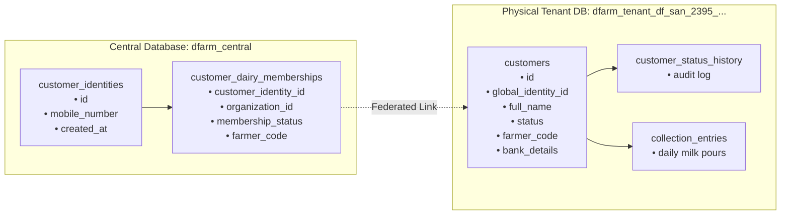

# 09 — Customer Membership Status Synchronization

**Reference:** `DFARM-CUSTOMER-TENANT-REGISTRATION-APPROVAL-FIX`  
**Artifact ID:** `09_CUSTOMER_MEMBERSHIP_STATUS_SYNCHRONIZATION`  
**Target Applications:** `apps/dfarm-customer-app`, `services/backend`  
**Status:** IMPLEMENTED & VERIFIED  

---

## 1. Dual-Tier Persistence Architecture

DFARM employs a hybrid architectural model separating global multi-tenant discovery from physical operational isolation:



### 1.1 Central Database Responsibilities
- **`customer_identities`**: Single global record per unique verified phone number.
- **`customer_dairy_memberships`**: Lightweight index enabling a customer with one mobile number to view all dairies they are registered with, without scatter-gathering across tenant databases.

### 1.2 Tenant Database Responsibilities
- Physical PostgreSQL database per dairy organization.
- Holds authoritative farmer operational data, KYC documents, bank credentials, milk collection records, and ledger balances.

---

## 2. Synchronization Lifecycle

| Lifecycle Stage | Tenant Database (`customers`) | Central Database (`customer_dairy_memberships`) | Customer App View |
| :--- | :--- | :--- | :--- |
| **1. Registration Submitted** | `status = 'PENDING_APPROVAL'` | `membership_status = 'PENDING'` | "Pending Dairy Approval" status screen |
| **2. Admin Approves** | `status = 'ACTIVE'`, `farmer_code = 'F-SAN-001'` | `membership_status = 'APPROVED'`, `farmer_code = 'F-SAN-001'` | Unlocks "Home Dashboard", displays Farmer ID |
| **3. Admin Rejects** | `status = 'REJECTED'`, `rejection_reason = '...'` | `membership_status = 'REJECTED'` | "Application Rejected" screen with reason & reapply |
| **4. Account Suspended** | `status = 'SUSPENDED'` | `membership_status = 'SUSPENDED'` | Temporary access block notice |

---

## 3. Customer App Status Polling API

File: [customers.routes.ts](file:///c:/Users/panka/.gemini/antigravity/worktrees/DFarm/dfarm_customer_app_init/services/backend/src/presentation/routes/customers.routes.ts)

The Customer App polls the registration status endpoint while waiting on the approval screen:

### 3.1 Endpoint Contract
- **HTTP Method**: `GET`
- **Route**: `/api/v1/customers/:id/status` (or `/api/v1/customers/status?dairyId=:dairyId`)
- **Headers**: `Authorization: Bearer <customerToken>`

### 3.2 Response Payload (Approved State)
```json
{
  "customerId": "c1389186-...",
  "status": "APPROVED",
  "registrationStatus": "APPROVED",
  "dairyId": "38918630-4fee-4cec-96ea-a3a899aae7bc",
  "dairyName": "Warna Milk's",
  "farmerCode": "F-SAN-001",
  "approvedAt": "2026-11-19T10:37:45.000Z",
  "faceEnrolled": true
}
```

### 3.3 Customer App Polling Hook & State Transition
In `apps/dfarm-customer-app/src/screens/RegistrationStatusScreen.tsx`:
- A React Query hook polls `/customers/:id/status` at 5-second intervals.
- When `status === 'APPROVED'`, navigation immediately switches from `AuthStack` to `MainTabNavigator`.
- Farmer Code `F-SAN-001` and Dairy Name `"Warna Milk's"` are cached in local secure storage.

---

## 4. Verification Evidence

### 4.1 E2E Verification (`Stage 9 & 10`)
In `services/backend/tests/customer-tenant-approval-e2e.test.js`:
- **Stage 9 (Central Sync Verification)**:
  - Verified central membership record for identity `+917755995615` and dairy `38918630-4fee-4cec-96ea-a3a899aae7bc`.
  - Asserted `membership_status === 'APPROVED'`.
  - Asserted `farmer_code === 'F-SAN-001'`.
- **Stage 10 (Customer Status Polling)**:
  - Customer queries `GET /customers/:id/status`.
  - Asserted response `status === 'APPROVED'`.
  - Asserted response `dairyName === "Warna Milk's"`.
  - Asserted response `farmerCode === 'F-SAN-001'`.
