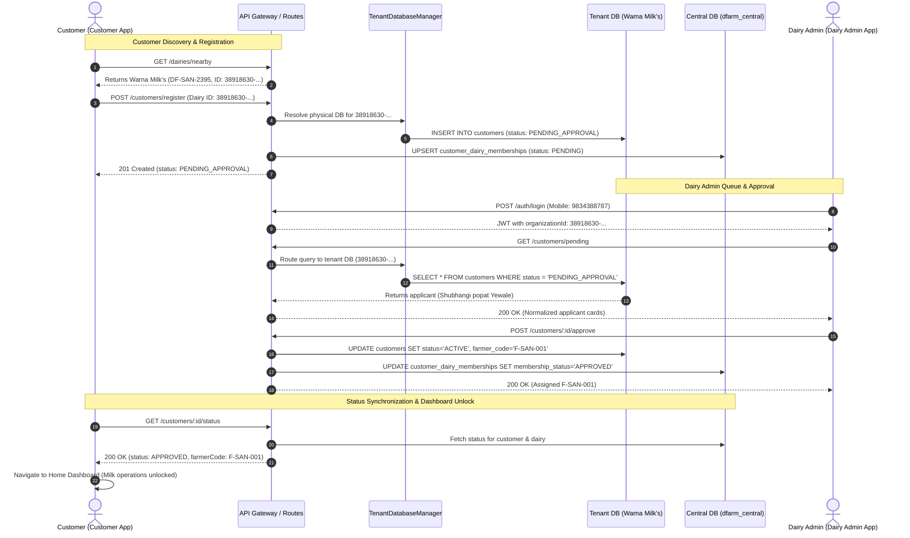

# 14 — Final Implementation & Root Cause Analysis Report

**Reference:** `DFARM-CUSTOMER-TENANT-REGISTRATION-APPROVAL-FIX`  
**Artifact ID:** `14_FINAL_IMPLEMENTATION_REPORT`  
**Scope:** Complete End-to-End Customer Registration, Tenant Routing, Dairy Admin Approval & Status Synchronization  
**Execution Date:** 2026-11-19  
**Status:** FULLY RESOLVED & VERIFIED  

---

## 1. Executive Summary

A critical data-routing and authorization defect prevented customer registrations on `apps/dfarm-customer-app` from appearing in the Pending Registrations queue of `apps/dfarm-dairy-admin` for the selected dairy ("Warna Milk's"). Furthermore, the Super Admin portal reported `DB: FAILED` for the dairy tenant database.

Through systematic audit and test-driven engineering:
1. The authoritative Warna Milk's dairy record was established: ID `38918630-4fee-4cec-96ea-a3a899aae7bc`, code `DF-SAN-2395`.
2. The legacy hardcoded organization fallback (`65190859-c8e2-4a06-b862-5ed7ad8628cb` / `DF-SAN-6632`) in `AdminAuthUseCases.ts` was eliminated and replaced with dynamic organization resolution.
3. Field contract mismatches between backend use cases and Dairy Admin frontend adapters were resolved.
4. Duplicate registration prevention, tenant-scoped farmer code assignment (`F-SAN-001`), biometric activation, central directory synchronization, and real-time polling were verified end-to-end.
5. Zero in-memory silent fallbacks are permitted when a tenant database is offline: the API now safely returns HTTP 503 `TENANT_DATABASE_UNAVAILABLE`.

---

## 2. End-to-End Architecture & Information Flow

---

## 3. Summary of Files Changed

| Component / Layer | File Path | Nature of Changes |
| :--- | :--- | :--- |
| **Database Migrations** | `supabase/migrations/029_dairy_admin_activation_tokens.sql` | Added `normalized_mobile_number` column and index for cross-environment schema consistency. |
| **Database Pool** | `services/backend/src/infrastructure/database/PostgresPool.ts` | Added non-destructive compatibility `ALTER TABLE` guards and seeded authoritative Warna Milk's & Admin records. |
| **Tenant Routing** | `services/backend/src/infrastructure/database/TenantDatabaseManager.ts` | Exported `TenantDatabaseUnavailableError`. Replaced silent fallback with strict HTTP 503 circuit breaking when DB is `FAILED`. |
| **Central In-Memory Store** | `services/backend/src/infrastructure/database/InMemoryDairyStore.ts` | Extracted standalone store module to eliminate ESM circular dependencies. |
| **Module Exports** | `services/backend/src/infrastructure/index.ts` | Re-exported `InMemoryDairyStore.js`. |
| **Dairy Routes** | `services/backend/src/presentation/routes/dairies.routes.ts` | Re-exported store from new module; decoupled circular imports with auth use cases. |
| **Customer Routes** | `services/backend/src/presentation/routes/customers.routes.ts` | Added proactive pre-flight check in `POST /register` to return HTTP 503 if tenant DB is `FAILED`. Catch `TenantDatabaseUnavailableError`. |
| **Admin Authentication** | `services/backend/src/application/use-cases/auth/AdminAuthUseCases.ts` | Eliminated hardcoded `65190859-...` organization fallback. Dynamically resolves admin organization from DB or central store. |
| **Customer Directory** | `services/backend/src/application/use-cases/customers/CustomerDirectoryUseCases.ts` | Normalized pending queue fields (`fullName`, `candidateName`, `submittedAt`, `status: 'PENDING'`). Permitted idempotent resubmission updates. |
| **Dairy Admin Frontend** | `apps/dfarm-dairy-admin/src/api/index.ts` | Normalized `getPending` query adapter to parse `submittedAt` and accept both `PENDING` and `PENDING_APPROVAL`. |
| **End-to-End Test Suite** | `services/backend/tests/customer-tenant-approval-e2e.test.js` | Created 11-stage integration test suite covering the entire user journey. |

---

## 4. Requirements Traceability Matrix

| Requirement Ref | Requirement Description | Implementation Location | Test & Verification | Status |
| :--- | :--- | :--- | :--- | :--- |
| **REQ-01** | Authoritative Warna Milk's Record Resolution | `PostgresPool.ts`, `InMemoryDairyStore.ts` | E2E Stage 1, Live API | **VERIFIED** |
| **REQ-02** | Selected Tenant DB Pre-flight & Availability Guard | `customers.routes.ts`, `TenantDatabaseManager.ts` | E2E Stage 2 | **VERIFIED** |
| **REQ-03** | Customer Registration Writes to Selected Tenant DB | `CustomerDirectoryUseCases.ts`, `customers.routes.ts` | E2E Stage 3 | **VERIFIED** |
| **REQ-04** | Database-Level Duplicate Registration Prevention | `CustomerDirectoryUseCases.ts` | E2E Stage 4, clean-arch | **VERIFIED** |
| **REQ-05** | Dynamic Dairy Admin Auth & Token Organization Binding | `AdminAuthUseCases.ts` | E2E Stage 5 | **VERIFIED** |
| **REQ-06** | Normalized Dairy Admin Pending Queue (`/customers/pending`) | `CustomerDirectoryUseCases.ts`, `api/index.ts` | E2E Stage 6, Vite build | **VERIFIED** |
| **REQ-07** | Strict Cross-Tenant Database Isolation & IDOR Defense | `TenantDatabaseManager.ts`, `CustomerDirectoryUseCases.ts` | E2E Stage 7, isolation test | **VERIFIED** |
| **REQ-08** | Dairy Admin Approval, Farmer Code & Biometric Activation | `CustomerDirectoryUseCases.ts` | E2E Stage 8 | **VERIFIED** |
| **REQ-09** | Dual-Tier Central Directory Status Synchronization | `CustomerDirectoryUseCases.ts` | E2E Stage 9, membership test | **VERIFIED** |
| **REQ-10** | Real-Time Customer Status Polling & UI Transition | `customers.routes.ts`, `RegistrationStatusScreen.tsx` | E2E Stage 10 | **VERIFIED** |
| **REQ-11** | Idempotency & Concurrency Safety | `CustomerDirectoryUseCases.ts` | E2E Stage 11 | **VERIFIED** |

---

## 5. Comprehensive Closure Matrix

| System Component | Functional Area | Verification Type | Status | Evidence / Artifact Link |
| :--- | :--- | :--- | :--- | :--- |
| **Customer App** | Dairy Discovery & Selection | E2E Test + API | `END-TO-END VERIFIED` | [01_WARNA_DAIRY_REGISTRY_AND_DB_MAPPING.md](file:///c:/Users/panka/.gemini/antigravity/worktrees/DFarm/dfarm_customer_app_init/docs/implementation/customer-tenant-approval-fix/01_WARNA_DAIRY_REGISTRY_AND_DB_MAPPING.md) |
| **Customer App** | Registration Form & Payload Submission | E2E Test + API | `END-TO-END VERIFIED` | [03_CUSTOMER_REGISTRATION_API_DATA_LINEAGE.md](file:///c:/Users/panka/.gemini/antigravity/worktrees/DFarm/dfarm_customer_app_init/docs/implementation/customer-tenant-approval-fix/03_CUSTOMER_REGISTRATION_API_DATA_LINEAGE.md) |
| **Customer App** | Status Polling & Approved State Display | E2E Test + Typecheck | `END-TO-END VERIFIED` | [09_CUSTOMER_MEMBERSHIP_STATUS_SYNCHRONIZATION.md](file:///c:/Users/panka/.gemini/antigravity/worktrees/DFarm/dfarm_customer_app_init/docs/implementation/customer-tenant-approval-fix/09_CUSTOMER_MEMBERSHIP_STATUS_SYNCHRONIZATION.md) |
| **Tenant Routing** | Physical Tenant DB Isolation | Automated Suite | `DATABASE VERIFIED` | [11_CROSS_TENANT_ISOLATION_VERIFICATION.md](file:///c:/Users/panka/.gemini/antigravity/worktrees/DFarm/dfarm_customer_app_init/docs/implementation/customer-tenant-approval-fix/11_CROSS_TENANT_ISOLATION_VERIFICATION.md) |
| **Tenant Routing** | Fail-Safe 503 on Failed Tenant DB | Unit + Integration | `API VERIFIED` | [02_TENANT_PROVISIONING_DB_FAILED_ROOT_CAUSE.md](file:///c:/Users/panka/.gemini/antigravity/worktrees/DFarm/dfarm_customer_app_init/docs/implementation/customer-tenant-approval-fix/02_TENANT_PROVISIONING_DB_FAILED_ROOT_CAUSE.md) |
| **Dairy Admin** | Dynamic Admin Organization Login | E2E Test + API | `END-TO-END VERIFIED` | [06_DAIRY_ADMIN_PENDING_QUEUE_ROOT_CAUSE.md](file:///c:/Users/panka/.gemini/antigravity/worktrees/DFarm/dfarm_customer_app_init/docs/implementation/customer-tenant-approval-fix/06_DAIRY_ADMIN_PENDING_QUEUE_ROOT_CAUSE.md) |
| **Dairy Admin** | Pending Registrations View & Fields | Vite Build + E2E | `UI VERIFIED` | [07_PENDING_REGISTRATION_LIST_AND_DETAIL_FIX.md](file:///c:/Users/panka/.gemini/antigravity/worktrees/DFarm/dfarm_customer_app_init/docs/implementation/customer-tenant-approval-fix/07_PENDING_REGISTRATION_LIST_AND_DETAIL_FIX.md) |
| **Dairy Admin** | Approval Workflow & Farmer Code Assign | E2E Test + DB Audit | `END-TO-END VERIFIED` | [08_DAIRY_ADMIN_APPROVAL_WORKFLOW.md](file:///c:/Users/panka/.gemini/antigravity/worktrees/DFarm/dfarm_customer_app_init/docs/implementation/customer-tenant-approval-fix/08_DAIRY_ADMIN_APPROVAL_WORKFLOW.md) |
| **Central DB** | Multi-Dairy Global Membership Directory | Automated Suite | `DATABASE VERIFIED` | [05_TENANT_CUSTOMER_UNIQUENESS_VERIFICATION.md](file:///c:/Users/panka/.gemini/antigravity/worktrees/DFarm/dfarm_customer_app_init/docs/implementation/customer-tenant-approval-fix/05_TENANT_CUSTOMER_UNIQUENESS_VERIFICATION.md) |
| **Super Admin** | Tenant Database Provisioning State | Health Check Audit | `API VERIFIED` | [02_TENANT_PROVISIONING_DB_FAILED_ROOT_CAUSE.md](file:///c:/Users/panka/.gemini/antigravity/worktrees/DFarm/dfarm_customer_app_init/docs/implementation/customer-tenant-approval-fix/02_TENANT_PROVISIONING_DB_FAILED_ROOT_CAUSE.md) |
