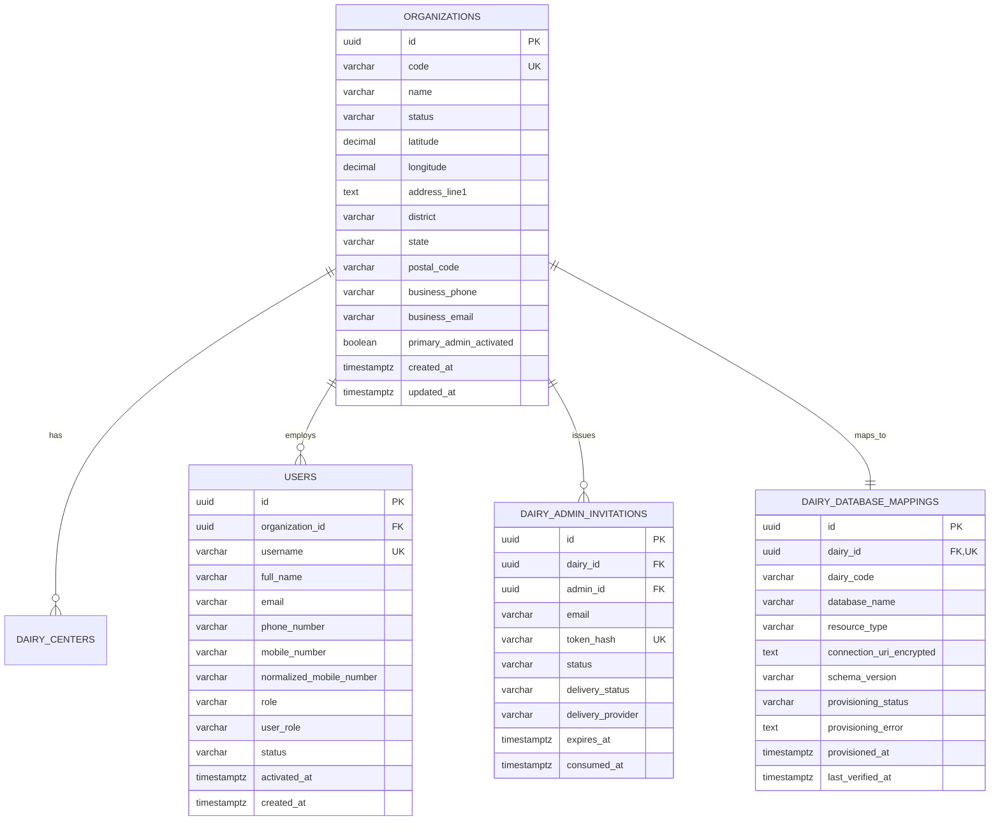

# 01 - Existing Dairy Registry & Central Schema Audit

**Execution Reference:** `DFARM-DAIRY-REGISTRY-ADMIN-LOGIN-RECOVERY`  
**Central Database:** `dfarm_central` (PostgreSQL Control Plane)

---

## 1. Central Registry Architecture

DFarm utilizes a database-per-dairy multi-tenant architecture. The central database (`dfarm_central`) operates as the platform control plane, housing the authoritative registry of all dairy businesses, global customer identities, physical database connection routings, and administrative authorization records.

---

## 2. Table Schemas & Invariants

### 2.1 `organizations` (Authoritative Tenant Registry)
- **Primary Key:** `id` (UUIDv4)
- **Unique Constraint:** `code` (e.g. `DF-SAN-6632`)
- **Name Invariant:** Unique business name enforced at application level and central unique constraints (`chk_organizations_name_unique`).
- **Lifecycle Statuses:**
  - `draft_onboarding`: Tenant profile registered; waiting for primary administrator activation or device pairing.
  - `ACTIVE`: Fully operational tenant business.
  - `suspended`: Administrative freeze; API access blocked by middleware.
- **Location Invariants:**
  - `latitude`: Between `-90.0` and `+90.0`.
  - `longitude`: Between `-180.0` and `+180.0`.
  - `district` & `state`: Required geographical boundary strings.

### 2.2 `dairy_database_mappings` (Tenant Physical Isolation Mapping)
- **Foreign Key:** `dairy_id REFERENCES organizations(id) ON DELETE RESTRICT`
- **Database Naming Convention:** `dfarm_tenant_<code_hash>_<uuid_prefix>` (conforming to PostgreSQL 63-character limit).
- **Provisioning State Machine:**
  - `PENDING` -> Initial intent recorded.
  - `PROVISIONING` -> In flight.
  - `DATABASE_CREATED` -> Cluster DDL complete.
  - `MIGRATING` -> Operational schema track (001-027) applied.
  - `ACTIVE` -> Ready for tenant connections.
  - `FAILED` -> Creation or migration failure captured in `provisioning_error`.

### 2.3 `users` (Administrative Identity Store)
- Stores staff and administrator identities.
- Columns `role` and `user_role` both hold administrative roles (`SUPER_ADMIN`, `PRIMARY_DAIRY_ADMIN`, `DAIRY_ADMIN`).
- Foreign key `organization_id` strictly isolates tenant administrators.

---

## 3. Discovered Audit Findings

1. **Role Coalescing:** Historical migrations populated `role`, while newer controllers referenced `user_role`. Queries must always use `COALESCE(u.role, u.user_role)` or check both columns.
2. **Status Case Sensitivity:** Central tables in pg-mem or PostgreSQL store uppercase (`ACTIVE`) or lowercase (`active`). All operational comparisons must normalize via `UPPER(status) = 'ACTIVE'`.
3. **Provisioning Isolation:** A dairy record must remain visible in Super Admin even if its physical tenant database is in `FAILED` or `PENDING` state, with explicit failure diagnostics exposed.
