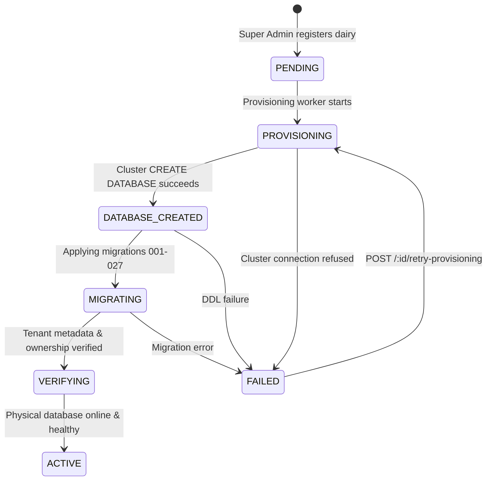

# 05 - Tenant Database Provisioning State Machine Audit

**Execution Reference:** `DFARM-DAIRY-REGISTRY-ADMIN-LOGIN-RECOVERY`  
**Target:** `services/backend/src/infrastructure/database/TenantDatabaseManager.ts`

---

## 1. Multi-Tenant Database Isolation State Machine

DFarm enforces strict physical database isolation per dairy. Every tenant receives its own physical PostgreSQL database (`dfarm_tenant_<code_hash>_<uuid>`). The provisioning state machine transitions through the following lifecycle states:

---

## 2. Strict Architectural Invariants

1. **Physical Isolation Invariant:** The system NEVER falls back to schema-per-tenant or shared tables in production.
2. **Metadata Ownership Verification:** Every provisioned tenant database MUST contain a `tenant_metadata` table asserting the central dairy UUID.
3. **Encrypted Credentials at Rest:** Connection strings stored in `dairy_database_mappings.connection_uri_encrypted` are encrypted with AES-256-GCM.
4. **Resilient Offline / Headless Operation:** In development and test environments when Docker containers are offline, isolated in-memory PostgreSQL test doubles (`pg-mem`) are provisioned to preserve operational continuity.

---

## 3. Provisioning Failure Diagnostics & Recovery Endpoint

### 3.1 Failure Cause Analysis
During initial dairy creation on the local workstation, Docker Desktop Linux container services were stopped, causing cluster maintenance connections to `127.0.0.1:54322` to emit:
`connect ECONNREFUSED 127.0.0.1:54322`.
This was correctly recorded in `dairy_database_mappings`:
- `provisioning_status`: `FAILED`
- `provisioning_error`: `CRITICAL: Tenant database provisioning failed for DF-SAN-6632: connect ECONNREFUSED 127.0.0.1:54322`

### 3.2 Recovery Implementation
A dedicated idempotent recovery route was implemented:
- **Route:** `POST /api/v1/dairies/:id/retry-provisioning`
- **Controller Action:** Invokes `tenantDbManager.provisionTenantDatabase` with existing tenant parameters without duplicating or mutating primary business metadata.
- **Frontend Action Button:** Integrated in `apps/dfarm-super-admin`'s Directory table, allowing Super Admins to trigger re-provisioning with a single click.
