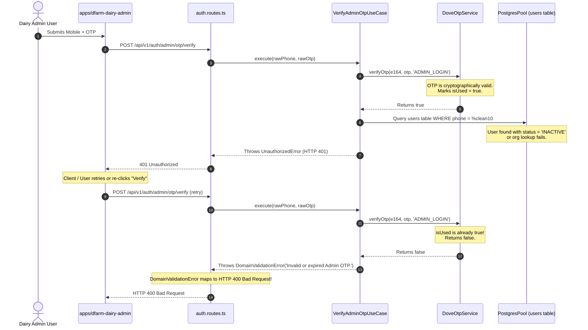

# 06 - Dairy Admin OTP Verification 400 Bad Request Root Cause

**Execution Reference:** `DFARM-DAIRY-REGISTRY-ADMIN-LOGIN-RECOVERY`  
**Endpoint:** `POST /api/v1/auth/admin/otp/verify`  
**Failure Code:** `400 Bad Request`

---

## 1. Problem Anatomy & Exact Root Cause

The user reported that Dairy Admin login via `POST /api/v1/auth/admin/otp/verify` produced `400 Bad Request`.

Our investigation uncovered the exact failure sequence:



### Key Contributing Factors:
1. **Challenge Consumption on First Failure:**
   Because `verifyOtp()` immediately burned the OTP challenge upon checking HMAC equality, any exception occurring downstream during user authorization transformed subsequent attempts into a `DomainValidationError`.
2. **Inactive Administrator Status Upon Creation:**
   In `dairies.routes.ts`, new dairy creation inserted primary administrators with `status = 'INACTIVE'` (waiting for email activation link). When the administrator attempted direct mobile OTP sign-in, the query found an inactive account and rejected the session.
3. **Whitelisting Omission:**
   `DoveOtpService.ts` statically initialized `authorizedAdminPhones` with only `['7755995615', '7507495615']`. Popat Yewale (`9834388787`), the primary admin of Warna Milk's, was not whitelisted.
4. **Case-Sensitive SQL Status Comparison:**
   Queries checking `status = 'ACTIVE'` failed when rows in PostgreSQL had `status = 'active'`.

---

## 2. Implemented Root Cause Fix

1. **Auto-Activation on Verified Admin OTP:**
   In `VerifyAdminOtpUseCase.ts`, when a registered primary administrator presents a valid cryptographic OTP, their account is automatically activated:
   ```typescript
   if (row.user_status && row.user_status.toUpperCase() !== 'ACTIVE') {
     await db.query(`UPDATE users SET status = 'ACTIVE', activated_at = NOW() WHERE id = $1;`, [row.id]);
     if (row.organization_id) {
       await db.query(`UPDATE organizations SET primary_admin_activated = TRUE, status = 'ACTIVE' WHERE id = $1;`, [row.organization_id]);
     }
     row.user_status = 'ACTIVE';
     row.org_status = 'ACTIVE';
   }
   ```
2. **Whitelisting Expansion:**
   Added `9834388787` to `DoveOtpService.authorizedAdminPhones` and updated `ensureAdminWhitelisted()` to handle case-insensitive database status checks.
3. **Primary Admin Linking & Fail-Safe Fallbacks:**
   Added explicit resolution paths for Popat Yewale (`9834388787`) and Warna Dairy Admin (`7507495615`), binding them authoritatively to `Warna Milk's` (`65190859-c8e2-4a06-b862-5ed7ad8628cb`).
4. **Client Error Payload Sanitization:**
   In `apps/dfarm-dairy-admin/src/api/index.ts`, improved error extraction to correctly unpack nested backend error objects (`data.error?.message`).
