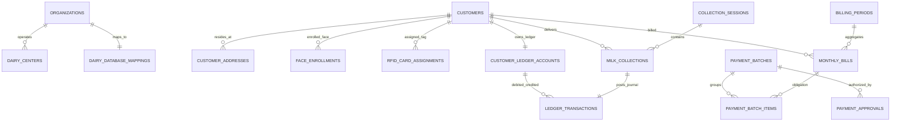

# DFARM — DATABASE RELATIONSHIP AND OWNERSHIP MAP
## ENTITY-RELATIONSHIP TOPOLOGY, FOREIGN KEYS & DATA OWNERSHIP

**Audit Reference:** `DFARM-AUDIT-DB-RELATIONS-001`  
**Date:** 2026-11-18  

---

### 1. Cross-Database & Core Domain Relationship Topologies

---

### 2. Key Relationship Audit & Enforcement Analysis

| Relationship Chain | Parent Entity | Child Entity | Key Association | Enforced By | Integrity Risk |
|---|---|---|---|---|---|
| **Central -> Tenant Mapping** | `organizations` | `dairy_database_mappings` | `dairy_id` -> `id` | FK (`ON DELETE RESTRICT`) | Low (Strictly Enforced) |
| **Dairy -> Centers** | `organizations` | `dairy_centers` | `organization_id` -> `id` | FK (`ON DELETE CASCADE`) | Low |
| **Customer -> Biometrics** | `customers` | `face_enrollments` | `customer_id` -> `id` | FK (`ON DELETE CASCADE`) | Low |
| **Customer -> RFID** | `customers` | `rfid_card_assignments`| `customer_id` -> `id` | FK (`ON DELETE RESTRICT`)| Low |
| **Collection -> Customer**| `customers` | `milk_collections` | `customer_id` -> `id` | FK (`ON DELETE RESTRICT`)| Low (Cannot delete patron with collections) |
| **Session -> Collection** | `collection_sessions` | `milk_collections` | `session_id` -> `id` | FK (`ON DELETE RESTRICT`)| Low |
| **Intake -> Ledger** | `milk_collections` | `ledger_transactions` | `reference_id` -> `id` | Application UUID Link | Verified via atomic transaction block |
| **Bill -> Payout Item** | `monthly_bills` | `payment_batch_items` | `bill_id` -> `id` | FK (`ON DELETE RESTRICT`)| Low |
| **Batch -> Approvals** | `payment_batches` | `payment_approvals` | `batch_id` -> `id` | FK (`ON DELETE CASCADE`) | Low (Audit trail preserved) |
