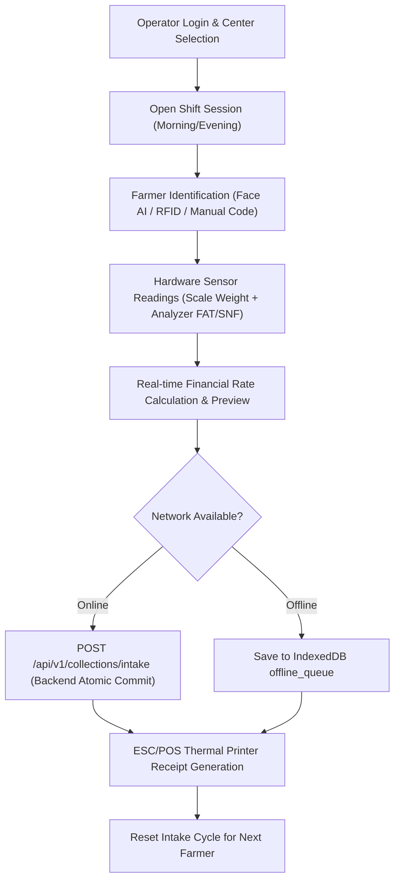

# DFARM — MILK COLLECTION APP SCREEN AND DATA AUDIT (`dfarm-collection-app`)
## 13 TERMINAL SCREENS, HARDWARE DRIVERS & OFFLINE QUEUE AUDIT

**Audit Reference:** `DFARM-AUDIT-APP-COLLECTION-001`  
**Target:** `apps/dfarm-collection-app` (React 18 / Vite / Web Serial Kiosk)  
**Date:** 2026-11-18  

---

### 1. Kiosk Workspace Operational Pipeline

---

### 2. Kiosk Screen & Hardware Component Inventory

| Component / Modal | Source File | Data Source | Database Mapping | Defect Finding |
|---|---|---|---|---|
| **Collection Workspace** | `src/pages/collection/CollectionWorkspace.tsx` | `HardwareContext` | `milk_collections` | Clean |
| **Identity Panel** | `src/components/workspace/CustomerIdentityPanel.tsx` | `identityApi` | `customers`, `face_enrollments` | Clean |
| **Measurement Panel** | `src/components/workspace/MeasurementPanel.tsx` | RS-232 Drivers | `collection_quality_readings` | Non-zero mock default when disconnected (**DFARM-AUDIT-005**) |
| **Transaction Summary**| `src/components/workspace/TransactionSummaryPanel.tsx` | Active Rate Matrix | `rate_chart_cells` | Clean |
| **Offline Queue View** | `src/pages/sync/OfflineQueueView.tsx` | IndexedDB (`localDB`) | `sync_events` | Clean |
| **Device Diagnostics** | `src/pages/devices/DeviceDiagnostics.tsx` | Web Serial Ports | `devices` | Clean |
