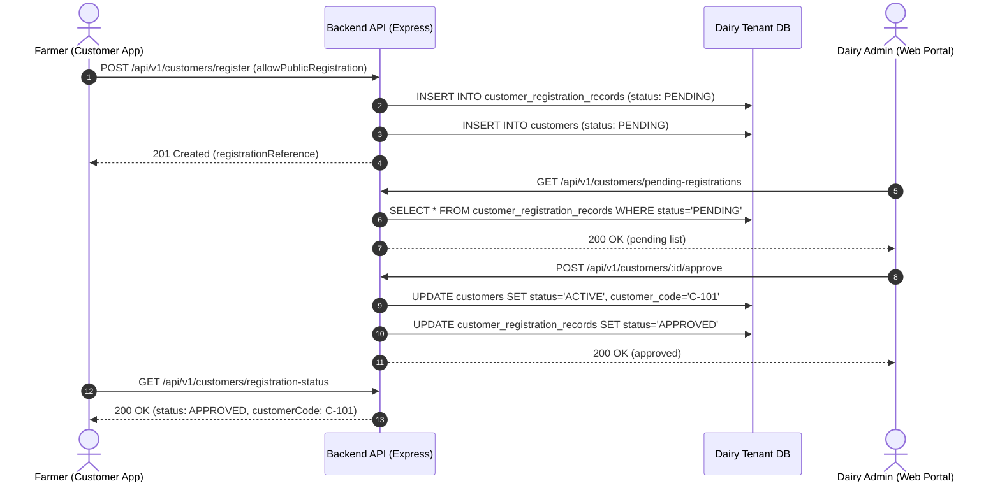
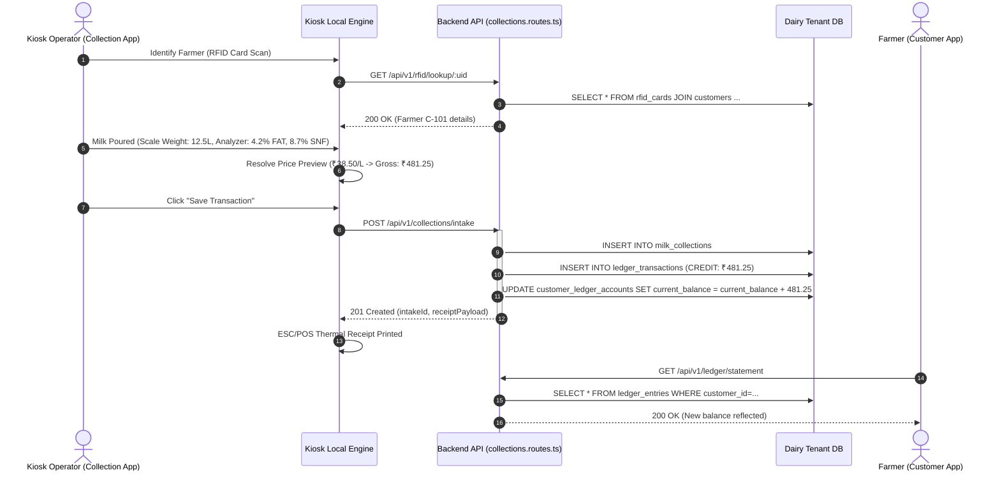

# DFARM — CROSS-APP DATA FLOW DIAGRAMS
## WORKFLOW A THROUGH H COMPLETE END-TO-END EVENT FLOWS

**Audit Reference:** `DFARM-AUDIT-CROSS-APP-FLOWS-001`  
**Date:** 2026-11-18  

---

### Workflow A: Farmer Self-Registration & Approval


---

### Workflow D: Milk Collection Intake & Real-time Ledger Posting


---

### Workflow G: Finalized Billing, Bulk Payout & Double-Entry Settlement
```mermaid
sequenceDiagram
    autonumber
    actor Accountant as Accountant (Maker)
    actor Owner as Dairy Owner (Checker)
    participant Backend as Backend API
    participant TenantDB as Dairy Tenant DB
    participant Bank as Commercial Bank (RBI NEFT)

    Accountant->>Backend: POST /api/v1/billing/generate (Period: Nov 01 - Nov 10)
    Backend->>TenantDB: Compute net payable = Gross Milk - Feed Sales - Advances
    Backend->>TenantDB: INSERT INTO monthly_bills (status: DRAFT)
    Accountant->>Backend: POST /api/v1/billing/:id/finalize
    Backend->>TenantDB: UPDATE monthly_bills SET status='FINALIZED' (Locked)
    Accountant->>Backend: POST /api/v1/payments/batches (Maker Step)
    Backend->>TenantDB: INSERT INTO payment_batches (status: PENDING_APPROVAL)
    Owner->>Backend: POST /api/v1/payments/batches/:id/approve (Checker Step)
    Backend->>TenantDB: Assert Maker != Checker; UPDATE status='APPROVED'
    Accountant->>Backend: GET /api/v1/payments/batches/:id/export (RBI NEFT)
    Backend-->>Accountant: RBI Format File + SHA-256 Checksum (Zero Ledger Debit)
    Accountant->>Bank: Upload NEFT Batch File to Bank Portal
    Bank-->>Accountant: Bank Statement / UTR Reference (UTR-20261118-99)
    Accountant->>Backend: POST /api/v1/payments/reconciliation (Confirm Settlement)
    Backend->>TenantDB: ATOMIC DEBIT: customer_ledger_accounts (CUSTOMER_PAYABLE -> CASH_BANK)
    Backend->>TenantDB: UPDATE payment_batches SET status='RECONCILED'
```
