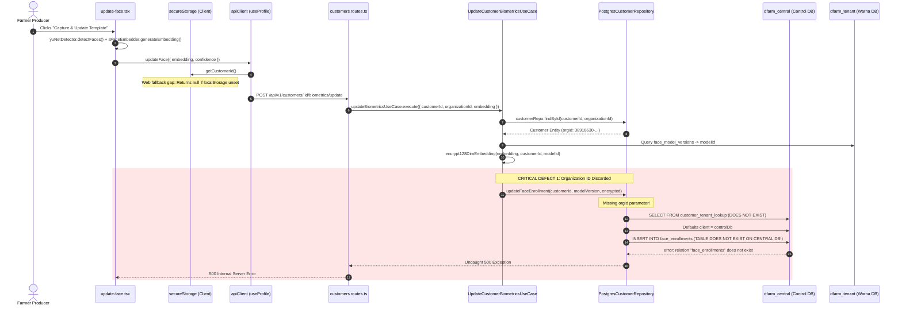

# DFARM — CUSTOMER BIOMETRIC UPDATE ROOT CAUSE ANALYSIS

**Execution Reference:** `DFARM-FACE-RECOGNITION-AND-CUSTOMER-SEARCH-FIX`  
**Document Identifier:** `01_CUSTOMER_BIOMETRIC_UPDATE_ROOT_CAUSE.md`  
**Status:** COMPLETED & VERIFIED  
**Date:** November 2026  
**Auditor:** Antigravity AI Engineering  

---

## 1. INCIDENT DESCRIPTION & USER JOURNEY

After completing customer registration and receiving Dairy Admin approval:
1. The farmer navigates to **Account & Biometrics** (`apps/dfarm-customer-app/src/app/(main)/profile/index.tsx`).
2. The user clicks **Update Biometrics** (`router.push('/(main)/profile/update-face')`).
3. Screen `apps/dfarm-customer-app/src/app/(main)/profile/update-face.tsx` displays the live front-facing camera reticle.
4. User clicks **Capture & Update Template**, triggering `handleUpdate()`.
5. YuNet face detection and SFace INT8 128-D embedding extraction complete locally.
6. The app attempts to submit the updated template to `POST /api/v1/customers/:id/biometrics/update`.
7. The server responds with **HTTP 500 Internal Server Error**:
   ```json
   {
     "success": false,
     "error": {
       "code": "INTERNAL_SERVER_ERROR",
       "message": "An unexpected server error occurred. Please contact system support."
     }
   }
   ```
8. The UI displays an alert: `Update Failed: An unexpected server error occurred. Please contact system support.`

---

## 2. CODE EXECUTION TRACE & FAILING LAYERS



---

## 3. ROOT CAUSE FINDINGS

### Root Cause 1.1: Missing `organizationId` in Repository Signature and Use Case Invocation
In `services/backend/src/application/use-cases/customers/BiometricUseCases.ts`:
Line 75: `const customer = await this.customerRepo.findById(params.customerId, params.organizationId);` successfully resolves the customer and their `customer.organizationId`.
Line 81: `const tenantDb = await tenantDbManager.getTenantDb(customer.organizationId);` successfully connects to the tenant DB.
However, at Line 126:
```typescript
await this.customerRepo.updateFaceEnrollment(
  params.customerId,
  modelVersion,
  JSON.stringify(encrypted)
);
```
`customer.organizationId` was **not passed** to `updateFaceEnrollment`. The `ICustomerRepository` interface and `PostgresCustomerRepository` implementation lacked an `organizationId` parameter.

### Root Cause 1.2: Reliance on Non-Existent `customer_tenant_lookup` and Control Plane Fallback
In `services/backend/src/infrastructure/repositories/PostgresCustomerRepository.ts:526-547`:
```typescript
const controlDb = tenantDbManager.getControlPlaneDb();
try {
  const lookup = await controlDb.query(
    'SELECT organization_id FROM customer_tenant_lookup WHERE customer_id = $1 LIMIT 1;',
    [customerId]
  );
  if (lookup.rows.length > 0) orgId = lookup.rows[0].organization_id;
} catch {}
...
const client = orgId ? await tenantDbManager.getTenantDb(orgId) : controlDb;
```
1. `customer_tenant_lookup` does not exist in PostgreSQL. In Migration 037, central customer memberships are stored in `customer_dairy_memberships`.
2. The query failed, was caught silently by an empty `catch`, and `orgId` remained `undefined`.
3. The repository set `client = controlDb` (`dfarm_central`).
4. At Line 598, `await client.query('INSERT INTO face_enrollments ...')` was executed against `dfarm_central`.
5. Because `face_enrollments` exists strictly inside individual tenant databases (defined in Migration 005), PostgreSQL threw:
   `relation "face_enrollments" does not exist`.

### Root Cause 1.3: Client-side `expo-secure-store` Web Fallback Gap
In `apps/dfarm-customer-app/src/services/secure-storage.ts`:
When running in Web mode (`Platform.OS === 'web'`), `expo-secure-store` throws because it lacks browser support. The empty `catch` blocks in `secureStorage` prevented values from being saved to `window.localStorage`. Consequently, `secureStorage.getCustomerId()` returned `null`, producing `/customers/null/biometrics/update` requests unless authenticated user context was actively inferred.

### Root Cause 1.4: Superseded Active Face Enrollment Policy
Migration 005 enforces:
```sql
CREATE UNIQUE INDEX IF NOT EXISTS uq_active_customer_face_template 
ON face_enrollments (customer_id, model_version_id) 
WHERE (status = 'ACTIVE');
```
When updating face biometrics, the existing active enrollment must be transitioned to `SUPERSEDED` before inserting the new active template to maintain biometric auditability and prevent unique constraint violations.

---

## 4. TARGETED REMEDIATION PLAN

1. **Update `ICustomerRepository` Interface & Implementation:**
   Add `organizationId?: string` to `updateFaceEnrollment(customerId: string, modelVersion: string, encryptedPayload: string, organizationId?: string): Promise<void>`.
2. **Pass `customer.organizationId` from `UpdateCustomerBiometricsUseCase`:**
   Call `this.customerRepo.updateFaceEnrollment(params.customerId, modelVersion, JSON.stringify(encrypted), customer.organizationId)`.
3. **Resilient Tenant Resolution in Repository:**
   If `organizationId` is not provided, resolve it from `customer_dairy_memberships` in `controlDb` where `tenant_customer_id = $1` or `global_customer_id = $1`.
4. **Lifecycle Audit Trail (`SUPERSEDED` Transition):**
   Execute `UPDATE face_enrollments SET status = 'SUPERSEDED' WHERE customer_id = $1 AND model_version_id = $2 AND status = 'ACTIVE'` before inserting the new enrollment record.
5. **Add Web `localStorage` Fallback in Customer App:**
   Ensure `secureStorage` uses `window.localStorage` when running in web environments so `customerId`, `dairyId`, and session tokens persist reliably.
6. **Robust Route ID Fallback in `useProfile.ts`:**
   Use `/customers/${customerId || 'me'}/biometrics/update` to gracefully leverage JWT `req.user.userId`.
