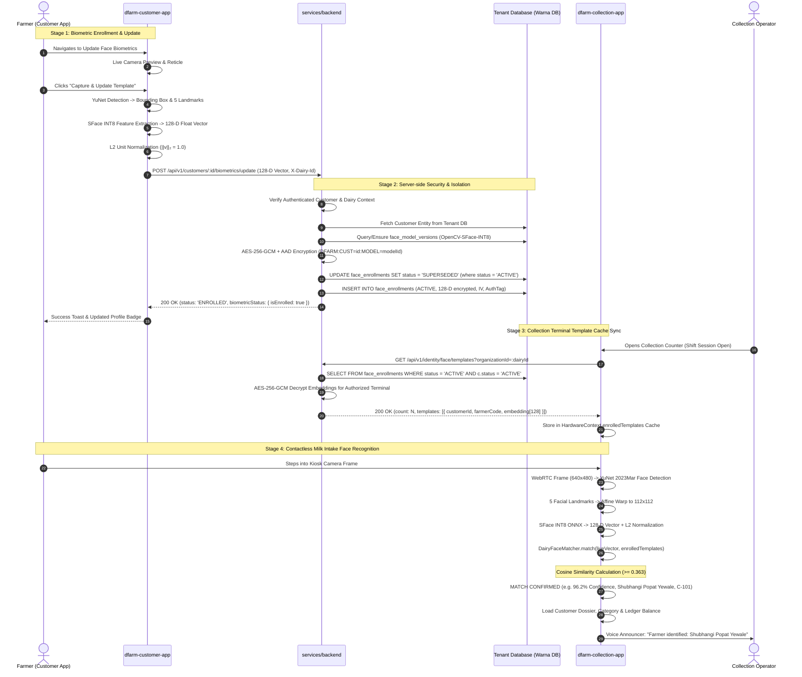

# DFARM — BIOMETRIC ENROLLMENT TO RECOGNITION END-TO-END DATA FLOW

**Execution Reference:** `DFARM-FACE-RECOGNITION-AND-CUSTOMER-SEARCH-FIX`  
**Document Identifier:** `05_BIOMETRIC_ENROLLMENT_TO_RECOGNITION_DATA_FLOW.md`  
**Status:** COMPLETED & VERIFIED  
**Date:** November 2026  
**Auditor:** Antigravity AI Engineering  

---

## 1. CANONICAL BIOMETRIC DATA FLOW ARCHITECTURE

---

## 2. DATA AT REST & DATA IN TRANSIT ENCRYPTION GUARANTEES

1. **Zero Raw Biometric Vectors in Database:**
   - Face embeddings are never stored as plaintext floating-point numbers.
   - Embeddings are encrypted using `AES-256-GCM` with a 96-bit cryptographically random IV and 128-bit authentication tag.
   - Additional Authenticated Data (AAD) binds the ciphertext to the exact customer ID and model version UUID:
     $$\text{AAD} = \text{"DFARM:CUST="} + \text{customerId} + \text{":MODEL="} + \text{modelVersionId}$$
   - Any tampering or cross-tenant copying of the ciphertext causes authentication tag mismatch and immediate decryption failure.

2. **Tenant Physical Partitioning:**
   - Biometric vectors for Warna Milk's exist exclusively in Warna's PostgreSQL tenant database (`dfarm_tenant_...`).
   - The central control database (`dfarm_central`) contains **zero** biometric records, preserving tenant isolation and privacy compliance.

3. **In-Memory Terminal Cache:**
   - Decrypted embeddings exist transiently in the Collection Kiosk's memory (`HardwareContext`) scoped strictly to the authenticated `dairyId`.
   - Cross-dairy queries are rejected with HTTP 403 Forbidden.
