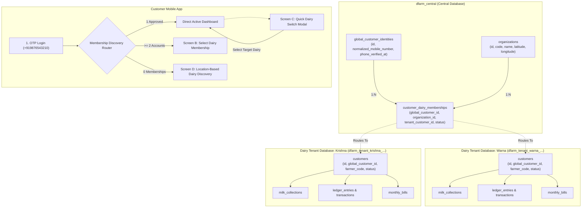

# 01 — MULTI-DAIRY IDENTITY ARCHITECTURE

**Execution Reference:** `DFARM-MULTI-DAIRY-CUSTOMER-MEMBERSHIP`  
**Target Systems:** Central Control Plane (`dfarm_central`), Tenant Databases (`dfarm_tenant_<code_hash>`), Customer App (`apps/dfarm-customer-app`), Backend API (`services/backend`)

---

## 1. Architectural Overview

DFarm employs a hybrid database-per-tenant architecture paired with a centralized control plane directory for identity discovery. A farmer customer uses a single verified phone number (E.164 canonical format) to access services across multiple independent dairy cooperatives without duplicating their global identity and without sharing operational records across cooperatives.

---

## 2. Core Architectural Guarantees

1. **Rule 1 — Global Identity Canonicalization:**
   One verified mobile number (normalized to E.164 standard, e.g. `+919876543210`) maps to exactly one stable UUID record in `dfarm_central.global_customer_identities`.
2. **Rule 2 — Multi-Dairy Independent Memberships:**
   A customer identity can independently hold memberships across Dairy A, Dairy B, Dairy C, etc. Registration with Dairy A never blocks registration with Dairy B.
3. **Rule 3 — Per-Dairy Zero Duplication:**
   Within any single dairy tenant, a customer identity can have exactly one registration. Enforced by:
   - Central directory constraint: `CONSTRAINT uq_customer_dairy_membership UNIQUE (organization_id, global_customer_id)`.
   - Tenant database constraint: `CREATE UNIQUE INDEX uq_customer_global_identity_per_org ON customers(organization_id, global_customer_id)`.
4. **Rule 4 — Independent Membership Lifecycles:**
   Dairy A may be `APPROVED`, Dairy B `PENDING_APPROVAL`, and Dairy C `REJECTED`. Approvals or rejections in one dairy do not cascade to others.
5. **Rule 5 — Strict Operational Tenant Isolation:**
   Operational tables (`milk_collections`, `ledger_entries`, `monthly_bills`, `face_enrollments`) reside strictly inside the tenant database for that dairy. Central control plane stores only discovery routing metadata.

---

## 3. Component Interaction Matrix

| Flow | Initiator | Control Plane Operation | Tenant Database Operation | Result |
|---|---|---|---|---|
| OTP Request | Customer App | Rate limit check & cryptographic challenge generation | None | SMS dispatched via Dove SMS Gateway |
| OTP Verification | Customer App | Upsert `global_customer_identities`, lookup `customer_dairy_memberships` | None | Returns `globalCustomerId` & membership array |
| Dairy Selection | Customer App | Validate membership status = `APPROVED` | Resolve customer profile | Issues tenant-scoped HMAC-SHA256 JWT |
| Discovery | Customer App | Haversine distance search on `organizations` | Join user memberships to show "Already Registered" | Returns nearby active dairies |
| New Registration | Customer App | Check `uq_customer_dairy_membership`, insert `customer_dairy_memberships` | Insert `customers` with `global_customer_id` | Status `PENDING_APPROVAL` |
| Dairy Switch | Customer App | Invalidate token, issue new token for target dairy | Flush React Query cache, fetch new tenant data | Seamless switch |
