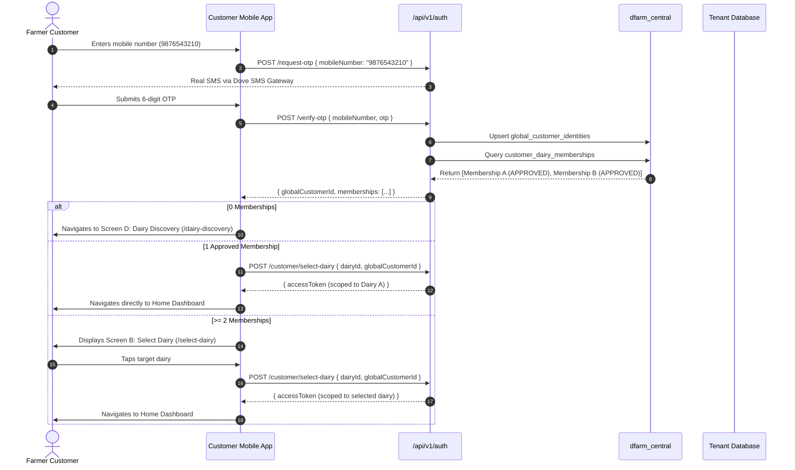

# 06 — MULTI-DAIRY LOGIN AND SWITCH FLOW

**Execution Reference:** `DFARM-MULTI-DAIRY-CUSTOMER-MEMBERSHIP`  
**Target Systems:** `apps/dfarm-customer-app`, `verify-otp.tsx`, `select-dairy.tsx`, `DairySwitchModal.tsx`, `auth.routes.ts`

---

## 1. OTP Verification & Dynamic Routing Flow

---

## 2. In-App Quick Dairy Switching (`DairySwitchModal`)

When a farmer is inside the active dashboard:
1. Top banner displays current dairy tag: `[🌿 Warna Dairy | C-WARNA-101 बदला ▾]`.
2. Tapping the tag triggers `DairySwitchModal` bottom sheet.
3. Modal displays all registered dairy accounts:
   - Current active dairy (highlighted in Green Claymorphism with "Active" badge).
   - Other approved dairies with 1-tap "स्विच करा" button.
   - Pending / Rejected dairies with informative non-clickable badges.
   - "+ Register with Another Dairy" discovery link.
4. When switching:
   - App calls `POST /api/v1/customers/switch-dairy` with target `dairyId`.
   - Backend issues a fresh HMAC-SHA256 JWT scoped exclusively to the target `organizationId`.
   - App updates `SecureStorage` (`token`, `dairyId`, `dairyName`).
   - App flushes the React Query cache via `queryClient.clear()`.
   - Home Dashboard reloads with fresh operational data from the newly selected dairy's physical tenant database.
