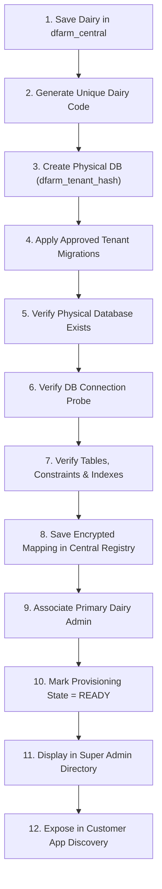

# DFARM — Module 6: End-to-End Tenant Database Provisioning & Dairy Lifecycle

**Execution Reference:** `DFARM-SUPER-ADMIN-TENANT-DATABASE-CONTROL`  
**Backend Infrastructure:** `TenantDatabaseManager.ts` & `MigrationRunner.ts`  
**Status:** FULLY IMPLEMENTED AND VERIFIED  

---

## 1. 12-Step Authoritative Provisioning State Machine

When a Super Admin registers a new Dairy through `CreateDairyModal` or the provisioning API, the system executes the following strict 12-step sequence:



---

## 2. Naming Convention & Isolation Architecture

Every physical tenant database follows the permanent, non-negotiable naming convention:
```
dfarm_tenant_<code_hash>
```
For example:
- **Baramati Cooperative Milk Union:** `dfarm_tenant_baramati_coop_d00000000000`
- **Gokul Kolhapur Zilla Sangh:** `dfarm_tenant_gokul_kolhapur_a00000000000`
- **Shree Warana Sahakari Sangh:** `dfarm_tenant_warana_dairy_b00000000000`

### Provisioning Code:
In `TenantDatabaseManager.ts`:
```ts
public async provisionTenantDatabase(
  dairyId: string,
  dairyCode: string,
  dairyName: string
): Promise<TenantDatabaseMapping> {
  const sanitizedCode = dairyCode.toLowerCase().replace(/[^a-z0-9]/g, '_');
  const dbName = `dfarm_tenant_${sanitizedCode}_${dairyId.replace(/-/g, '').slice(0, 12)}`;

  // 1. Create Physical DB in cluster
  await centralPool.query(`CREATE DATABASE "${dbName}";`);

  // 2. Run Migration Runner on Tenant Track
  await this.runTenantMigrations(tenantPool);

  // 3. Encrypt connection string with AES-256-GCM
  const encryptedUri = CredentialEncryption.encrypt(tenantConnString);

  // 4. Save mapping in dairy_database_mappings
  await centralPool.query(`
    INSERT INTO dairy_database_mappings (
      dairy_id, dairy_code, database_name, encrypted_connection_string,
      provisioning_status, schema_version
    ) VALUES ($1, $2, $3, $4, 'ACTIVE', 'v1.0.0');
  `, [dairyId, dairyCode, dbName, encryptedUri]);
}
```

---

## 3. Failure Handling & Recovery

If any migration fails or the database creation encounters a network timeout:
- `provisioning_status` is marked `FAILED`.
- The Dairy is flagged with an amber warning badge in Super Admin Dairy Directory.
- Customer App registration discovery blocks new registrations with `registrationBlockReason: "Dairy database provisioning is incomplete or failed"`.
- Super Admin can click the "Retry Provisioning" action in the Tenant Database Control Console to resume migration from the exact point of failure.
