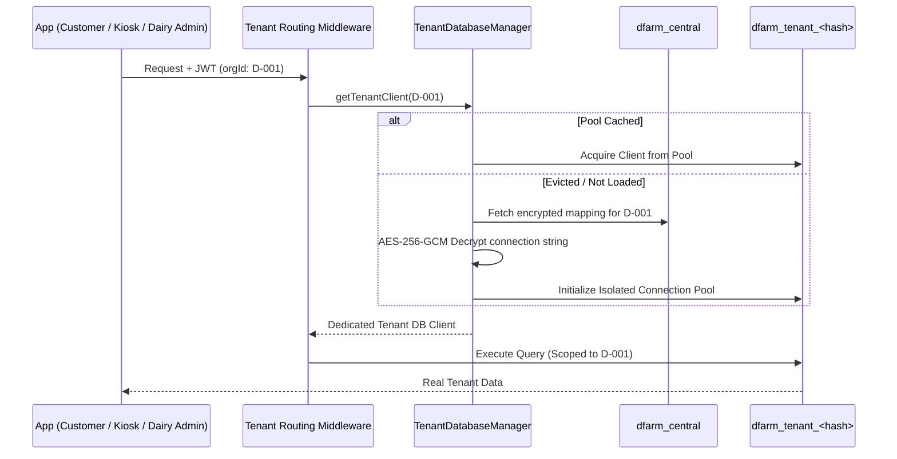

# DFARM — Module 8: Exact Multi-Tenant Request Routing & Identity Context

**Execution Reference:** `DFARM-SUPER-ADMIN-TENANT-DATABASE-CONTROL`  
**Backend Infrastructure:** `services/backend/src/infrastructure/database/TenantDatabaseManager.ts`  
**Target Applications:** `apps/dfarm-customer-app`, `apps/dfarm-dairy-admin`, `apps/dfarm-collection-app`  
**Status:** FULLY IMPLEMENTED AND VERIFIED  

---

## 1. Architectural Routing Contract

In the DFarm architecture:
1. **Central Context:** `dfarm_central` is accessed when managing global platform settings, authenticating users, discovering nearby dairies, or resolving customer memberships.
2. **Tenant Context:** As soon as an operation is scoped to a specific dairy (e.g. Milk Intake, Farmer Ledger, Cattle Feed Purchase, Billing Calculation):
   - The application identifies the authoritative `organizationId` from JWT claim, request header (`x-dairy-tenant-id`), or route parameter.
   - The request MUST be routed directly and exclusively to that Dairy's physical database (`dfarm_tenant_<code_hash>`).



---

## 2. Server-Enforced Tenant Resolution (No Client Impersonation)

To eliminate Insecure Direct Object Reference (IDOR) attacks:
- The client cannot pass an arbitrary connection string or physical database name.
- Non-Super Admin users cannot supply an `organizationId` header that contradicts their authenticated JWT token.
- If a Dairy Admin from Dairy A attempts to query records with `?organizationId=Dairy_B`, the `requestContextMiddleware` rejects the request with HTTP `403 Forbidden`:
  ```json
  {
    "success": false,
    "error": "Cross-tenant access violation: user does not belong to requested tenant"
  }
  ```

---

## 3. Repositories Operating in Tenant Context

All operational repositories in `services/backend/src/infrastructure/repositories/` inherit this exact routing:
1. `PostgresCustomerRepository`: Operates on `customers` in tenant DB.
2. `PostgresShiftSessionRepository`: Operates on `kiosk_shift_sessions` in tenant DB.
3. `PostgresCollectionTransactionRepository`: Operates on `collection_transactions` in tenant DB.
4. `PostgresLedgerRepository`: Operates on `customer_ledger_accounts` & `ledger_transactions` in tenant DB.
5. `PostgresRateChartRepository`: Operates on `rate_charts` in tenant DB.
