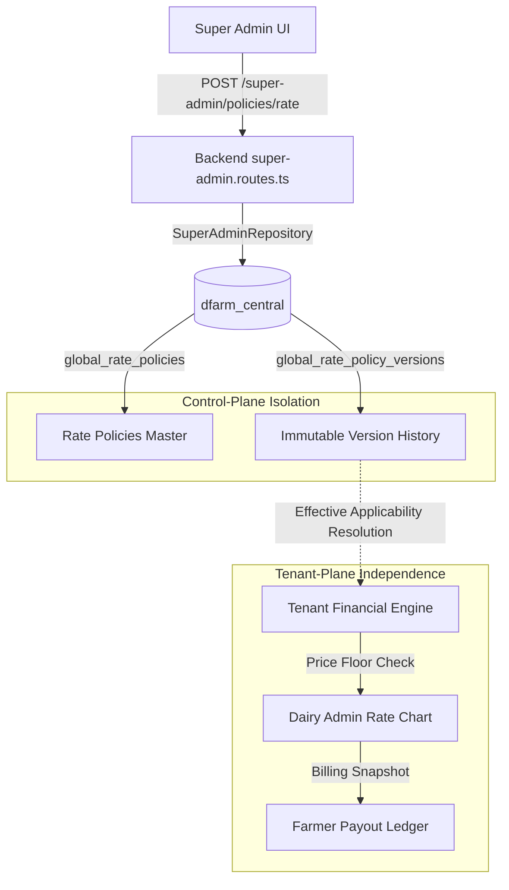

# Module 1: Global Rate Policy Management UI Integration

**Document Reference:** `DFARM-SUPER-ADMIN-DOC-03`  
**Application Target:** `apps/dfarm-super-admin`  
**Backend Reference:** `services/backend`  
**Database Central:** `dfarm_central`  

---

## 1. Executive Summary & Purpose

The **Global Rate Policy Management** module exposes the federation-wide procurement pricing governance capabilities to authorized Super Administrators (`SUPER_ADMIN` role). In multi-tenant dairy operations, pricing sovereignty must balance state/federation statutory procurement protection against individual dairy commercial freedom. 

This module implements the **Authorized Dairy / Federation Procurement Price Floor** standard, ensuring that:
1. Super Administrators can configure minimum price baselines and standard reference parameters for Cow and Buffalo milk across jurisdictions.
2. Tenant Dairies (`dfarm_tenant_*`) inherit these floors as non-negotiable legal/federation baselines while retaining autonomous control over their operational rate charts.
3. Every policy mutation is versioned, cryptographically sealed with SHA-256 checksums, and permanently audited in `dfarm_central.platform_audit_logs`.

---

## 2. Architectural Boundaries & Data Flow

### Critical Architectural Rules
- **Super Admin vs. Dairy Admin Sovereignty:** Super Admin defines the *Authorized Procurement Price Floor*. Super Admin *never* calculates or edits local collection rates, farmer deductions, or customer retail milk prices.
- **Immutability of Published Versions:** Draft versions can be updated and validated. Once marked `PUBLISHED`, a version is permanently sealed. Its parameters cannot be modified, preventing retroactive distortion of historical milk collection records.
- **Cryptographic Tamper-Evidence:** Each version record stores a SHA-256 checksum over its canonical JSON parameters (`cowMinRate`, `buffaloMinRate`, `standardFatCow`, `standardSnfCow`, `standardFatBuffalo`, `standardSnfBuffalo`, `effectiveFrom`).

---

## 3. Database Schema Traceability

All global rate policy data resides strictly within `dfarm_central` (created in migration `033_central_platform_policies_and_support.sql`):

### 3.1 `global_rate_policies`
| Column | Type | Constraints | Description |
|---|---|---|---|
| `id` | `UUID` | `PRIMARY KEY, DEFAULT gen_random_uuid()` | Unique policy identifier |
| `policy_code` | `VARCHAR(100)` | `NOT NULL, UNIQUE` | Human-readable code (e.g., `GRP-MAHA-2026`) |
| `name` | `VARCHAR(255)` | `NOT NULL` | Descriptive title |
| `description` | `TEXT` | `NULLABLE` | Legal basis or federation mandate |
| `policy_type` | `VARCHAR(50)` | `NOT NULL, DEFAULT 'STATUTORY_MINIMUM'` | Classification type |
| `applicable_dairies`| `TEXT[]` | `NOT NULL, DEFAULT '{"*"}'` | Scope (`*` for all, or specific dairy UUIDs) |
| `is_active` | `BOOLEAN` | `NOT NULL, DEFAULT true` | Soft-state lifecycle flag |
| `created_by` | `UUID` | `NULLABLE` | Platform operator who authored policy |
| `created_at` | `TIMESTAMPTZ`| `NOT NULL, DEFAULT CURRENT_TIMESTAMP` | Record timestamp |
| `updated_at` | `TIMESTAMPTZ`| `NOT NULL, DEFAULT CURRENT_TIMESTAMP` | Last updated timestamp |

### 3.2 `global_rate_policy_versions`
| Column | Type | Constraints | Description |
|---|---|---|---|
| `id` | `UUID` | `PRIMARY KEY, DEFAULT gen_random_uuid()` | Version record UUID |
| `policy_id` | `UUID` | `NOT NULL, REFERENCES global_rate_policies(id)` | Foreign key to parent policy |
| `version_number` | `INTEGER` | `NOT NULL` | Sequential version index |
| `cow_min_rate` | `DECIMAL(10,2)` | `NOT NULL` | Minimum floor rate for standard cow milk (₹/L) |
| `buffalo_min_rate`| `DECIMAL(10,2)` | `NOT NULL` | Minimum floor rate for standard buffalo milk (₹/L) |
| `standard_fat_cow` | `DECIMAL(4,2)` | `NOT NULL, DEFAULT 3.50` | Standard reference FAT % for cow |
| `standard_snf_cow` | `DECIMAL(4,2)` | `NOT NULL, DEFAULT 8.50` | Standard reference SNF % for cow |
| `standard_fat_buffalo` | `DECIMAL(4,2)` | `NOT NULL, DEFAULT 6.00` | Standard reference FAT % for buffalo |
| `standard_snf_buffalo` | `DECIMAL(4,2)` | `NOT NULL, DEFAULT 9.00` | Standard reference SNF % for buffalo |
| `effective_from` | `TIMESTAMPTZ` | `NOT NULL` | Start timestamp of legal validity |
| `effective_to` | `TIMESTAMPTZ` | `NULLABLE` | Expiration timestamp |
| `status` | `VARCHAR(50)` | `NOT NULL, DEFAULT 'DRAFT'` | `DRAFT`, `PUBLISHED`, `EXPIRED`, `ARCHIVED` |
| `checksum` | `VARCHAR(64)` | `NOT NULL` | SHA-256 hash of parameters |
| `change_summary` | `TEXT` | `NULLABLE` | Justification note |
| `published_by` | `UUID` | `NULLABLE` | Super Admin who published the version |
| `published_at` | `TIMESTAMPTZ` | `NULLABLE` | Publication timestamp |

---

## 4. API Endpoints & Request/Response Contracts

The module communicates with backend routes registered under `/api/v1/super-admin/policies/rate` with `authenticateSuperAdmin` and `requireSuperAdminRole`:

1. `GET /api/v1/super-admin/policies/rate`
   - Returns array of `GlobalRatePolicy` objects with nested versions.
2. `POST /api/v1/super-admin/policies/rate`
   - Payload: `{ policyCode: string, name: string, description?: string, policyType?: string, applicableDairies?: string[] }`
   - Role Requirement: `SUPER_ADMIN`
3. `POST /api/v1/super-admin/policies/rate/:policyId/versions`
   - Payload: `{ cowMinRate: number, buffaloMinRate: number, standardFatCow: number, standardSnfCow: number, standardFatBuffalo: number, standardSnfBuffalo: number, effectiveFrom: string, effectiveTo?: string, changeSummary?: string }`
   - Computes SHA-256 checksum and inserts `DRAFT` version.
4. `POST /api/v1/super-admin/policies/rate/:policyId/versions/:versionId/publish`
   - Transitions status from `DRAFT` to `PUBLISHED`.
   - Records `publishedBy` actor and `publishedAt` timestamp.
   - Emits audit log to `dfarm_central.platform_audit_logs`.

---

## 5. Frontend UI Implementation

- **Component Path:** `apps/dfarm-super-admin/src/features/rate-policies/GlobalRatePoliciesPage.tsx`
- **Route Path:** `/policies/rate`
- **Navigation Position:** Sidebar item index 5 (`Global Rate Policies`, icon `FileCheck2`)
- **Key UI Sections:**
  1. **Control-Plane Header & Action Bar:** Displays title, subtitle, badge, and "Create Rate Policy" button.
  2. **Statutory Governance Banner:** Clarifies the legal distinction between Super Admin price floor and Dairy Admin rate charts.
  3. **Live Search & Filter Strip:** Allows real-time searching by code/title and filtering by policy type.
  4. **Policy Card Deck:** Each card displays policy metadata, current active parameters, and an expandable version history drawer.
  5. **Modals:**
     - *Create Rate Policy Modal:* Enforces code formatting and descriptions.
     - *Create Version Draft Modal:* Captures cow/buffalo floor rates, standard FAT/SNF baselines, and effective date ranges.
     - *Publish Confirmation Modal:* Explains permanent immutability before sealing the version.

---

## 6. Verification & Automated Test Coverage

- **Component Test Suite:** `apps/dfarm-super-admin/src/test/policyManagement.test.tsx`
- **Backend Test Suite:** `services/backend/tests/roadmap-phase-04-platform-services.test.js`
- **Verifications Passed:**
  - Rate policy creation, draft versioning, and publishing workflow.
  - Immutability check: published versions cannot be updated or silently overwritten.
  - Verification that the UI gracefully handles loading states, empty sets, and API errors.
