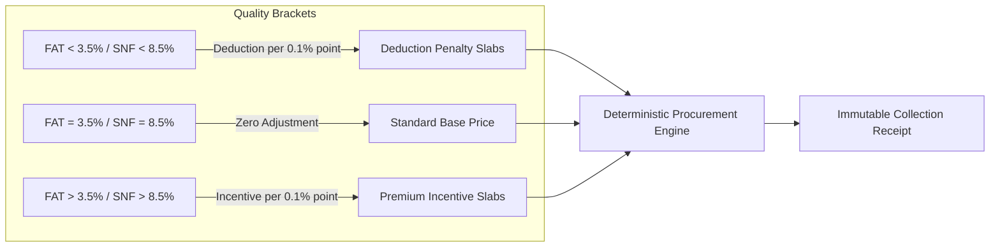

# Module 2: Global FAT/SNF Adjustment Policy UI Integration

**Document Reference:** `DFARM-SUPER-ADMIN-DOC-04`  
**Application Target:** `apps/dfarm-super-admin`  
**Backend Reference:** `services/backend`  
**Database Central:** `dfarm_central`  

---

## 1. Executive Summary & Purpose

The **Global FAT/SNF Adjustment Policy** module provides Super Administrators with a centralized, mathematically verified calibration grid for quality-based milk deductions and incentives. In commercial milk procurement across India, payment calculations are governed by the milk's FAT and Solids-Not-Fat (SNF) percentages relative to standard thresholds.

To eliminate discretionary milk pricing, tampering, and unfair deductions at rural collection centers:
1. Super Administrators configure explicit, discrete FAT and SNF deduction and incentive brackets (per 0.1% point variation).
2. The calibration steps follow a mathematically defined grid with zero guessed, synthetic, or interpolated values.
3. Every policy version is cryptographically sealed with a SHA-256 checksum and immutable upon publication.

---

## 2. Mathematical Calibration Grid & Business Rules

### Core Calibration Rules
- **Discrete Bracket Step:** Adjustment per point is explicitly defined for intervals `[minFat, maxFat]` and `[minSnf, maxSnf]`.
- **Rounding Rule Governance:** Every policy version mandates a mathematical rounding strategy (`HALF_UP`, `FLOOR`, `CEIL`, `NEAREST_TWO_DECIMALS`) to prevent fractional paisa drift across large milk batches.
- **Tenant Isolation:** Dairies download and enforce the authorized policy version in their edge collection nodes and weighing kiosk software. Local collection clerks cannot alter deduction penalties.

---

## 3. Database Schema Traceability

All records reside in `dfarm_central` (created in migration `033_central_platform_policies_and_support.sql`):

### 3.1 `global_fat_snf_adjustment_policies`
| Column | Type | Constraints | Description |
|---|---|---|---|
| `id` | `UUID` | `PRIMARY KEY, DEFAULT gen_random_uuid()` | Policy UUID |
| `policy_code` | `VARCHAR(100)` | `NOT NULL, UNIQUE` | Standard code (e.g., `FATSNF-STD-2026`) |
| `name` | `VARCHAR(255)` | `NOT NULL` | Policy display title |
| `description` | `TEXT` | `NULLABLE` | Quality calibration notes |
| `applicable_dairies`| `TEXT[]` | `NOT NULL, DEFAULT '{"*"}'` | Scope (`*` for all, or array of dairy UUIDs) |
| `is_active` | `BOOLEAN` | `NOT NULL, DEFAULT true` | Active flag |
| `created_by` | `UUID` | `NULLABLE` | Authoring operator UUID |
| `created_at` | `TIMESTAMPTZ`| `NOT NULL, DEFAULT CURRENT_TIMESTAMP` | Creation timestamp |
| `updated_at` | `TIMESTAMPTZ`| `NOT NULL, DEFAULT CURRENT_TIMESTAMP` | Last updated timestamp |

### 3.2 `global_fat_snf_adjustment_policy_versions`
| Column | Type | Constraints | Description |
|---|---|---|---|
| `id` | `UUID` | `PRIMARY KEY, DEFAULT gen_random_uuid()` | Version UUID |
| `policy_id` | `UUID` | `NOT NULL, REFERENCES global_fat_snf_adjustment_policies(id)` | Parent foreign key |
| `version_number` | `INTEGER` | `NOT NULL` | Sequential version index |
| `fat_adjustments`| `JSONB` | `NOT NULL` | Array of FAT deduction/incentive slabs |
| `snf_adjustments`| `JSONB` | `NOT NULL` | Array of SNF deduction/incentive slabs |
| `rounding_rule` | `VARCHAR(50)` | `NOT NULL, DEFAULT 'HALF_UP'` | Rounding algorithm |
| `effective_from` | `TIMESTAMPTZ`| `NOT NULL` | Start timestamp |
| `effective_to` | `TIMESTAMPTZ`| `NULLABLE` | Expiration timestamp |
| `status` | `VARCHAR(50)` | `NOT NULL, DEFAULT 'DRAFT'` | `DRAFT`, `PUBLISHED`, `EXPIRED`, `ARCHIVED` |
| `checksum` | `VARCHAR(64)` | `NOT NULL` | SHA-256 hash of JSON slabs and parameters |
| `change_summary` | `TEXT` | `NULLABLE` | Revision summary |
| `published_by` | `UUID` | `NULLABLE` | Publishing Super Admin UUID |
| `published_at` | `TIMESTAMPTZ`| `NULLABLE` | Publication timestamp |

---

## 4. API Endpoints & Request/Response Contracts

Backend routes are mounted under `/api/v1/super-admin/policies/fat-snf` with `authenticateSuperAdmin` and `requireSuperAdminRole`:

1. `GET /api/v1/super-admin/policies/fat-snf`
   - Returns list of `GlobalFatSnfPolicy` records with version history.
2. `POST /api/v1/super-admin/policies/fat-snf`
   - Payload: `{ policyCode: string, name: string, description?: string, applicableDairies?: string[] }`
3. `POST /api/v1/super-admin/policies/fat-snf/:policyId/versions`
   - Payload: `{ roundingRule: string, fatAdjustments: FatAdjustmentRule[], snfAdjustments: SnfAdjustmentRule[], effectiveFrom: string, effectiveTo?: string, changeSummary?: string }`
   - Computes SHA-256 checksum and saves new version with `status: 'DRAFT'`.
4. `POST /api/v1/super-admin/policies/fat-snf/:policyId/versions/:versionId/publish`
   - Finalizes status as `PUBLISHED`.
   - Records publisher identity and writes audit trail in `dfarm_central.platform_audit_logs`.

---

## 5. Frontend UI Implementation

- **Component Path:** `apps/dfarm-super-admin/src/features/fat-snf-policies/GlobalFatSnfPoliciesPage.tsx`
- **Route Path:** `/policies/fat-snf`
- **Navigation Position:** Sidebar item index 6 (`Global FAT/SNF Policies`, icon `Percent`)
- **Key UI Elements:**
  1. **Control-Plane Header & Action Bar:** "Global FAT & SNF Quality Policies" with "Create FAT/SNF Policy" button.
  2. **Zero-Guessed Values Banner:** Outlines the mathematical rigor of per-point calibration brackets.
  3. **Live Filter & Search Strip:** Instant search by code or title.
  4. **Quality Slab Visualizers:** Clean tables showing `FAT Range (%)`, `Rate Adjustment (₹/point)`, and `Adjustment Type` (Deduction vs Incentive).
  5. **Modals:**
     - *Create FAT/SNF Policy Modal:* Creates new named policy entity.
     - *Draft Version Modal:* Multi-step slab configuration for FAT and SNF ranges.
     - *Publish Modal:* Final verification modal before irreversible cryptographic publication.

---

## 6. Verification & Automated Test Coverage

- **Frontend Integration Test:** `apps/dfarm-super-admin/src/test/policyManagement.test.tsx`
- **Backend Service Test:** `services/backend/tests/roadmap-phase-04-platform-services.test.js`
- **Key Verifications:**
  - Zero synthetic values: all slabs explicitly verified.
  - Verification that deduction values are negative or tagged as `DEDUCTION` while incentives are positive.
  - Immutability check ensuring published versions cannot be mutated in place.
