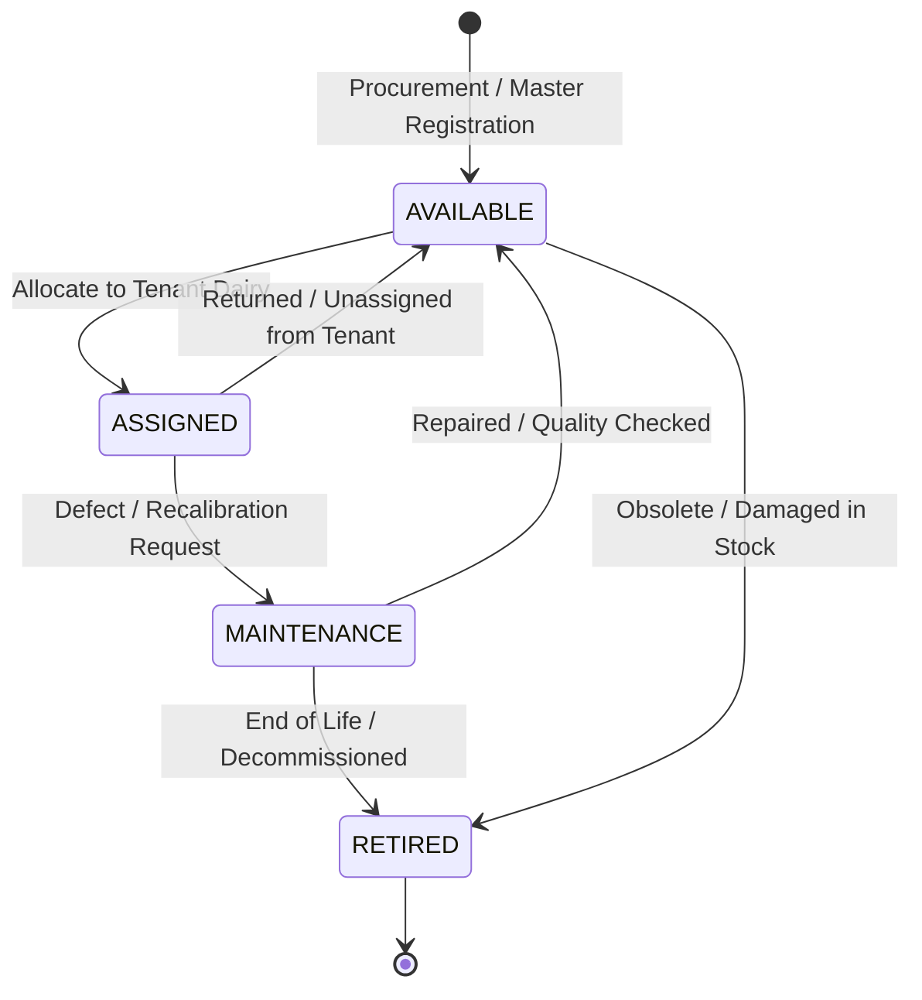

# Module 3: Hardware Inventory and Allocation UI Integration

**Document Reference:** `DFARM-SUPER-ADMIN-DOC-05`  
**Application Target:** `apps/dfarm-super-admin`  
**Backend Reference:** `services/backend`  
**Database Central:** `dfarm_central`  

---

## 1. Executive Summary & Purpose

The **Central Hardware Inventory & Allocation** module manages the physical edge-device fleet that powers village-level milk collection centers. These hardware assets include:
1. **Ultrasonic / Optical Milk Analyzers:** Measure FAT %, SNF %, protein, and added water in real time.
2. **Digital Weighing Scales:** Provide high-precision weights with serial communication to collection PCs/tablets.
3. **Automated Milk Collection Units (AMCU) & Kiosks:** Integrated touch-screen kiosks for collection point operators.
4. **Thermal Receipt Printers & RFID Tag Readers:** For farmer identification and paper slip generation.

Super Administrators govern the central warehouse inventory, procure device stock, assign devices to authorized tenant dairies, track firmware versions, and reassign/retire units.

---

## 2. Hardware Lifecycle Architecture & Transitions

### Key Hardware Lifecycle Rules
- **Central Master Inventory:** All devices are initially registered in `dfarm_central.central_hardware_inventory` with unique hardware serial numbers, optional MAC addresses, and IMEI codes.
- **Single Tenant Allocation:** A device unit can be allocated to at most *one* tenant dairy at any time. Multi-tenant device sharing is strictly prohibited to guarantee data integrity during offline synchronizations.
- **Audit Logging of Transfers:** Every assignment, unassignment, and status mutation creates an immutable event in `hardware_assignment_history` and `platform_audit_logs`.

---

## 3. Database Schema Traceability

All tables are located in `dfarm_central` (created in migration `032_central_super_admin_features.sql`):

### 3.1 `central_hardware_inventory`
| Column | Type | Constraints | Description |
|---|---|---|---|
| `id` | `UUID` | `PRIMARY KEY, DEFAULT gen_random_uuid()` | Device UUID |
| `serial_number` | `VARCHAR(100)` | `NOT NULL, UNIQUE` | Manufacturer serial number |
| `device_category` | `VARCHAR(50)` | `NOT NULL` | `ANALYZER`, `WEIGHING_SCALE`, `AMCU_KIOSK`, `PRINTER`, `RFID_READER` |
| `manufacturer` | `VARCHAR(100)` | `NOT NULL` | Brand / vendor (e.g. Essae, Lactoscan) |
| `model` | `VARCHAR(100)` | `NOT NULL` | Device model identifier |
| `status` | `VARCHAR(50)` | `NOT NULL, DEFAULT 'AVAILABLE'` | `AVAILABLE`, `ASSIGNED`, `MAINTENANCE`, `RETIRED` |
| `assigned_dairy_id`| `UUID` | `NULLABLE, REFERENCES dairies(id)` | Current tenant assignee |
| `assigned_at` | `TIMESTAMPTZ`| `NULLABLE` | Timestamp of current assignment |
| `warranty_until` | `DATE` | `NULLABLE` | Manufacturer warranty expiration |
| `notes` | `TEXT` | `NULLABLE` | Calibration and provisioning notes |
| `created_at` | `TIMESTAMPTZ`| `NOT NULL, DEFAULT CURRENT_TIMESTAMP` | Ingestion timestamp |
| `updated_at` | `TIMESTAMPTZ`| `NOT NULL, DEFAULT CURRENT_TIMESTAMP` | Last modified timestamp |

### 3.2 `hardware_assignment_history`
| Column | Type | Constraints | Description |
|---|---|---|---|
| `id` | `UUID` | `PRIMARY KEY, DEFAULT gen_random_uuid()` | Audit log UUID |
| `hardware_id` | `UUID` | `NOT NULL, REFERENCES central_hardware_inventory(id)` | Targeted device |
| `dairy_id` | `UUID` | `NULLABLE` | Associated tenant |
| `action` | `VARCHAR(50)` | `NOT NULL` | `REGISTER`, `ASSIGN`, `UNASSIGN`, `STATUS_CHANGE` |
| `actor_id` | `UUID` | `NULLABLE` | Super Admin / Operator UUID |
| `notes` | `TEXT` | `NULLABLE` | Transfer remarks |
| `created_at` | `TIMESTAMPTZ`| `NOT NULL, DEFAULT CURRENT_TIMESTAMP` | History timestamp |

---

## 4. API Endpoints & Request/Response Contracts

Endpoints are mounted under `/api/v1/super-admin/hardware` with `authenticateSuperAdmin` and `requireSuperAdminRole`:

1. `GET /api/v1/super-admin/hardware`
   - Query filters: `status`, `category`, `dairyId`, `search`.
   - Returns array of `HardwareDevice` objects with tenant metadata.
2. `POST /api/v1/super-admin/hardware`
   - Payload: `{ serialNumber: string, deviceCategory: string, manufacturer: string, model: string, warrantyUntil?: string, notes?: string }`
3. `POST /api/v1/super-admin/hardware/:id/assign`
   - Payload: `{ dairyId: string, notes?: string }`
   - Sets status to `ASSIGNED` and logs assignment history.
4. `POST /api/v1/super-admin/hardware/:id/unassign`
   - Payload: `{ notes?: string }`
   - Resets status to `AVAILABLE` and clears `assigned_dairy_id`.
5. `PATCH /api/v1/super-admin/hardware/:id/status`
   - Payload: `{ status: string, notes?: string }`

---

## 5. Frontend UI Implementation

- **Component Path:** `apps/dfarm-super-admin/src/features/hardware/HardwareInventoryPage.tsx`
- **Route Path:** `/hardware`
- **Navigation Position:** Sidebar item index 7 (`Hardware Inventory & Allocation`, icon `Cpu`)
- **Key UI Sections:**
  1. **Telemetry Metric Cards:** Displays 4 summary KPIs: Total Units, Allocated Units, In Stock, In Repair.
  2. **Inventory Search & Filter Strip:** Instant search by serial/model and select filters for Category, Status, and Dairy Tenant.
  3. **Data Table:** Renders device details with category icons, manufacturer model, current status badge, and assigned dairy link.
  4. **Modals:**
     - *Register Device Modal:* Enforces serial uniqueness and category taxonomy.
     - *Assign to Dairy Modal:* Dynamic dropdown listing active dairies.
     - *Unassign Confirmation Modal:* Verifies transfer back to warehouse stock.
     - *Status Update Modal:* Manages transitions between `MAINTENANCE`, `AVAILABLE`, and `RETIRED`.

---

## 6. Verification & Automated Test Coverage

- **Automated Test Suite:** `apps/dfarm-super-admin/src/test/hardwareAndAmc.test.tsx`
- **Backend Service Test:** `services/backend/tests/roadmap-phase-04-platform-services.test.js`
- **Verification Outcomes:**
  - Real hardware listing with accurate status tags.
  - Verification that assigned devices reflect in the tenant dairy directory.
  - Device assignment restrictions preventing double allocation.
