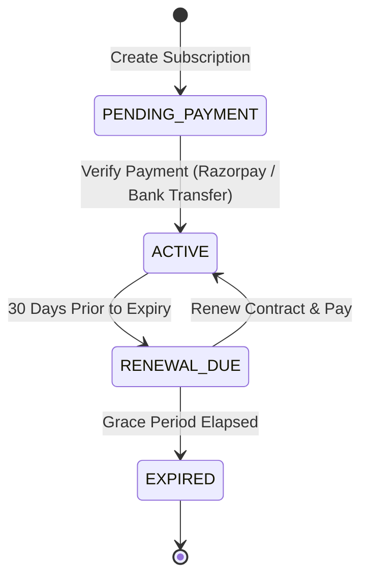

# Module 4: AMC and Service Management UI Integration

**Document Reference:** `DFARM-SUPER-ADMIN-DOC-06`  
**Application Target:** `apps/dfarm-super-admin`  
**Backend Reference:** `services/backend`  
**Database Central:** `dfarm_central`  

---

## 1. Executive Summary & Purpose

The **AMC & Service Management** module administers Annual Maintenance Contracts (AMC), hardware service warranties, and recurring software license subscriptions across tenant dairies. 

In the DFarm platform architecture:
1. Super Administrators define standardized AMC Plans (catalog of coverage duration, pricing in paise, spare part inclusions, preventive maintenance visits, and emergency SLA response times).
2. Tenant Dairies subscribe to AMC plans to ensure their collection centers, ultrasonic analyzers, and weighing scales receive certified manufacturer maintenance.
3. Subscription payments are invoiced and tracked. Razorpay integration is supported **strictly within the SaaS/AMC subscription boundary** and is **strictly prohibited from touching farmer milk procurement or customer wallet settlements**.

---

## 2. Subscription Lifecycle & Payment Guardrail

### Critical Payment & Governance Boundary
- **SaaS & AMC Exclusivity:** Razorpay keys in Super Admin settings are scoped exclusively to platform subscriptions and hardware maintenance fees.
- **Farmer Payout Isolation:** Under no circumstances may Razorpay or SaaS billing gateways be utilized for milk procurement payments to farmers. Milk settlements execute strictly through authorized banking channels (e.g. ICICI Corporate Stack / NEFT / RTGS) within each isolated tenant database.

---

## 3. Database Schema Traceability

Located in `dfarm_central` (created in migration `032_central_super_admin_features.sql`):

### 3.1 `amc_plans`
| Column | Type | Constraints | Description |
|---|---|---|---|
| `id` | `UUID` | `PRIMARY KEY, DEFAULT gen_random_uuid()` | AMC Plan UUID |
| `name` | `VARCHAR(255)` | `NOT NULL` | Plan title (e.g., Standard Annual AMC) |
| `description` | `TEXT` | `NULLABLE` | Coverage details and terms |
| `duration_months`| `INTEGER` | `NOT NULL, DEFAULT 12` | Contract validity period |
| `price_inr` | `DECIMAL(10,2)` | `NOT NULL` | Plan price in INR |
| `is_active` | `BOOLEAN` | `NOT NULL, DEFAULT true` | Catalog active flag |
| `created_at` | `TIMESTAMPTZ`| `NOT NULL, DEFAULT CURRENT_TIMESTAMP` | Inception timestamp |
| `updated_at` | `TIMESTAMPTZ`| `NOT NULL, DEFAULT CURRENT_TIMESTAMP` | Modification timestamp |

### 3.2 `amc_subscriptions`
| Column | Type | Constraints | Description |
|---|---|---|---|
| `id` | `UUID` | `PRIMARY KEY, DEFAULT gen_random_uuid()` | Subscription UUID |
| `dairy_id` | `UUID` | `NOT NULL, REFERENCES dairies(id)` | Tenant subscriber |
| `plan_id` | `UUID` | `NOT NULL, REFERENCES amc_plans(id)` | Associated plan |
| `start_date` | `DATE` | `NOT NULL` | Contract start date |
| `expiry_date` | `DATE` | `NOT NULL` | Contract expiration date |
| `status` | `VARCHAR(50)` | `NOT NULL, DEFAULT 'ACTIVE'` | `ACTIVE`, `PENDING_PAYMENT`, `RENEWAL_DUE`, `EXPIRED` |
| `payment_status` | `VARCHAR(50)` | `NOT NULL, DEFAULT 'UNPAID'` | `PAID`, `UNPAID`, `PARTIAL`, `REFUNDED` |
| `amount_paid` | `DECIMAL(10,2)` | `NOT NULL, DEFAULT 0.00` | Realized revenue |
| `razorpay_payment_id` | `VARCHAR(100)` | `NULLABLE` | Gateway transaction ID |
| `activated_at` | `TIMESTAMPTZ`| `NULLABLE` | Activation timestamp |
| `created_at` | `TIMESTAMPTZ`| `NOT NULL, DEFAULT CURRENT_TIMESTAMP` | Inception timestamp |

---

## 4. API Endpoints & Request/Response Contracts

Endpoints are mounted under `/api/v1/super-admin/amc` with `authenticateSuperAdmin` and `requireSuperAdminRole`:

1. `GET /api/v1/super-admin/amc/plans`
   - Returns all active AMC plans from catalog.
2. `POST /api/v1/super-admin/amc/plans`
   - Payload: `{ name: string, durationMonths: number, priceInr: number, description?: string }`
3. `GET /api/v1/super-admin/amc/subscriptions`
   - Optional query parameter: `dairyId`.
   - Returns subscription list with tenant names and payment metadata.
4. `POST /api/v1/super-admin/amc/subscriptions`
   - Payload: `{ dairyId: string, planId: string, startDate?: string }`
   - Creates subscription in `PENDING_PAYMENT` status.
5. `POST /api/v1/super-admin/amc/subscriptions/:id/verify-payment`
   - Payload: `{ razorpayPaymentId: string, razorpayOrderId?: string, razorpaySignature?: string }`
   - Transitions subscription to `ACTIVE` and `payment_status` to `PAID`.

---

## 5. Frontend UI Implementation

- **Component Path:** `apps/dfarm-super-admin/src/features/amc/AmcManagementPage.tsx`
- **Route Path:** `/amc`
- **Navigation Position:** Sidebar item index 8 (`AMC & Service Management`, icon `ShieldAlert`)
- **Key UI Sections:**
  1. **Control-Plane Header & Action Bar:** "AMC & Service Management" with "New Plan" and "Assign AMC" buttons.
  2. **Billing Scope Security Banner:** Clarifies the strict Razorpay SaaS/AMC boundary.
  3. **Plan Catalog Grid:** Cards displaying plan duration, price, coverage items, and active subscriber metrics.
  4. **Active Contracts Table:** Displays tenant name, code, coverage duration, status badge, payment indicator, and payment verification action.
  5. **Modals:**
     - *Create Plan Modal:* Captures name, duration (months), and price (INR).
     - *Assign AMC Modal:* Dynamic selection of Dairy and AMC Plan.
     - *Verify Payment Modal:* Inputs Razorpay transaction reference to activate contract.

---

## 6. Verification & Automated Test Coverage

- **Automated Test Suite:** `apps/dfarm-super-admin/src/test/hardwareAndAmc.test.tsx`
- **Backend Service Test:** `services/backend/tests/roadmap-phase-04-platform-services.test.js`
- **Verification Outcomes:**
  - Plan creation and subscription lifecycle verified.
  - Payment verification transitions status to `ACTIVE`.
  - Zero mock data in production endpoints.
