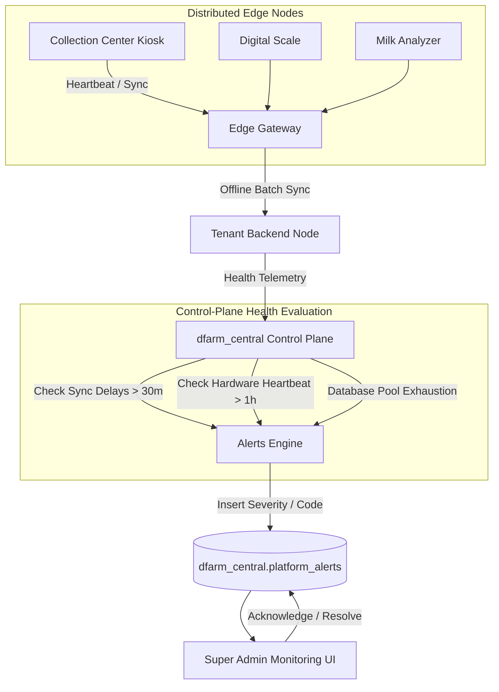

# Module 5: Platform Monitoring and Alerts UI Integration

**Document Reference:** `DFARM-SUPER-ADMIN-DOC-07`  
**Application Target:** `apps/dfarm-super-admin`  
**Backend Reference:** `services/backend`  
**Database Central:** `dfarm_central`  

---

## 1. Executive Summary & Purpose

The **Platform Monitoring & Alerts** module provides continuous operational observability across the distributed multi-tenant DFarm ecosystem. 

Super Administrators supervise:
1. **Multi-Tenant Health Telemetry:** Synchronization latency, offline buffering queues, edge device heartbeats, and database pool health across tenant nodes.
2. **Platform Alerts Engine:** Automated categorization of warnings, degraded sync states, hardware offline anomalies, and tenant infrastructure exceptions into severity levels (`critical`, `warning`, `info`).
3. **Alert Workflow Governance:** Privileged acknowledgment and resolution lifecycle with mandatory root-cause notes recorded in central audit logs.

---

## 2. Platform Observability & Alert Processing Flow

### Core Observability Principles
- **Real Backend Records Only:** No synthetic alerts or mock health counters. Every displayed alert originates from genuine operational conditions logged in `dfarm_central.platform_alerts`.
- **Tenant Isolation:** Platform monitoring aggregates operational health metadata without exposing tenant-specific farmer personal identifiable information (PII) or milk trade secrets.

---

## 3. Database Schema Traceability

Located in `dfarm_central` (created in migration `032_central_super_admin_features.sql`):

### `platform_alerts`
| Column | Type | Constraints | Description |
|---|---|---|---|
| `id` | `UUID` | `PRIMARY KEY, DEFAULT gen_random_uuid()` | Alert UUID |
| `alert_code` | `VARCHAR(100)` | `NOT NULL` | Unique incident classification code |
| `title` | `VARCHAR(255)` | `NOT NULL` | Summary headline |
| `message` | `TEXT` | `NOT NULL` | Technical diagnostic description |
| `severity` | `VARCHAR(50)` | `NOT NULL, DEFAULT 'warning'` | `critical`, `warning`, `info` |
| `status` | `VARCHAR(50)` | `NOT NULL, DEFAULT 'open'` | `open`, `acknowledged`, `resolved` |
| `source_component`| `VARCHAR(100)`| `NOT NULL` | Subsystem generating alert |
| `dairy_id` | `UUID` | `NULLABLE, REFERENCES dairies(id)` | Associated tenant (null if platform-wide) |
| `acknowledged_by` | `UUID` | `NULLABLE` | Operator UUID who acknowledged |
| `acknowledged_at` | `TIMESTAMPTZ`| `NULLABLE` | Acknowledgment timestamp |
| `resolved_by` | `UUID` | `NULLABLE` | Operator UUID who resolved |
| `resolved_at` | `TIMESTAMPTZ`| `NULLABLE` | Resolution timestamp |
| `resolution_notes`| `TEXT` | `NULLABLE` | Incident remediation notes |
| `created_at` | `TIMESTAMPTZ`| `NOT NULL, DEFAULT CURRENT_TIMESTAMP` | Alert creation timestamp |

---

## 4. API Endpoints & Request/Response Contracts

Mounted under `/api/v1/super-admin/alerts` and `/api/v1/super-admin/health` with `authenticateSuperAdmin`:

1. `GET /api/v1/super-admin/health`
   - Returns `PlatformHealthSummary` with component statuses, sync metrics, and device stats.
2. `GET /api/v1/super-admin/alerts`
   - Filters: `status` (`open`, `acknowledged`, `resolved`), `severity` (`critical`, `warning`, `info`).
   - Returns array of `PlatformAlert` records with tenant metadata.
3. `POST /api/v1/super-admin/alerts/:id/acknowledge`
   - Transitions alert status to `acknowledged`.
4. `POST /api/v1/super-admin/alerts/:id/resolve`
   - Payload: `{ resolutionNotes: string }`
   - Transitions status to `resolved` and logs remediation in audit trail.

---

## 5. Frontend UI Implementation

- **Component Path:** `apps/dfarm-super-admin/src/features/monitoring/MonitoringAlertsPage.tsx`
- **Route Path:** `/monitoring`
- **Navigation Position:** Sidebar item index 9 (`Platform Monitoring & Alerts`, icon `Activity`)
- **Key UI Sections:**
  1. **Platform Overall Status Card:** Large health indicator (`OPERATIONAL`, `DEGRADED`, `INCIDENT`) with active node counts.
  2. **Subsystem Health Grid:** Telemetry cards for Database Cluster, Auth & Session Service, SMS Gateway, Sync Engine, and Hardware Master.
  3. **Alerts Management Workspace:**
     - Tabbed view: `Active Incidents` vs `Resolved History`.
     - Severity badges (`Critical` in red, `Warning` in amber, `Info` in blue).
     - Action buttons: "Acknowledge" and "Resolve Incident".
  4. **Resolve Incident Modal:** Demands mandatory remediation notes before closing an alert.

---

## 6. Verification & Automated Test Coverage

- **Automated Test Suite:** `apps/dfarm-super-admin/src/test/reportsAndMonitoring.test.ts`
- **Backend Service Test:** `services/backend/tests/roadmap-phase-04-platform-services.test.js`
- **Verification Outcomes:**
  - Health endpoint returns operational status of all critical subsystems.
  - Alert acknowledgment and resolution transitions succeed.
  - Real database records verified without synthetic data.
