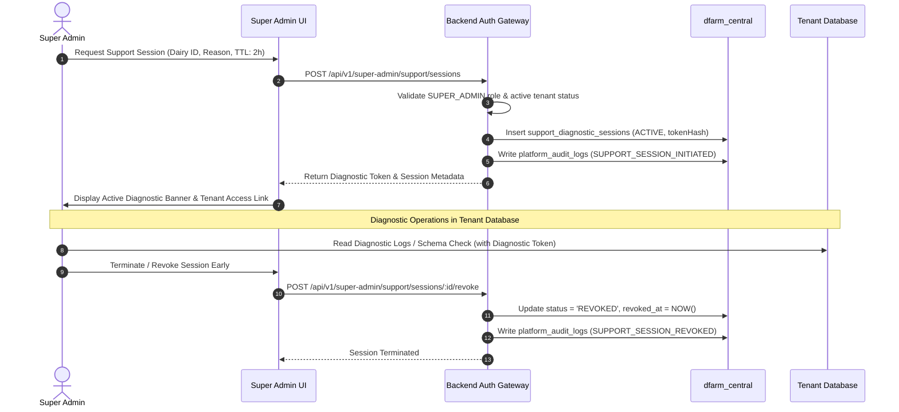

# Module 6: Authorized Support Management UI Integration

**Document Reference:** `DFARM-SUPER-ADMIN-DOC-08`  
**Application Target:** `apps/dfarm-super-admin`  
**Backend Reference:** `services/backend`  
**Database Central:** `dfarm_central`  

---

## 1. Executive Summary & Purpose

The **Support Management** module implements time-bounded, cryptographic diagnostics and technical assistance across tenant dairies (`dfarm_tenant_*`). 

In multi-tenant SaaS architecture where each tenant possesses a physically separate PostgreSQL database, arbitrary or unmonitored administrative intrusion into tenant data is strictly forbidden. 

The DFarm platform enforces the **Controlled Diagnostic Support Protocol**:
1. Super Administrators cannot access a tenant's database without an active, explicit Support Session Token.
2. Support sessions are time-bounded (maximum TTL of 4 hours).
3. Every session requires a logged business justification, generates a cryptographic token, and is immediately revocable.
4. An immutable audit record is committed to `dfarm_central.platform_audit_logs` upon session creation and revocation.

---

## 2. Controlled Diagnostic Access Protocol Flow

---

## 3. Database Schema Traceability

Located in `dfarm_central` (created in migration `033_central_platform_policies_and_support.sql`):

### `support_diagnostic_sessions`
| Column | Type | Constraints | Description |
|---|---|---|---|
| `id` | `UUID` | `PRIMARY KEY, DEFAULT gen_random_uuid()` | Session UUID |
| `dairy_id` | `UUID` | `NOT NULL, REFERENCES dairies(id)` | Targeted tenant dairy |
| `requested_by` | `UUID` | `NOT NULL` | Super Admin / Operator UUID |
| `reason` | `TEXT` | `NOT NULL` | Mandatory diagnostic justification |
| `status` | `VARCHAR(50)` | `NOT NULL, DEFAULT 'ACTIVE'` | `ACTIVE`, `EXPIRED`, `REVOKED` |
| `session_token_hash`| `VARCHAR(64)` | `NOT NULL` | Cryptographic SHA-256 token hash |
| `expires_at` | `TIMESTAMPTZ`| `NOT NULL` | Timestamp when session auto-expires |
| `revoked_at` | `TIMESTAMPTZ`| `NULLABLE` | Early termination timestamp |
| `revocation_reason` | `TEXT` | `NULLABLE` | Explanation for early termination |
| `created_at` | `TIMESTAMPTZ`| `NOT NULL, DEFAULT CURRENT_TIMESTAMP` | Inception timestamp |

---

## 4. API Endpoints & Request/Response Contracts

Mounted under `/api/v1/super-admin/support` with `authenticateSuperAdmin` and `requireSuperAdminRole`:

1. `GET /api/v1/super-admin/support/sessions/active`
   - Returns currently active support diagnostic session if one exists.
2. `GET /api/v1/super-admin/support/sessions`
   - Returns historical log of past support diagnostic sessions.
3. `POST /api/v1/super-admin/support/sessions`
   - Payload: `{ dairyId: string, reason: string, durationMinutes?: number }`
   - Validates that duration does not exceed 240 minutes (4 hours).
   - Generates secure random session token, hashes it, stores in database, and returns clear token.
4. `POST /api/v1/super-admin/support/sessions/:id/revoke`
   - Payload: `{ revocationReason?: string }`
   - Immediately revokes session and writes audit event.

---

## 5. Frontend UI Implementation

- **Component Path:** `apps/dfarm-super-admin/src/features/support/SupportManagementPage.tsx`
- **Route Path:** `/support`
- **Navigation Position:** Sidebar item index 10 (`Support Management`, icon `HelpCircle`)
- **Key UI Sections:**
  1. **Zero-Trust Diagnostic Banner:** Explicitly warns that all support queries are audited and unmonitored access is prohibited.
  2. **Active Support Session Card:** When a session is active, renders an emergency high-visibility banner with countdown timer, dairy name, diagnostic token, and an immediate "Revoke Access" button.
  3. **Initiate Diagnostic Session Form / Modal:** Requires selection of tenant dairy, duration slider (15m to 240m), and a detailed reason textarea.
  4. **Diagnostic Session Audit History Table:** Displays historical sessions, operator identity, duration, expiration timestamp, and revocation reasons.

---

## 6. Verification & Automated Test Coverage

- **Automated Test Suite:** `apps/dfarm-super-admin/src/test/auditAndSecurity.test.ts`
- **Backend Service Test:** `services/backend/tests/roadmap-phase-04-platform-services.test.js`
- **Verification Outcomes:**
  - Token creation, expiration calculation, and immediate revocation verified.
  - Verification that session tokens are hashed with SHA-256 in `dfarm_central`.
  - Immutable audit trail committed on each support transition.
