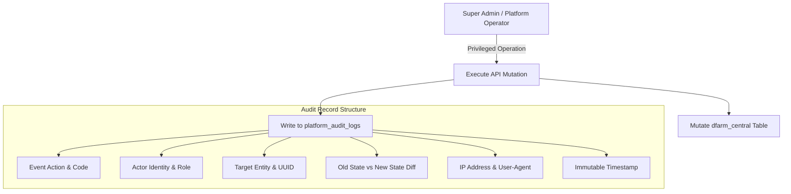

# Module 9: Platform Reports and Audit Logs UI Integration

**Document Reference:** `DFARM-SUPER-ADMIN-DOC-11`  
**Application Target:** `apps/dfarm-super-admin`  
**Backend Reference:** `services/backend`  
**Database Central:** `dfarm_central`  

---

## 1. Executive Summary & Purpose

The **Platform Reports & Audit Logs** modules provide non-repudiable oversight and governance compliance across all platform operations.

In multi-tenant architecture, data privacy and tenant isolation dictate strict boundaries:
1. **Aggregated Platform Reports:** Reports provide macro-level trends (tenant growth, hardware synchronization reliability, dairy lifecycle state changes, and admin compliance) without exposing confidential farmer ledgers, milk testing values, or commercial payouts.
2. **Immutable Audit Trail:** Privileged actions taken by Super Administrators or Platform Operators (dairy suspension, policy publication, device assignment, diagnostic support session initiation) are committed to an append-only audit ledger in `dfarm_central.platform_audit_logs`.
3. **Tamper-Evident Design:** Audit entries cannot be modified or deleted via UI or standard API endpoints.

---

## 2. Audit Event Lifecycle & Classification

### Core Compliance Rules
- **Farmer Data Privacy:** General platform reports must *never* export individual farmer personal data, phone numbers, milk Fat/SNF measurements, or farmer bank account numbers.
- **Append-Only Assurance:** Audit logs have zero `UPDATE` or `DELETE` endpoints. Database row triggers and application layer clean architecture forbid audit truncation.

---

## 3. Database Schema Traceability

Located in `dfarm_central` (created in migration `001_create_central_schema.sql` and `032_central_super_admin_features.sql`):

### `platform_audit_logs`
| Column | Type | Constraints | Description |
|---|---|---|---|
| `id` | `UUID` | `PRIMARY KEY, DEFAULT gen_random_uuid()` | Audit event UUID |
| `action` | `VARCHAR(100)` | `NOT NULL` | Event action name (e.g., `POLICY_PUBLISHED`) |
| `actor_id` | `UUID` | `NOT NULL` | Super Admin / Operator UUID |
| `actor_name` | `VARCHAR(255)` | `NOT NULL` | Human-readable actor name |
| `actor_role` | `VARCHAR(50)` | `NOT NULL` | `SUPER_ADMIN`, `PLATFORM_OPERATOR` |
| `target_type` | `VARCHAR(100)` | `NOT NULL` | Entity type (`DAIRY`, `POLICY`, `HARDWARE`, `AMC`) |
| `target_id` | `VARCHAR(100)` | `NOT NULL` | Target entity UUID / Code |
| `details` | `JSONB` | `NOT NULL, DEFAULT '{}'` | Parameter diff / payload metadata |
| `ip_address` | `VARCHAR(45)` | `NULLABLE` | Client IP address |
| `user_agent` | `TEXT` | `NULLABLE` | Client user-agent string |
| `timestamp` | `TIMESTAMPTZ`| `NOT NULL, DEFAULT CURRENT_TIMESTAMP` | Canonical event timestamp |

---

## 4. API Endpoints & Request/Response Contracts

Mounted under `/api/v1/super-admin/reports` and `/api/v1/super-admin/audit` with `authenticateSuperAdmin`:

1. `GET /api/v1/super-admin/reports`
   - Parameters: `reportType` (`dairy_growth`, `dairy_lifecycle`, `admin_compliance`, `sync_health`), `startDate`, `endDate`.
   - Returns aggregated rows and summary metrics.
2. `GET /api/v1/super-admin/audit`
   - Filters: `action`, `targetType`, `dairyId`, `startDate`, `endDate`, `search`.
   - Returns array of `AuditLogEntry` objects.

---

## 5. Frontend UI Implementation

### 5.1 Platform Reports (`apps/dfarm-super-admin/src/features/reports/ReportsPage.tsx`)
- **Route:** `/reports`
- **Navigation Position:** Sidebar item index 11 (`Platform Reports`, icon `BarChart3`)
- **Features:** Report type picker, date range filter, summary metric widgets, responsive data table, and CSV export functionality.

### 5.2 Audit Logs (`apps/dfarm-super-admin/src/features/audit/AuditLogsPage.tsx`)
- **Route:** `/audit`
- **Navigation Position:** Sidebar item index 12 (`Audit Logs`, icon `History`)
- **Features:** Search by actor/entity, filter by action category, formatted JSON diff drawer, IP address badge, and relative time formatting.

---

## 6. Verification & Automated Test Coverage

- **Automated Test Suite:** `apps/dfarm-super-admin/src/test/reportsAndMonitoring.test.ts` & `apps/dfarm-super-admin/src/test/auditAndSecurity.test.ts`
- **Backend Service Test:** `services/backend/tests/roadmap-phase-04-platform-services.test.js`
- **Verification Outcomes:**
  - Reports return aggregated macro metrics without farmer privacy violations.
  - Audit trail append-only guarantees verified.
