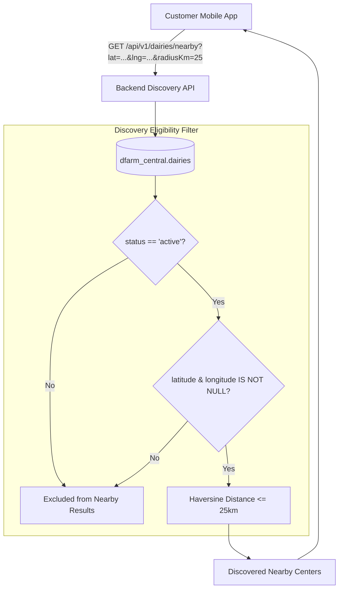

# Module 10: Dairy Location and Discovery UI Integration

**Document Reference:** `DFARM-SUPER-ADMIN-DOC-12`  
**Application Target:** `apps/dfarm-super-admin`  
**Backend Reference:** `services/backend`  
**Database Central:** `dfarm_central`  

---

## 1. Executive Summary & Purpose

The **Dairy Locations & Discovery Directory** module provides geospatial management for tenant dairies and collection centers. 

The DFarm Customer Mobile Application utilizes geo-proximity calculation (`/api/v1/dairies/nearby`) so that local milk-producing farmers can automatically discover, select, and register with nearby collection centers. 

To prevent customer onboarding failures and rogue pins:
1. Super Administrators review the precise GPS coordinates (`latitude`, `longitude`), formatted addresses, districts, and states for all registered dairies.
2. Inactive, suspended, or unpinned dairies are marked ineligible for customer self-discovery.
3. Super Admins can adjust or calibrate coordinates using the interactive Google Maps / marker picker (`DairyLocationPicker.tsx`).

---

## 2. Proximity Discovery Flow & Ineligibility Rules

---

## 3. Database Schema Traceability

Located in `dfarm_central` (created in migration `001_create_central_schema.sql` and `003_dairies.sql`):

### `dairies` (Geographic Columns)
| Column | Type | Constraints | Description |
|---|---|---|---|
| `latitude` | `DECIMAL(10,8)` | `NULLABLE` | Precise GPS latitude (e.g., 18.5204) |
| `longitude` | `DECIMAL(11,8)` | `NULLABLE` | Precise GPS longitude (e.g., 73.8567) |
| `formatted_address`| `TEXT` | `NULLABLE` | Full reverse-geocoded address string |
| `address_line1` | `VARCHAR(255)` | `NOT NULL` | Street / Survey number / Area |
| `village_locality` | `VARCHAR(100)` | `NULLABLE` | Rural village or urban locality name |
| `district` | `VARCHAR(100)` | `NOT NULL` | Revenue district |
| `state` | `VARCHAR(100)` | `NOT NULL` | State (e.g., Maharashtra, Karnataka) |
| `pincode` | `VARCHAR(10)` | `NOT NULL` | Indian Postal PIN code |

---

## 4. API Endpoints & Request/Response Contracts

Mounted under `/api/v1/dairies` with `authenticateSuperAdmin`:

1. `GET /api/v1/dairies`
   - Returns list of `DairyTenant` records with populated location structures.
2. `PATCH /api/v1/dairies/:id/location`
   - Payload: `{ latitude: number, longitude: number, formattedAddress?: string, addressLine1?: string, district?: string, state?: string, pincode?: string, villageLocality?: string }`
   - Updates `dfarm_central.dairies` coordinates and commits audit log entry.
3. `GET /api/v1/dairies/nearby`
   - Query: `latitude`, `longitude`, `radiusKm` (default: 25).
   - Enforces `status = 'active'` and non-null coordinates.

---

## 5. Frontend UI Implementation

- **Component Path:** `apps/dfarm-super-admin/src/features/locations/DairyLocationsPage.tsx`
- **Route Path:** `/locations`
- **Navigation Position:** Sidebar item index 4 (`Dairy Locations & Discovery`, icon `MapPin`)
- **Key UI Sections:**
  1. **Geographic Vitality Metrics:** Total Dairies, Geocoded & Pinned, Discovery Eligible, and Needs Verification.
  2. **Filter & Search Bar:** Multi-criteria search across dairy name, village, district, state, and pincode.
  3. **Location Directory Table:** Displays verified GPS coordinates, discovery eligibility badge, and "Adjust Pin" action.
  4. **`DairyLocationPicker` Integration:** Interactive Google Map modal supporting geocoder place search, current location GPS capture, and pin dragging.

---

## 6. Verification & Automated Test Coverage

- **Automated Test Suite:** `apps/dfarm-super-admin/src/test/platformSettingsAndLocations.test.tsx` & `apps/dfarm-super-admin/src/test/dairyLocationPicker.test.tsx`
- **Backend Service Test:** `services/backend/tests/roadmap-phase-04-platform-services.test.js`
- **Verification Outcomes:**
  - Map rendering with mocked Google Maps API verified.
  - Coordinate saving and discovery eligibility filters verified.
