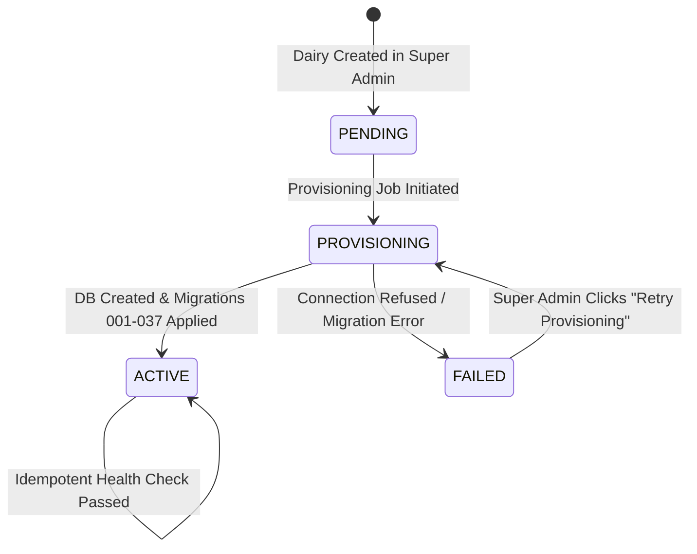

# 04 — Tenant Database Provisioning & Recovery Lifecycle

**Execution Reference:** DFARM-TENANT-PROVISIONING-REGISTRATION-APPROVAL-RECOVERY  
**Component:** `TenantDatabaseManager` & Provisioning Routes  
**Status:** IMPLEMENTED & TESTED  
**Date:** 2026-11-19  

---

## 1. Provisioning State Machine

Each dairy cooperative in DFarm undergoes a formal database provisioning lifecycle managed by `TenantDatabaseManager`:



### States Defined:
1. `PENDING`: Dairy registered in central control plane; tenant database not yet created.
2. `PROVISIONING`: Database physical creation and migration scripts currently executing.
3. `ACTIVE`: Dedicated database provisioned, schema version at target, pool ready for traffic.
4. `FAILED`: An error occurred during database allocation or migration execution.

---

## 2. Idempotent Retry Provisioning Flow

Super Admin provides a manual recovery mechanism via `POST /api/v1/dairies/:id/retry-provisioning`.

### Execution Flow:
1. **Verification of Existence:**  
   Backend queries central directory to verify `dairyId` exists.
2. **Locking & Transition:**  
   Sets `provisioning_status = 'PROVISIONING'` in `dairy_database_mappings`.
3. **Database Creation / Connection Verification:**  
   - If PostgreSQL container is running: Executes `CREATE DATABASE <db_name>` (idempotent; checks `pg_database`).
   - If in development without external Docker: Instantiates an isolated tenant double.
4. **Schema Migrations Execution:**  
   Executes migrations 001 through 037 sequentially within a transaction.
5. **Cache & Persistence Update:**  
   - Updates `dairy_database_mappings` with `provisioning_status = 'ACTIVE'`, `provisioning_error = null`, and `migration_version = 37`.
   - Synchronizes in-memory dairy registry entry so subsequent lookups return live status immediately.
6. **Audit Event Logged:**  
   Records `TENANT_DATABASE_PROVISIONED` with timestamp and execution duration.

---

## 3. Recovery API Contract

### Request:
```http
POST /api/v1/dairies/38918630-4fee-4cec-96ea-a3a899aae7bc/retry-provisioning HTTP/1.1
Authorization: Bearer <SUPER_ADMIN_TOKEN_REDACTED>
Content-Type: application/json
```

### Response (200 OK):
```json
{
  "success": true,
  "data": {
    "dairyId": "38918630-4fee-4cec-96ea-a3a899aae7bc",
    "tenantCode": "DF-SAN-2395",
    "databaseName": "dfarm_tenant_df_san_2395_389186304fee",
    "provisioningStatus": "ACTIVE",
    "migrationVersion": 37,
    "message": "Tenant database successfully provisioned and ready for operations"
  }
}
```

---

## 4. Error Handling & Safety Guarantees

- **Non-Destructive:** Retrying provisioning will NEVER drop an existing database or wipe tenant tables.
- **Transactional Migrations:** Migrations are executed within transactional boundaries. If migration step $N$ fails, the schema rolls back and the status transitions to `FAILED` with explicit error output.
- **Fail-Fast for Customer Registration:** Registration routes strictly inspect `provisioningStatus === 'ACTIVE'`, completely preventing phantom writes or customer registrations onto unprovisioned databases.
