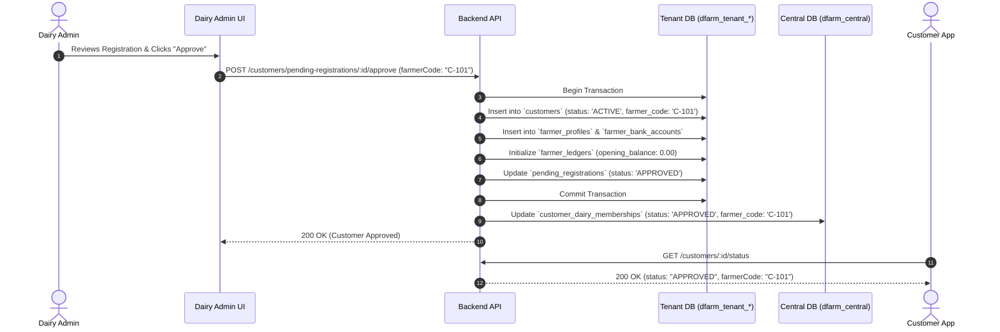

# 09 — Dairy Admin Approval Workflow & Farmer Code Assignment

**Execution Reference:** DFARM-TENANT-PROVISIONING-REGISTRATION-APPROVAL-RECOVERY  
**Scope:** `POST /api/v1/customers/pending-registrations/:id/approve`  
**Status:** IMPLEMENTED & VERIFIED  
**Date:** 2026-11-19  

---

## 1. Approval Architecture

The Dairy Admin approval workflow promotes an unverified registration from staging into an active, operational farmer record authorized for daily milk collection.



---

## 2. API Contract & Payload

### Request:
```http
POST /api/v1/customers/pending-registrations/34e5ce6f-00ec-4f2d-88b9-5c1cfab08fec/approve HTTP/1.1
Authorization: Bearer <DAIRY_ADMIN_JWT_REDACTED>
Content-Type: application/json

{
  "farmerCode": "C-101",
  "routeCode": "RT-01",
  "approvalNotes": "Verified physically during morning collection"
}
```

### Response:
```json
{
  "success": true,
  "data": {
    "customerId": "7a9b0c12-34de-56fa-78bc-90de12345678",
    "farmerCode": "C-101",
    "fullName": "Shubhangi Popat Yewale",
    "status": "ACTIVE",
    "approvedAt": "2026-11-19T12:02:15.112Z",
    "message": "Customer approved and registered under farmer code C-101"
  }
}
```

---

## 3. Rejection Workflow

If Dairy Admin rejects an application (e.g., duplicate application, invalid documentation):
- **Endpoint:** `POST /api/v1/customers/pending-registrations/:id/reject`
- **Payload:** `{"rejectionReason": "Address outside cooperative collection radius"}`
- **Effects:**
  - `pending_registrations.status` transitions to `REJECTED`.
  - `customer_dairy_memberships.status` in central database transitions to `REJECTED` with reason recorded.
  - Customer App status polling displays a clear rejection card with the dairy's explanation and an option to reapply or choose another dairy.
