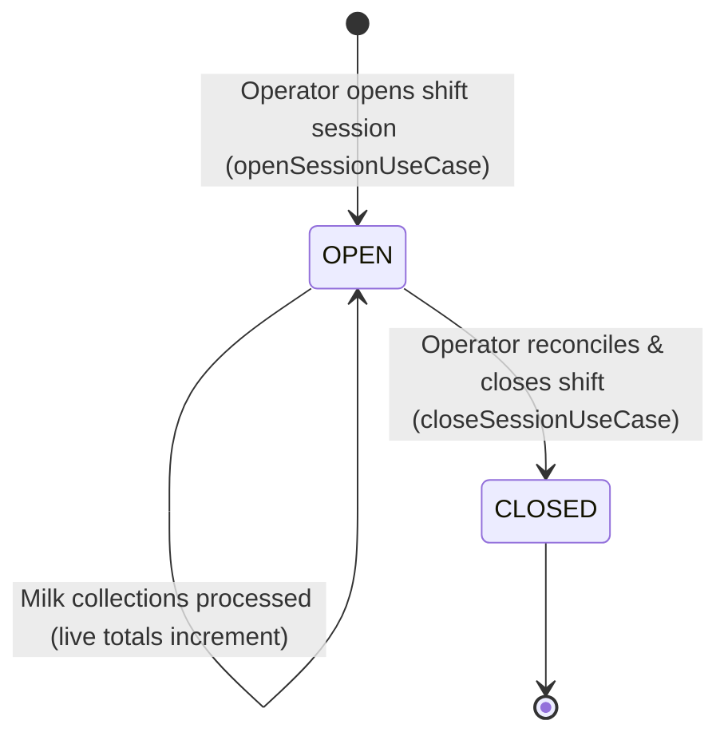

# DFARM — Collection Session Integration & Kiosk Operational Shifts

**Document Reference:** `docs/integration/COLLECTION_SESSION_INTEGRATION.md`  
**Classification:** Kiosk Shift Architecture & Session Management  
**Status:** Landed & Verified  

---

## 1. Overview & Problem Remediation

Previously, the Collection Sessions module in Dairy Admin rendered static, mock-generated active sessions (e.g. `SES-2026-11-15-M`). The module did not reflect real sessions initiated by collection operators on Kiosk terminals.

The session pipeline is now unified under the `kiosk_shift_sessions` table (defined in `supabase/migrations/027_kiosk_shift_sessions_and_sface128_seed.sql`), serving both the Kiosk Collection App and the Dairy Admin Web platform.

---

## 2. Session Lifecycle & Schema Invariants



### 2.1 Database Structure
```sql
CREATE TABLE IF NOT EXISTS kiosk_shift_sessions (
    id UUID PRIMARY KEY DEFAULT gen_random_uuid(),
    session_code VARCHAR(50) NOT NULL UNIQUE,
    organization_id UUID NOT NULL REFERENCES organizations(id) ON DELETE RESTRICT,
    center_id UUID NOT NULL REFERENCES dairy_centers(id) ON DELETE RESTRICT,
    business_date DATE NOT NULL,
    shift VARCHAR(20) NOT NULL CHECK (shift IN ('MORNING', 'EVENING')),
    status VARCHAR(20) NOT NULL DEFAULT 'OPEN' CHECK (status IN ('OPEN', 'CLOSED')),
    opened_at TIMESTAMPTZ NOT NULL DEFAULT NOW(),
    closed_at TIMESTAMPTZ,
    opening_operator_id UUID NOT NULL REFERENCES users(id) ON DELETE RESTRICT,
    closing_operator_id UUID REFERENCES users(id) ON DELETE RESTRICT,
    device_identifier VARCHAR(100) NOT NULL,
    device_name VARCHAR(150),
    total_liters NUMERIC(10,2) NOT NULL DEFAULT 0.00,
    cow_liters NUMERIC(10,2) NOT NULL DEFAULT 0.00,
    buffalo_liters NUMERIC(10,2) NOT NULL DEFAULT 0.00,
    transaction_count INT NOT NULL DEFAULT 0,
    total_amount NUMERIC(12,2) NOT NULL DEFAULT 0.00,
    average_fat NUMERIC(5,2) NOT NULL DEFAULT 0.00,
    average_snf NUMERIC(5,2) NOT NULL DEFAULT 0.00,
    created_at TIMESTAMPTZ NOT NULL DEFAULT NOW(),
    updated_at TIMESTAMPTZ NOT NULL DEFAULT NOW()
);
```

---

## 3. API Workflows & Contracts

### 3.1 Get All Sessions (Dairy Admin)
- **Endpoint:** `GET /api/v1/collections/sessions`
- **Scoping:** Scoped to `req.user.organizationId`.
- **Response Format:**
```json
{
  "success": true,
  "count": 1,
  "data": [
    {
      "id": "s-00000000-0000-0000-0000-000000000001",
      "sessionId": "SES-20261116-M-01",
      "dairyId": "00000000-0000-0000-0000-000000000001",
      "date": "2026-11-16",
      "shift": "MORNING",
      "status": "OPEN",
      "openedAt": "2026-11-16T05:30:00.000Z",
      "openingOperatorId": "00000000-0000-0000-0000-000000000003",
      "openingOperatorName": "Counter Operator",
      "deviceId": "KIOSK_MAIN",
      "deviceName": "Main Collection Kiosk",
      "totals": {
        "transactionCount": 18,
        "totalLiters": 142.5,
        "cowLiters": 95.0,
        "buffaloLiters": 47.5,
        "averageFat": 4.25,
        "averageSnf": 8.75,
        "totalAmount": 5842.50
      },
      "syncStatus": "SYNCED"
    }
  ]
}
```

### 3.2 Open Shift Session (Kiosk Operator)
- **Endpoint:** `POST /api/v1/collections/sessions/open`
- **Request Body:**
```json
{
  "shift": "MORNING",
  "businessDate": "2026-11-16",
  "deviceId": "KIOSK_MAIN"
}
```

### 3.3 Close Shift Session (Operator or Dairy Admin)
- **Endpoint:** `POST /api/v1/collections/sessions/close` (or `POST /api/v1/collections/sessions/:sessionId/close`)
- **Request Body:**
```json
{
  "sessionCode": "SES-20261116-M-01",
  "operatorName": "Counter Operator"
}
```
- **Result:**
  Sets `status = 'CLOSED'`, updates `closed_at = NOW()`, records `closing_operator_id`, freezes final shift volume and financial totals.
