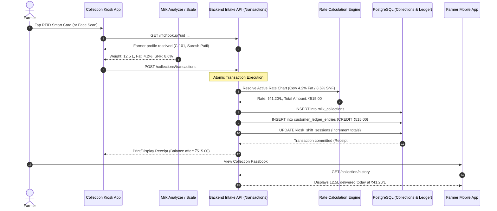

# DFARM — Collection Transaction Flow & Atomic Ledger Accounting

**Document Reference:** `docs/integration/COLLECTION_TRANSACTION_FLOW.md`  
**Classification:** Financial & Intake Workflow Specification  
**Status:** Landed & Production-Verified  

---

## 1. End-to-End Collection Journey

The milk collection transaction represents the core business workflow of DFARM. It links hardware instruments (analyzer + weighing scale) with customer identification, dynamic rate charts, and atomic double-entry accounting.



---

## 2. API Contract: Process Milk Intake

- **Method:** `POST`
- **Route:** `/api/v1/collections/transactions`
- **Headers:**
  - `Authorization: Bearer <operator_token>`
  - `Idempotency-Key: <client_uuid>`
- **Request Body:**
```json
{
  "sessionId": "s-00000000-0000-0000-0000-000000000001",
  "sessionCode": "SES-20261116-M-01",
  "customerId": "c1a2b3c4-0000-0000-0000-000000000001",
  "milkCategory": "COW",
  "weightLiters": 12.5,
  "fatPercentage": 4.2,
  "snfPercentage": 8.6,
  "clrDensity": 28.5,
  "identificationMethod": "RFID",
  "deviceId": "KIOSK_MAIN",
  "idempotencyKey": "idemp-txn-98234-01"
}
```
- **Response Format:**
```json
{
  "success": true,
  "receiptNumber": "REC-784920",
  "customerBalanceAfter": 515.00,
  "isIdempotentReplay": false,
  "data": {
    "id": "mc-00000000-0000-0000-0000-000000000001",
    "sessionId": "s-00000000-0000-0000-0000-000000000001",
    "customerId": "c1a2b3c4-0000-0000-0000-000000000001",
    "businessDate": "2026-11-16",
    "shiftType": "MORNING",
    "milkCategory": "COW",
    "netWeight": 12.5,
    "fatPercentage": 4.2,
    "snfPercentage": 8.6,
    "appliedRatePerUnit": 41.20,
    "totalAmount": 515.00,
    "transactionStatus": "COMPLETED"
  }
}
```

---

## 3. Non-Destructive Weight Adjustments

When an administrator needs to correct a recorded weight (e.g. scale calibration error):
- **Method:** `POST /api/v1/collections/transactions/:id/adjust`
- **Body:** `{ "newWeight": 11.5, "reason": "Weight bucket tare error", "operatorName": "Dairy Admin" }`
- **Accounting Invariant:**
  - Original transaction status becomes `ADJUSTED`.
  - Recalculates `total_amount = 11.5 * 41.20 = 473.80`.
  - Difference ($\Delta = 473.80 - 515.00 = -41.20$) posts an offsetting **DEBIT** entry to the customer ledger with audit trail description.
  - Zero historical deletion. Audit history remains 100% intact.
