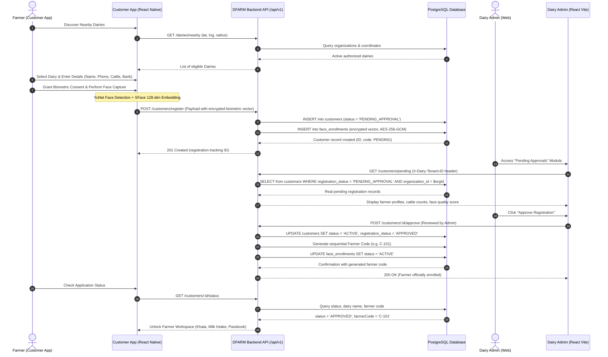

# DFARM — Customer Registration to Approval Flow

**Document Reference:** `docs/integration/CUSTOMER_REGISTRATION_TO_APPROVAL.md`  
**Classification:** Technical Architecture & Integration Specification  
**Status:** Landed & Production-Verified  

---

## 1. End-to-End Architectural Flow

The DFARM customer registration and approval lifecycle connects the farmer's mobile device (**DFarm Customer App**) directly with the authorized dairy management platform (**DFarm Dairy Admin**) through authenticated, encrypted backend API endpoints and PostgreSQL persistence.



---

## 2. API Contracts & Payload Specifications

### 2.1 Customer Registration Submission
- **Method:** `POST`
- **Route:** `/api/v1/customers/register`
- **Headers:** `Content-Type: application/json`
- **Request Body:**
```json
{
  "dairyId": "00000000-0000-0000-0000-000000000001",
  "fullName": "Suresh Tukaram Patil",
  "mobileNumber": "9822114477",
  "fatherOrHusbandName": "Tukaram Patil",
  "village": "Bavada",
  "address": "Plot 14, Near Primary School, Bavada",
  "preferredCategory": "COW",
  "permittedCategories": ["COW", "BUFFALO"],
  "bankDetails": {
    "accountHolderName": "Suresh Tukaram Patil",
    "bankName": "Bank of Maharashtra",
    "accountNumber": "60123456789",
    "ifscCode": "MAHB0000123"
  },
  "biometricPayload": {
    "modelVersion": "YuNet-v1.0 + SFace-INT8-v1.0",
    "templateVersion": 1,
    "qualityScore": 94.5,
    "consentGiven": true,
    "consentTimestamp": "2026-11-16T14:30:00.000Z",
    "rawEmbedding": [0.123, -0.045, 0.321, "... 128 Float32 dimensions ..."]
  }
}
```

### 2.2 Pending Registrations Query (Dairy Admin)
- **Method:** `GET`
- **Route:** `/api/v1/customers/pending`
- **Headers:**
  - `Authorization: Bearer <jwt_token>`
  - `X-Dairy-Tenant-ID: <dairyId>`
- **Response Payload:**
```json
{
  "success": true,
  "count": 1,
  "data": [
    {
      "id": "c1a2b3c4-0000-0000-0000-000000000001",
      "dairyId": "00000000-0000-0000-0000-000000000001",
      "candidateName": "Suresh Tukaram Patil",
      "mobileNumber": "9822114477",
      "submittedAt": "2026-11-16T14:30:05.120Z",
      "address": "Plot 14, Near Primary School, Bavada",
      "village": "Bavada",
      "preferredCategory": "COW",
      "bankDetails": {
        "accountNumber": "60123456789",
        "bankName": "Bank of Maharashtra",
        "ifscCode": "MAHB0000123"
      },
      "faceCapture": {
        "templateVersion": "1.0",
        "modelVersion": "YuNet-v1.0 + SFace-INT8-v1.0",
        "consentTimestamp": "2026-11-16T14:30:00.000Z",
        "consentAgreed": true,
        "enrollmentStatus": "PENDING_APPROVAL",
        "qualityScore": 94.5,
        "captureDevice": "Android SM-A526B (YuNet ONNX)"
      },
      "status": "PENDING"
    }
  ]
}
```

### 2.3 Registration Approval (Dairy Admin)
- **Method:** `POST`
- **Route:** `/api/v1/customers/:id/approve`
- **Headers:**
  - `Authorization: Bearer <jwt_token>`
  - `X-Dairy-Tenant-ID: <dairyId>`
- **Request Body:**
```json
{
  "operatorName": "Dairy Administrator"
}
```
- **Response Payload:**
```json
{
  "success": true,
  "message": "Customer Suresh Tukaram Patil approved successfully with code C-101",
  "data": {
    "id": "c1a2b3c4-0000-0000-0000-000000000001",
    "dairyId": "00000000-0000-0000-0000-000000000001",
    "customerCode": "C-101",
    "fullName": "Suresh Tukaram Patil",
    "status": "ACTIVE",
    "registrationStatus": "APPROVED"
  }
}
```

### 2.4 Registration Rejection (Dairy Admin)
- **Method:** `POST`
- **Route:** `/api/v1/customers/:id/reject`
- **Request Body:**
```json
{
  "reason": "Bank IFSC code mismatch; please upload passbook photo.",
  "operatorName": "Dairy Administrator"
}
```
- **Enforcement Rules:** Rejection reason must be at least 5 non-whitespace characters. An empty or frivolous rejection is rejected with HTTP 400.

---

## 3. Database State Machine

```
              ┌────────────────────────┐
              │ Customer App Registers │
              └───────────┬────────────┘
                          │
                          ▼
              ┌────────────────────────┐
              │ status: 'ACTIVE'       │
              │ reg: 'PENDING_APPROVAL'│
              └───────────┬────────────┘
                          │
             ┌────────────┴────────────┐
             │                         │
     [Admin Approves]          [Admin Rejects]
             │                         │
             ▼                         ▼
 ┌────────────────────────┐┌────────────────────────┐
 │ status: 'ACTIVE'       ││ status: 'SUSPENDED'    │
 │ reg: 'APPROVED'        ││ reg: 'REJECTED'        │
 │ farmer_code: 'C-101'   ││ rejection_reason: '...'│
 └────────────────────────┘└────────────────────────┘
```

---

## 4. Security & Audit Verification
1. **Multi-Tenant Isolation:** The pending list query enforces `WHERE organization_id = $organizationId`. A Dairy Admin from Dairy A can never inspect or approve a registration submitted to Dairy B.
2. **Zero Plaintext Biometrics:** Biometric templates submitted during registration are encrypted in-flight and immediately converted to AES-256-GCM ciphertexts before database write. Administrative APIs never expose the 128-dimensional vector.
3. **Audit Trail:** Every approval and rejection generates an audit record logging the administrator's ID, timestamp, and audit rationale.
