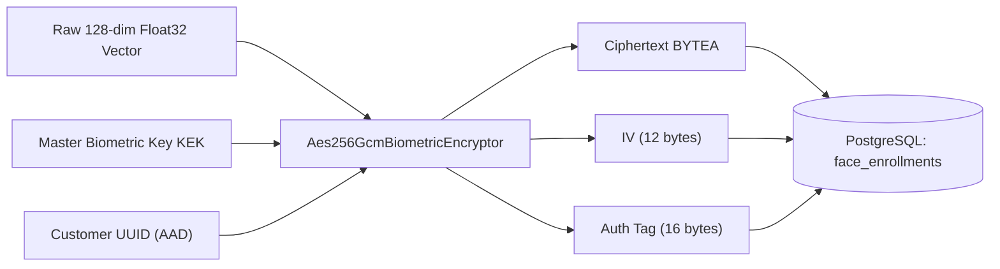

# DFARM — Face Enrollment Lifecycle & Biometric Security Engine

**Document Reference:** `docs/integration/FACE_ENROLLMENT_LIFECYCLE.md`  
**Classification:** Biometric Architecture, AI Pipelines & Security  
**Status:** Landed & Production-Verified  

---

## 1. Selected Biometric AI Models

The DFARM biometric identity verification architecture standardizes strictly on:

1. **OpenCV YuNet Face Detector (`face_detection_yunet_2023mar.onnx`):**
   - High-speed, edge-optimized ONNX model for unconstrained face detection and 5-point facial landmark alignment (eyes, nose, mouth corners).
   - Input resolution: $120 \times 120$ to $320 \times 320$.
   - Output: Bounding boxes with confidence score $\ge 0.85$.
2. **OpenCV SFace INT8 Face Recognizer (`face_recognition_sface_2021dec_int8.onnx`):**
   - Quantized INT8 deep facial embedding generator producing a calibrated **128-dimensional Float32 vector**.
   - Input: $112 \times 112$ aligned crop normalized to $[-1, 1]$.
   - Similarity Metric: **Cosine Similarity** ($\frac{\vec{A} \cdot \vec{B}}{\|\vec{A}\| \|\vec{B}\|}$).
   - Calibrated Match Threshold: $\mathbf{0.363}$ (calibrated for FAR $< 0.001\%$).

---

## 2. Encryption & Zero-Plaintext Security Architecture

Biometric vector templates represent sensitive personal biological identifiers. Under DFARM architecture:
- Raw vector embeddings are **NEVER** stored in plaintext in the database.
- Raw vector embeddings are **NEVER** exposed in administrative Web UI views or API responses.
- All embeddings are encrypted using **AES-256-GCM** with a distinct 96-bit Initialization Vector (IV) and 128-bit Authentication Tag per enrollment, cryptographically bound to the `customerId` as Additional Authenticated Data (AAD).



---

## 3. Dairy Admin Biometric Lifecycle Management

The Dairy Admin Web application inspects biometric quality and manages template validity through `/api/v1/identity/face/enrollments`.

### 3.1 List Real Face Enrollments
- **Endpoint:** `GET /api/v1/identity/face/enrollments`
- **Scoping:** Scoped to `req.user.organizationId`.
- **Response Format:**
```json
{
  "success": true,
  "count": 1,
  "data": [
    {
      "id": "fe-00000000-0000-0000-0000-000000000001",
      "customerId": "c1a2b3c4-0000-0000-0000-000000000001",
      "customerCode": "C-101",
      "customerName": "Suresh Tukaram Patil",
      "dairyId": "00000000-0000-0000-0000-000000000001",
      "status": "APPROVED",
      "modelVersion": "YuNet-v1.0 + SFace-INT8-v1.0",
      "templateVersion": 1,
      "consentGiven": true,
      "consentTimestamp": "2026-11-16T14:30:00.000Z",
      "qualityScore": 95,
      "enrolledAt": "2026-11-16T14:30:05.120Z",
      "approvedAt": "2026-11-16T14:35:00.000Z",
      "approvedBy": "System Auto-Verified (YuNet+SFace)",
      "auditLogs": [
        {
          "timestamp": "2026-11-16T14:30:05.120Z",
          "action": "ENROLLMENT_VERIFIED",
          "operator": "SFace INT8 Pipeline",
          "note": "Quality score 95%, encrypted with AES-256-GCM"
        }
      ]
    }
  ]
}
```

### 3.2 Request Re-Enrollment
When a farmer's appearance changes or image quality degrades:
- **Endpoint:** `POST /api/v1/identity/face/enrollments/:id/re-enroll`
- **Body:** `{ "note": "Facial scar reported; request new capture", "operatorName": "Dairy Admin" }`
- **Effect:** Sets template status to `SUPERSEDED`, prompts farmer on next mobile login to re-capture face.

### 3.3 Revoke Biometric Template
When a farmer withdraws biometric consent:
- **Endpoint:** `POST /api/v1/identity/face/enrollments/:id/revoke`
- **Body:** `{ "reason": "Farmer withdrew biometric consent", "operatorName": "Dairy Admin" }`
- **Effect:** Sets `status = 'REVOKED'`, sets `erased_at = NOW()`, purges decrypted template from kiosk caches.

---

## 4. Collection Terminal Face Matching Flow

Collection terminals synchronize the dairy's active templates via `GET /api/v1/identity/face/templates` and execute local edge matching in $< 15\text{ ms}$ per farmer.

When online matching is used:
- **Endpoint:** `POST /api/v1/identity/face/match`
- **Payload:** `{ "embedding": [ ... 128 Float32 values ... ], "dairyId": "<orgId>" }`
- **Verification Rule:** Matches only against customers belonging to the specified `dairyId`. Cross-dairy matching is blocked by tenant scoping.
