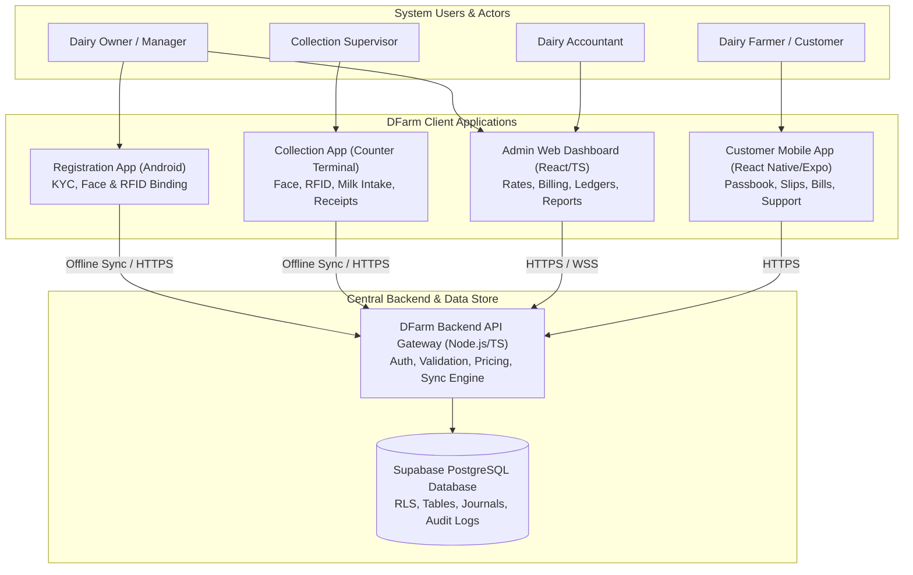

# DFarm: Smart Dairy Management System — Project Overview

## 1. Executive Summary

DFarm is an automated, enterprise-grade dairy operations platform engineered specifically for milk collection centers and dairy farm management. The platform is designed from the ground up to replace error-prone paper registers, eliminate identity mix-ups at intake counters, enforce strict milk composition pricing, provide real-time double-entry farmer accounting, and maintain continuous high-speed collection capability during rural internet blackouts.

The platform treats Cow Milk and Buffalo Milk as distinct biological and financial commodities with separate composition limits and rate matrices.

---

## 2. Core Business Problems Solved

1. **Intake Bottlenecks & Identity Fraud:** Manual lookup of farmer account numbers during peak morning and evening intake causes long queues and misattribution. DFarm introduces a tiered identification pipeline: On-Device Biometric Face Recognition $\rightarrow$ RFID Card Verification $\rightarrow$ Documented Supervisor Manual Override.
2. **Pricing Discrepancies:** Manual rate chart lookup leads to calculation errors. DFarm applies automated rate engines using dynamic Fat% and SNF% grids with historical snapshot immutability.
3. **Data Loss During Internet Outages:** Rural collection counters experience frequent network interruptions. DFarm implements an offline-first local SQLite store with a two-way sync journal and idempotent conflict resolution.
4. **Account Transparency:** Farmers frequently lack visibility into their passbook balances, deduction schedules, and cattle feed purchases. The Customer Mobile App delivers real-time collection slips, ledger statements, and monthly settlement summaries.
5. **Commingled Accounting:** Small dairies often mix internal worker payroll with farmer milk settlements. DFarm enforces structural database isolation between the Farmer Financial Ledger and Employee Payroll.

---

## 3. High-Level System Scope & Ecosystem

---

## 4. Key Architectural Guarantees

- **Canonical UUID Principle:** Every farmer is assigned an immutable RFC4122 v4 UUID. All biometrics (facial templates), physical credentials (RFID cards), milk collection records, and ledger debits/credits link to this single identifier.
- **Biometric Privacy:** No raw facial photographs are stored or uploaded to the cloud database. On-device feature extraction converts camera frames to high-dimensional embedding vectors, which are encrypted at rest using AES-256.
- **Double-Entry Ledger Integrity:** Financial balances are maintained through immutable credit and debit records. Direct balance updates are prohibited; account totals are calculated dynamically or derived through verified reconciliation.
- **Physical Hardware Deferral:** Physical analyzers (serial RS-232/USB analyzers and load-cell weighing indicators) are out of scope for development phases. DFarm establishes strict software input contracts, validation interfaces, and simulation handlers for all compositional and weight data.

