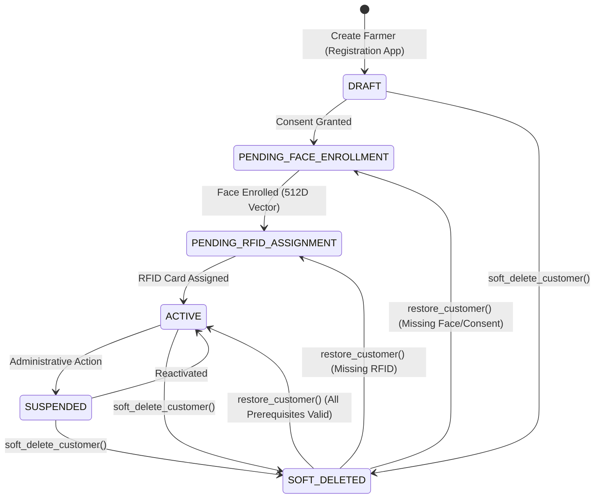

# Customer Lifecycle Validation & State Machine Specification
**DFarm — Smart Dairy Management System**  
**Remediation Deliverable 03**  

---

## 1. Customer Lifecycle State Machine

The customer lifecycle connects basic identity registration, biometric consent, facial feature enrollment, RFID credential issuance, synchronization, and soft-delete/restore operations.

---

## 2. Circular Dependency Resolution

### Pre-Remediation Circular Issue:
- P06 created a customer in `DRAFT` status (`registration_status = 'IN_PROGRESS'`).
- P07 biometric enrollment endpoint required customer status to be `ACTIVE` before accepting face templates.
- P08 RFID assignment required customer status to be `ACTIVE` or face-enrolled.
- The customer could never become `ACTIVE` because activation depended on Face and RFID completion.

### Remediated Sequence:
1. **Creation**:
   - `public.register_customer()` or `POST /api/v1/customers` creates customer in status `DRAFT` (or `PENDING_FACE_ENROLLMENT` when consent is logged).
   - `registration_status` is explicitly set to `'IN_PROGRESS'`.
2. **Biometric Enrollment**:
   - `POST /api/v1/biometrics/enroll` accepts customers in `DRAFT` or `PENDING_FACE_ENROLLMENT` status.
   - Enforces valid unrevoked biometric consent (`customer_consent_records`).
   - Upon successful 512D embedding storage, customer status transitions to `PENDING_RFID_ASSIGNMENT` (with `registration_status = 'IN_PROGRESS'`).
3. **RFID Card Assignment**:
   - `POST /api/v1/rfid/assign` accepts customers in `PENDING_RFID_ASSIGNMENT` status.
   - Verifies canonical Customer UUID, unassigned card UID, and active face enrollment.
   - Upon successful card assignment, customer status transitions to `ACTIVE` and `registration_status` transitions to `'COMPLETED'`.
4. **Collection Eligibility**:
   - Only customers in status `ACTIVE` and `is_deleted = false` are eligible for milk intake sessions.

---

## 3. Database Check Constraints & Consistency

The PostgreSQL database enforces the following constraints:
- `chk_customer_status`: Only allows values `('DRAFT', 'PENDING_FACE_ENROLLMENT', 'PENDING_RFID_ASSIGNMENT', 'PENDING_SYNC', 'ACTIVE', 'SUSPENDED', 'INACTIVE', 'REJECTED')`.
- `chk_customer_registration_status`: Only allows values `('IN_PROGRESS', 'COMPLETED', 'REJECTED')`.
- Soft deleted customers have `is_deleted = TRUE`, `deleted_at IS NOT NULL`, and `deleted_by IS NOT NULL`.

---

## 4. Atomic Lifecycle RPCs

### 4.1 `public.soft_delete_customer(p_customer_id, p_deleted_by, p_reason)`
- Sets `is_deleted = TRUE`.
- Sets `deleted_at = CLOCK_TIMESTAMP()`.
- Sets `deleted_by = p_deleted_by`.
- Sets `status = 'SUSPENDED'` (or preserved as inactive).
- Generates a tombstone entry in `sync_tombstones` (`entity_name = 'customers'`).
- Generates durable `sync_events` entry for offline device invalidation.
- Inserts audit log in `customer_audit_log`.

### 4.2 `public.restore_customer(p_customer_id, p_restored_by, p_reason)`
- Hardened in Migration 015:
  1. Validates that operator possesses administrative privileges.
  2. Checks `customer_consent_records` for active biometric consent.
  3. Checks `face_enrollments` for active enrollment.
  4. Checks `rfid_card_assignments` for active card assignment.
  5. Determines target status dynamically:
     - Missing consent or face template -> `PENDING_FACE_ENROLLMENT`
     - Missing RFID assignment -> `PENDING_RFID_ASSIGNMENT`
     - All prerequisites intact -> `ACTIVE`
  6. Sets `is_deleted = FALSE`, `deleted_at = NULL`, `deleted_by = NULL`.
  7. Clears matching tombstone from `sync_tombstones`.
  8. Emits `sync_events` to restore customer on distributed edge devices.
