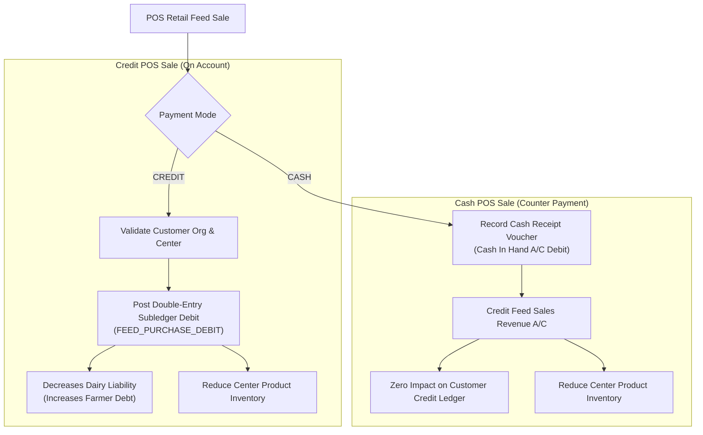

# DFarm Cattle Feed Inventory & POS Accounting Audit

**Document Reference:** `DFARM-FEED-AUDIT-006`  
**Classification:** Inventory Valuation & POS Accounting Audit  
**Auditor:** Principal Dairy Software Architect & Financial Systems Auditor  
**Date:** November 14, 2026  
**Scope:** Phase 14 (Cattle Feed Inventory, Procurement, Sales & Stock Accounting).  
**Status:** AUDITED, HARDENED & VERIFIED  

---

## 1. Inventory Costing & Weighted Average Cost (WAC)

### Exact Arithmetic Standard
To eliminate rounding drift across thousands of retail inventory transactions, DFarm strictly forbids JavaScript floating-point arithmetic (`Math.round`, float IEEE-754) for authoritative inventory valuation. All inventory cost calculations are executed in PostgreSQL using exact `NUMERIC(12,4)` arithmetic.

### Weighted Average Cost Formula
Upon receiving stock from a purchase order into `center_product_inventory`:

$$\text{New WAC} = \frac{(\text{Current Qty} \times \text{Current WAC}) + (\text{Received Qty} \times \text{Purchase Unit Cost})}{\text{Current Qty} + \text{Received Qty}}$$

When stock is sold or transferred, the inventory asset account is credited using the current WAC, and Cost of Goods Sold (COGS) is debited at exact WAC.

---

## 2. Cash vs. Credit POS Sales Accounting

DFarm strictly bifurcates retail POS transactions at the counter to maintain clean customer balance sheets:

### Invariants Enforced:
1. **Cash Sales Never Create Customer Debt:** Cash sales record immediate payment in the register and do not inflate the customer's accounts receivable.
2. **Credit Sales Organization Scoping:** Credit feed sales verify that the customer belongs strictly to the same organization as the collection center (`c.organization_id = p.organization_id`). Mismatched transactions are rejected with `Customer organization mismatch`.
3. **No Negative Stock:** Sales transactions execute `SELECT quantity_on_hand FROM center_product_inventory ... FOR UPDATE`. If requested quantity exceeds stock on hand, the transaction is rejected with `INSUFFICIENT_STOCK`.

---

## 3. Stock Lifecycle & Movement Types

All inventory movements are recorded in `stock_movements` as an append-only audit trail:

| Movement Type | Source / Direction | Inventory Impact | Accounting Impact |
| :--- | :--- | :--- | :--- |
| `PURCHASE_RECEIPT` | Inbound from Supplier | Increase Stock | Credit Supplier Payable, Debit Inventory Asset |
| `POS_SALE_CASH` | Outbound to Counter Customer | Decrease Stock | Debit Cash Clearing, Credit Sales Revenue, Debit COGS |
| `POS_SALE_CREDIT` | Outbound to Registered Farmer | Decrease Stock | Debit Farmer Subledger, Credit Sales Revenue, Debit COGS |
| `SALES_RETURN` | Inbound from Customer Return | Increase Stock | Credit Farmer Subledger (or Cash), Re-instate Inventory |
| `DAMAGE_WRITE_OFF` | Damaged / Expired Bags | Decrease Stock | Debit Inventory Shrinkage Expense, Credit Inventory Asset |
| `INTER_CENTER_TRANSFER` | Center A $\rightarrow$ Center B | Transit / Transfer | Dual movements linked by `transfer_id` |

---

## 4. Integration with Phase 13 Monthly Billing

During monthly billing generation:
1. The billing engine queries `FEED_PURCHASE_DEBIT` transactions recorded in `ledger_transactions` for the active period.
2. It deduplicates against already billed feed debits.
3. Total feed debits are subtracted from gross milk proceeds:
   $$\text{Net Payable} = \text{Gross Milk Amount} - \text{Feed Purchases Debit} - \text{Advances Debit} - \text{Deductions}$$
4. Every feed purchase appears as an individual line item in `monthly_bill_items` with reference to the original POS sale ID.
