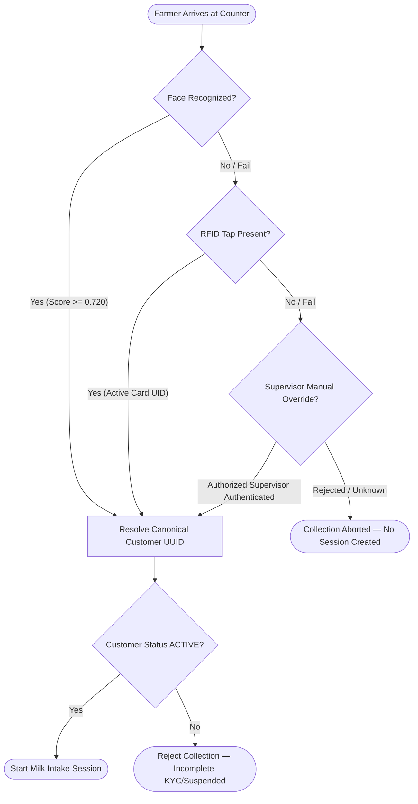

# Customer Identification & Tri-Modal Resolution Validation
**DFarm — Smart Dairy Management System**  
**Remediation Deliverable 06**  

---

## 1. Tri-Modal Identification Framework

DFarm establishes exactly three approved identification methods for milk collection sessions:
1. **Face Recognition** (Biometric matching).
2. **RFID Card Verification** (NFC / Mifare UID matching).
3. **Supervisor Manual Verification** (Farmer code search with supervisor biometric/credential sign-off).

### Priority Order:
$$\text{FACE} \longrightarrow \text{RFID} \longrightarrow \text{SUPERVISOR MANUAL}$$

---

## 2. Canonical Customer UUID Guarantee

Every identification method must resolve to the identical canonical server-generated Customer UUID:
- **Face Recognition**: Matches 512D probe against enrolled templates in `face_enrollments` -> retrieves `customer_id`.
- **RFID Verification**: Matches normalized card UID against `rfid_card_assignments` where `is_active = TRUE` -> retrieves `customer_id`.
- **Supervisor Manual**: Supervisor searches `farmer_code` or `mobile_number` -> retrieves `customer_id`, requiring explicit `supervisor_id` audit attribution.

**Critical Security Rule**:
- **Zero Nearest-Candidate Guessing**: If face recognition confidence falls below threshold (cosine distance > 0.720 or similarity < 0.720), the system must reject identification. It must **never** pick the nearest neighbor.
- **Unknown Persons Blocked**: Unidentified individuals cannot create draft sessions or post intake transactions.

---

## 3. Physical Hardware Boundary Enforcement

Physical Hardware Integration remains strictly **DEFERRED**:
- No physical RFID USB/UART/Wiegand drivers are integrated.
- No physical RS232 weighing scale or ultrasonic milk analyzer drivers are integrated.

### UI & Adapter Compliance:
All Android and backend components are updated with truthful labeling:
- Source Label: `SOFTWARE MANUAL UID ENTRY — PHYSICAL READER DEFERRED`.
- Measurement Source: `MANUAL_OPERATOR_ENTRY`.
- Hardware Status Flag: `isPhysicalReader = false`.
