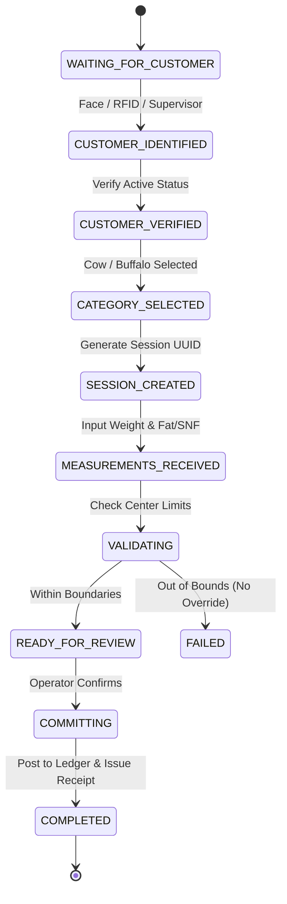

# Milk Collection & Financial Ledger Validation Report
**DFarm — Smart Dairy Management System**  
**Remediation Deliverable 09**  

---

## 1. Collection Session State Machine

The milk intake workflow executes a strictly validated state machine preventing incomplete, fraudulent, or duplicated collections.

---

## 2. Rate Calculation Rules

DFarm supports 3 pricing modes defined in `rate_charts` (`chk_rate_chart_pricing_type`):
1. **GRID (Default Matrix Lookup)**:
   - 2D matrix keyed by exact (Fat%, SNF%) increments (typically 0.1%).
   - Exact match lookup yields `rate_per_kg` or `rate_per_litre`.
   - If exact cell is unpopulated, nearest cell is prohibited; calculation fails safely.
2. **TOTAL_SOLIDS_FORMULA**:
   - $\text{Rate} = (\text{Fat\%} \times C_{\text{fat}}) + (\text{SNF\%} \times C_{\text{snf}})$.
3. **TWO_AXIS_FORMULA**:
   - Base rate adjusted by linear premiums/deductions for deviations from standard (e.g. 3.5/8.5 for Cow, 6.5/9.0 for Buffalo).

### Amount Calculation & Rounding:
$$\text{Total Payable} = \text{Quantity} \times \text{Applied Rate}$$
- Financial rounding follows standard **HALF_EVEN** (Banker's Rounding) to 2 decimal places.

---

## 3. Financial Ledger & Double-Entry Accounting

Intake commit automatically posts immutable ledger entries:
- **Debit**: Milk Inventory / Purchases Account (Expense / Asset).
- **Credit**: Customer Payable Account (Liability).

### Financial Invariants:
1. Every collection transaction has an immutable `idempotency_reference`. Duplicate submissions yield the original transaction and receipt without duplicate ledger postings.
2. Direct balance updates are prohibited; customer balance is derived by summing verified ledger transactions.
3. Once committed, a session cannot be mutated. Adjustments require explicit reversal records (`CORRECTION` or `FULL_REVERSAL`).

---

## 4. Tamper-Evident Receipt Generation

Every receipt generated upon collection completion includes a cryptographic verification hash:
$$\text{Verification Hash} = \text{SHA256}(\text{session\_uuid} \mathbin{\Vert} \text{customer\_id} \mathbin{\Vert} \text{business\_date} \mathbin{\Vert} \text{shift} \mathbin{\Vert} \text{weight} \mathbin{\Vert} \text{fat} \mathbin{\Vert} \text{snf} \mathbin{\Vert} \text{total\_amount} \mathbin{\Vert} \text{salt})$$
This guarantees that printed or transmitted receipts cannot be forged or altered.
