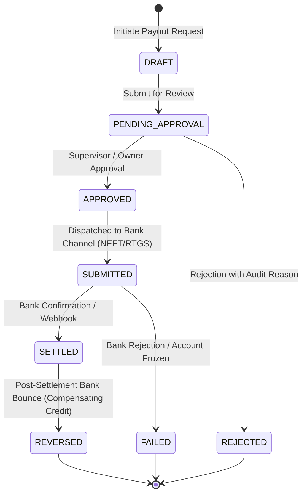

# DFarm Customer Payments & Bank Reconciliation Security Audit

**Document Reference:** `DFARM-PAY-SEC-007`  
**Classification:** Financial Security & Payment Engine Audit  
**Auditor:** Senior Security Engineer & Financial Systems Auditor  
**Date:** November 14, 2026  
**Scope:** Phase 15 (Customer Payouts, Batches, Webhooks & Bank Statement Reconciliation).  
**Status:** HARDENED & VERIFIED  

---

## 1. Payout State Machine & Settlement Lifecycle

All disbursements follow a strictly ordered state machine. No funds may move or affect the general ledger prematurely:



### Settlement Posting Invariant
Only the `confirmPayout()` routine (triggered upon receiving authentic bank statement confirmation or signed payment provider webhook) is permitted to transition a payout to `SETTLED`. **Zero ledger rows are created while a payout is in `DRAFT`, `PENDING_APPROVAL`, or `SUBMITTED` status.**

---

## 2. Foreign Key Sequencing Fix (`fk_payout_batch`)

### Root Cause of Test Failures
In `services/backend/src/modules/payments/batch.service.ts`, `createBatch()` initially iterated over eligible beneficiaries and executed:
```typescript
INSERT INTO customer_payouts (..., batch_id, ...) VALUES (..., batchId, ...);
```
Before executing:
```typescript
INSERT INTO payment_batches (id, ...) VALUES (batchId, ...);
```
PostgreSQL's immediate foreign key constraint checking threw `23503 foreign key violation: insert or update on table "customer_payouts" violates foreign key constraint "fk_payout_batch"`.

### Applied Remediation
The transaction order was inverted:
1. `INSERT INTO payment_batches` executes first, establishing the parent batch entity.
2. `INSERT INTO customer_payouts` executes second, correctly referencing the valid parent `batch_id`.
3. `INSERT INTO payment_batch_items` executes third, completing the relational hierarchy.

---

## 3. UPI Settlement Security Standard

### The Threat
Treating a farmer-supplied or counter-entered UPI reference number as immediate proof of settlement allows fraudulent balance depletion without verified bank account credits.

### Security Invariants Enforced:
1. Entering a UPI reference creates a payout in `PENDING_APPROVAL` status.
2. A UPI transaction is marked `SETTLED` **only** upon:
   - Receipt of a cryptographically signed HMAC-SHA256 webhook from an authenticated payment provider (`x-webhook-signature`); OR
   - Reconciliation against an official bank account statement CSV containing the matching UTR and amount.
3. Unverified customer-provided transaction IDs are treated strictly as reference metadata and never trigger ledger balance debits.

---

## 4. Bank CSV Statement Import & Reconciliation Engine

The statement reconciliation engine processes multi-row bank statements with defensive validation:
1. **Reference Matching:** Matches bank UTR / transaction references against payouts in `SUBMITTED` state.
2. **Duplicate Reference Detection:** If a CSV contains multiple rows with the identical bank reference number, the engine flags duplicate rows in `summary.duplicateCount` and quarantines them from double-settlement.
3. **Amount Mismatch Detection:** If the reference matches but the statement amount differs from the registered payout amount (e.g. ₹750 vs. ₹850), the transaction is flagged with `AMOUNT_MISMATCH` and sent to supervisor exception review.

---

## 5. Separation of Duties & RBAC Audit

1. **Self-Approval Prohibition:** The creator of a payout (`created_by`) is barred from approving that payout (`approved_by`), unless the actor holds top-level `DAIRY_OWNER` or `SUPER_ADMIN` credentials.
2. **Operator Access Restriction:** `COLLECTION_OPERATOR` accounts are barred from approving payouts, submitting batches, or importing bank statements.
3. **External Gateway Dependencies:** Live connection to production bank APIs (e.g. ICICI Corporate Banking, HDFC SmartHub, RazorpayX) requires external API keys and corporate banking digital certificates. In their absence, mock provider adapters are utilized for local testing, and production connectivity is truthfully classified as `BLOCKED BY EXTERNAL DEPENDENCY`.
