# DFarm: Security & Data Protection Architecture

This document defines the cryptographic standards, credential isolation rules, communication security protocols, and biometric privacy safeguards implemented across the DFarm ecosystem.

---

## 1. Threat Model & Security Principles

```mermaid
graph TD
    subgraph Client_Attack_Surface [Client Layer Threats]
        ReverseAPK[APK Decompilation & Reverse Engineering]
        StolenDevice[Stolen Counter Terminal / Offline DB Extraction]
        FakeCamera[Presentation Attack / Photo Spoofing]
    end

    subgraph Transport_Threats [Transport Layer Threats]
        MITM[Man-In-The-Middle Eavesdropping]
        ReplaySync[Replay Attack on Offline Sync Batches]
    end

    subgraph Server_Threats [Cloud & Server Layer Threats]
        KeyLeakage[Service-Role Secret Leakage]
        PrivEscalation[Horizontal / Vertical Privilege Escalation]
        DataTampering[Unauthorized Financial Ledger Alteration]
    end

    ReverseAPK -->|Mitigation: Zero Server Secrets in APK + ProGuard/R8| Defense1[Secure Client Sandbox]
    StolenDevice -->|Mitigation: Encrypted SQLite SQLCipher + Key Derivation| Defense2[Encrypted At-Rest Storage]
    FakeCamera -->|Mitigation: Passive Liveness + Face Pose Gates| Defense3[Biometric Liveness Engine]
    MITM -->|Mitigation: TLS 1.3 + Certificate Pinning| Defense4[Transport Encryption]
    ReplaySync -->|Mitigation: Unique Event UUIDs + Nonces + Idempotency Keys| Defense5[Idempotent Sync Gateway]
    KeyLeakage -->|Mitigation: Strict Server-Only Secrets + Public Anon Key in Frontend| Defense6[Credential Segregation]
    PrivEscalation -->|Mitigation: Supabase PostgreSQL Row Level Security RLS| Defense7[Database-Enforced RLS]
    DataTampering -->|Mitigation: Append-Only Immutable Ledgers + Cryptographic Signatures| Defense8[Immutable Financial Store]
```

---

## 2. Credential Segregation & Client Token Safety

### 2.1 The Cardinal Secret Rule
Under no circumstances may a server-side secret (such as the Supabase `service_role` key, database master credentials, payment gateway secret keys, or private signing keys) be bundled into:
- React frontend web applications (`apps/admin-web/`)
- Android application APKs or bundles (`apps/registration-android/`)
- Collection counter desktop/tablet applications (`apps/collection-app/`)
- Customer Mobile App bundles (`apps/customer-mobile/`)
- Public Git repositories or issue trackers

### 2.2 Client Token Usage
Client applications communicate exclusively with:
1. The DFarm Backend API using short-lived JWT access tokens issued upon verified user authentication.
2. The Supabase client initialized strictly with the public `VITE_SUPABASE_ANON_KEY` or `EXPO_PUBLIC_SUPABASE_ANON_KEY`, where access is governed entirely by database Row Level Security (RLS) policies.

---

## 3. Cryptography & Encryption Standards

### 3.1 Data in Transit
All network communications between edge devices, web clients, and backend services enforce **TLS 1.3** (with TLS 1.2 minimum fallback). Unencrypted HTTP traffic is rejected at the load balancer / reverse proxy.

### 3.2 Biometric Template Encryption at Rest
Biometric facial embedding vectors represent sensitive personal data. They are encrypted using **AES-256-GCM** before persistence in either local SQLite or central PostgreSQL:
- **Cipher:** AES-256-GCM with 96-bit random Initialization Vector (IV) generated per record.
- **Integrity Tag:** 128-bit authentication tag stored alongside ciphertext to detect tampering.
- **Key Management:** Encryption keys are injected into backend and authorized edge runtimes via secure environment variables (`DATA_ENCRYPTION_KEY_HEX`) and hardware keystores (Android Keystore / Windows DPAPI).

### 3.3 Ephemeral Biometric Frame Processing
Raw camera frames obtained during registration or intake identification are held strictly in volatile RAM for the sub-second duration of landmark detection and vector generation. Camera frames are **never flushed to disk**, uploaded to cloud servers, or logged in crash reports.

---

## 4. Edge Terminal Security & Device Binding

1. **Hardware Device Registration:** Each collection counter terminal generates a unique cryptographic keypair upon installation. The public key is registered with the dairy central server.
2. **Device-Signed Sync Payloads:** Offline synchronization batches are signed by the device private key, ensuring that sync events cannot be injected by unauthorized devices.
3. **Local Database Encryption:** Edge SQLite databases on mobile and desktop terminals utilize SQLCipher with AES-256 encryption, preventing unauthorized data extraction if a physical device is stolen.

---

## 5. Audit Logging & Non-Repudiation

An immutable audit trail is maintained in PostgreSQL (`identification_audit_logs`, `audit_events`):
- All supervisor identification overrides record supervisor UUID, customer UUID, reason code, and timestamp.
- Customer deletions, restorations, rate chart activations, and monthly billing approvals emit audit events.
- Audit tables are append-only; update and delete privileges are revoked from all application user roles.

