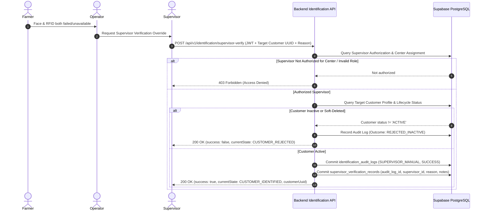

# DFarm: Supervisor Manual Verification Security & Override Governance

This document describes the security architecture, authorization barriers, justification requirements, and audit integrity safeguards governing the **Supervisor Manual Verification** method (Identification Method 3) in the DFarm milk collection system.

---

## 1. Governance Principles & Strict Constraints

Supervisor Manual Verification is strictly an exception-handling mechanism. It is only accessible when automated biometric and RFID verification fail or are physically unavailable.

The system enforces four immutable security rules:

1. **Anti-Impersonation Rule**:
   Operators (`COLLECTION_OPERATOR`) cannot impersonate or execute manual verifications on behalf of a supervisor. Attempts to invoke `/api/v1/identification/supervisor-verify` by non-supervisory roles return HTTP 403 Forbidden.

2. **Center Scoping & Isolation**:
   Supervisors can only approve overrides for centers to which they are explicitly assigned via `user_center_assignments`. Cross-center overrides are blocked unless the user holds global managerial roles (`DAIRY_OWNER`, `SUPER_ADMIN`).

3. **Non-Bypass of Account Status**:
   Supervisors **cannot** bypass soft-deleted (`is_deleted = TRUE`) or inactive customer accounts. If an account is suspended or soft-deleted, the override request is rejected with `CUSTOMER_REJECTED`. Re-enabling deleted accounts requires an administrative reactivation process.

4. **Mandatory Justification Taxonomy & Notes**:
   Every supervisor manual verification requires a categorized justification code and descriptive notes ($\ge 5$ characters). Submissions with missing or empty notes are rejected.

---

## 2. Permitted Justification Categories

| Category Code | Description | Example Operational Scenario |
| :--- | :--- | :--- |
| `FACIAL_INJURY` | Temporary or permanent facial trauma preventing biometric match. | Farmer with medical bandage or facial swelling. |
| `LIGHTING_CAMERA_DEFECT` | Environmental or hardware defect inhibiting camera image capture. | Direct severe sunlight glare or damaged lens. |
| `CARD_DAMAGED` | Physical RFID card is cracked, chipped, or unreadable by software reader. | Damaged antenna coil or worn RFID chip. |
| `CARD_FORGOTTEN` | Farmer forgot their RFID card at their homestead. | Farmer arrived without card; passbook verified. |
| `OTHER_DOCUMENTED` | Other verified exceptional operational circumstances. | Approved identity correction with detailed explanation. |

---

## 3. Override Authentication & Audit Pipeline

---

## 4. Immutable Audit Ledger

Every supervisor verification produces two linked, append-only database records:

1. `identification_audit_logs`:
   - `id`: Unique UUID of the identification attempt.
   - `identification_method`: `'SUPERVISOR_MANUAL'`.
   - `verification_outcome`: `'SUCCESS'` or `'REJECTED_INACTIVE'`.
   - `supervisor_id`: UUID of the authenticated supervisor.
   - `supervisor_reason_code`: The selected category taxonomy code.
   - `device_id`: Device identifier where the override was requested.
   - `recorded_at`: Tamper-evident timestamp (`TIMESTAMPTZ DEFAULT NOW()`).

2. `supervisor_verification_records`:
   - `audit_log_id`: Foreign key referencing the parent audit log.
   - `supervisor_id`: Authenticated supervisor user UUID.
   - `customer_id`: Target customer UUID resolved by the override.
   - `center_id`: Collection center UUID.
   - `reason_category`: Categorized justification code.
   - `justification_notes`: Detailed plain-text explanation entered by supervisor.
   - `authenticated_via`: Credentials used (`PIN`, `PASSWORD`, `BIOMETRIC`).
