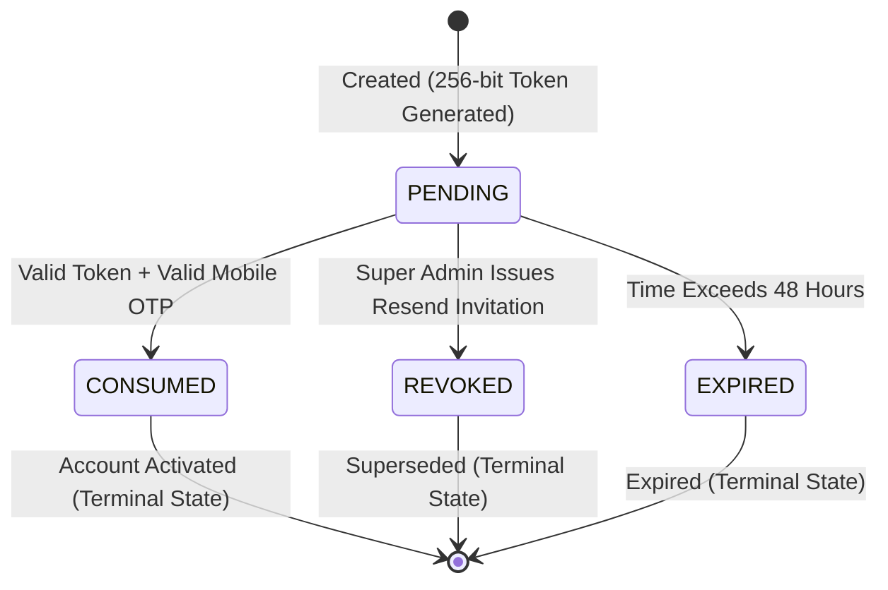

# DFarm Super Admin — Cryptographic Activation Token Security Specification

## Security Overview

The DFarm multi-tenant platform employs a zero-trust cryptographic token model for Primary Dairy Admin invitations. Activation tokens grant administrative authority over an entire dairy tenant, its financial ledger, member milk collection transactions, and staff permissions. Consequently, the token generation, persistence, and verification architecture complies with the highest standards of cryptographic security.

---

## 1. Token Generation & Entropy

Activation tokens are generated using the platform's operating system cryptographically secure pseudorandom number generator (CSPRNG):

```typescript
import crypto from 'node:crypto';

// 256 bits of cryptographic entropy (32 bytes = 64 hexadecimal characters)
const rawToken = crypto.randomBytes(32).toString('hex');
```

### Cryptographic Properties:
- **Entropy:** $2^{256}$ possible combinations, eliminating any possibility of brute-force enumeration, collision, or prediction.
- **Character Set:** URL-safe hexadecimal encoding (`[0-9a-f]{64}`).
- **Decoupled Identity:** The token carries zero readable metadata, timestamps, tenant IDs, or personal identification in plaintext.

---

## 2. Secure Hash Storage Policy

To defend against database breaches, internal access leaks, and SQL injection vectors, **the plaintext token is never stored in the database**:

```typescript
const tokenHash = crypto.createHash('sha256').update(rawToken).digest('hex');
```

1. **Only the Hash is Persisted:** The database table `dairy_admin_invitations` stores strictly the `token_hash` column.
2. **Zero-Knowledge Token Verification:** When an admin submits a token via `/activate?token=<rawToken>`, the server hashes the input with SHA-256 and searches for the matching `token_hash`.
3. **No Logging Policy:** Application loggers (Pino, console) are configured to exclude `rawToken`. Loggers record only masked emails, delivery statuses, or truncated invitation IDs.

---

## 3. Database Schema: `dairy_admin_invitations`

Created via Supabase migration `029_dairy_admin_activation_tokens.sql`:

```sql
CREATE TABLE IF NOT EXISTS dairy_admin_invitations (
  id UUID PRIMARY KEY DEFAULT gen_random_uuid(),
  dairy_id UUID NOT NULL REFERENCES organizations(id) ON DELETE CASCADE,
  admin_id UUID NOT NULL REFERENCES users(id) ON DELETE CASCADE,
  email TEXT NOT NULL,
  token_hash VARCHAR(64) NOT NULL UNIQUE,
  status VARCHAR(20) NOT NULL DEFAULT 'PENDING'
    CHECK (status IN ('PENDING', 'CONSUMED', 'EXPIRED', 'REVOKED')),
  delivery_status VARCHAR(20) NOT NULL DEFAULT 'PENDING'
    CHECK (delivery_status IN ('PENDING', 'ACCEPTED', 'DELIVERED', 'FAILED')),
  delivery_provider VARCHAR(50),
  delivery_message_id TEXT,
  delivery_error TEXT,
  created_at TIMESTAMPTZ NOT NULL DEFAULT NOW(),
  expires_at TIMESTAMPTZ NOT NULL,
  consumed_at TIMESTAMPTZ,
  revoked_at TIMESTAMPTZ
);

CREATE INDEX IF NOT EXISTS idx_dairy_invitations_token_hash 
  ON dairy_admin_invitations(token_hash);
CREATE INDEX IF NOT EXISTS idx_dairy_invitations_dairy_status 
  ON dairy_admin_invitations(dairy_id, status);
```

---

## 4. Lifecycle & State Machine

An invitation token traverses a strict, non-reversible state machine:



### State Definitions:
1. **PENDING:** Active, unconsumed token within its 48-hour validity period.
2. **CONSUMED:** Single-use execution completed. The Primary Admin has verified mobile OTP. Any subsequent presentation of this token returns HTTP 400 `ALREADY_CONSUMED`.
3. **REVOKED:** A Super Admin triggered `Resend Activation Invitation`. All previously pending invitations for this dairy are immediately transitioned to `REVOKED`. The old link cannot be used.
4. **EXPIRED:** Validity timestamp (`expires_at = created_at + 48 hours`) has passed.

---

## 5. Security Measures Comparison

| Property | Legacy Implementation | Current Cryptographic Architecture |
| :--- | :--- | :--- |
| **Token Format** | Public code (`DF-SAN-7082`) | 256-bit random hex (`crypto.randomBytes(32)`) |
| **Entropy** | Low (~14 bits) | High (256 bits) |
| **Database Storage** | No persistence table | Stored strictly as SHA-256 hash |
| **Single-Use Guard** | None | Marked `CONSUMED` transactionally |
| **Expiration Window** | Indefinite / Undefined | Strict 48-hour timeout |
| **Revocation Model** | None | Previous tokens revoked on fresh resend |
| **Exposure Protection** | Exposed in plaintext URLs | One-time transport to recipient email |
