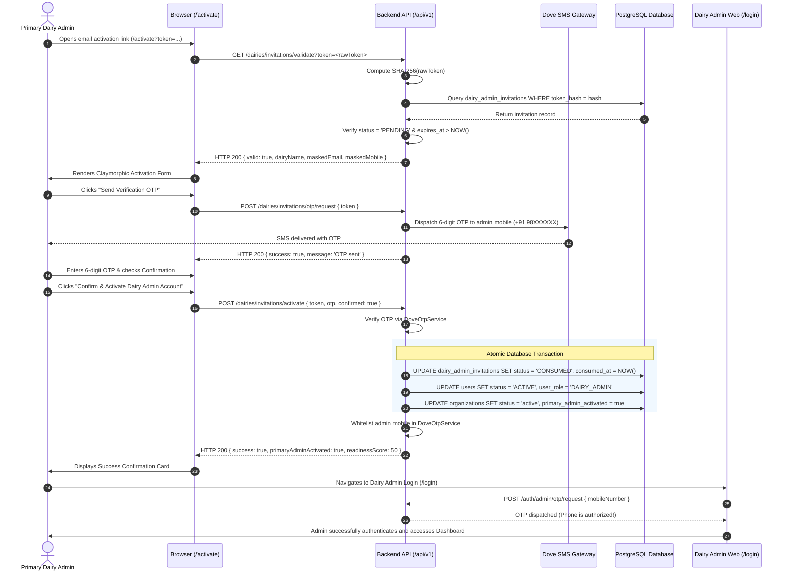

# DFarm Super Admin — Primary Admin Activation End-to-End Workflow

## Workflow Overview

The DFarm Primary Dairy Admin activation workflow transitions a newly provisioned tenant from a draft onboarding state into an active, operational dairy organization. The workflow combines high-entropy cryptographic token validation, two-factor SMS OTP authentication, transactional database updates, and immediate authorization for the Dairy Admin Portal.

---

## 1. End-to-End Sequence Diagram



---

## 2. Step-by-Step Workflow Stages

### Stage 1: Invitation Verification (`GET /invitations/validate`)
1. User clicks or pastes the activation link into any standard browser.
2. The page parses the `token` URL query parameter.
3. The client calls `GET /api/v1/dairies/invitations/validate?token=<token>`.
4. The server computes `SHA-256(token)` and evaluates the record:
   - **Invalid Token:** Returns HTTP 404 `INVALID_TOKEN`.
   - **Already Consumed:** Returns HTTP 400 `ALREADY_CONSUMED`.
   - **Revoked Token:** Returns HTTP 400 `INVITATION_REVOKED`.
   - **Expired Token (> 48h):** Returns HTTP 400 `INVITATION_EXPIRED`.
   - **Valid Token:** Returns HTTP 200 with masked contact details (`ad***@dairy.org`, `+91 ******5615`) and dairy metadata.

### Stage 2: Two-Factor Mobile OTP Verification
1. To ensure the person activating the tenant physically possesses the authorized mobile device, the administrator clicks **Send Verification OTP**.
2. The server issues a high-entropy 6-digit numeric OTP via the **Dove SMS Gateway** directly to the administrator's registered mobile number.
3. The OTP session is valid for 5 minutes with a maximum attempt limit.

### Stage 3: Atomic Transactional Activation
Upon OTP entry and policy confirmation, the client executes `POST /api/v1/dairies/invitations/activate`:

```sql
BEGIN;

-- 1. Mark token consumed (single-use enforcement)
UPDATE dairy_admin_invitations
SET status = 'CONSUMED', consumed_at = NOW()
WHERE token_hash = $1 AND status = 'PENDING';

-- 2. Activate Primary Dairy Admin User
UPDATE users
SET status = 'ACTIVE', activated_at = NOW(), user_role = 'DAIRY_ADMIN'
WHERE id = $2;

-- 3. Update Organization Operational Readiness
UPDATE organizations
SET status = 'active', activated_at = NOW()
WHERE id = $3;

COMMIT;
```

---

## 3. Operational Readiness Scoring Rules

When a Dairy Tenant is initially provisioned by a Super Admin:
- **Business Profile Complete:** `true` (25%)
- **Primary Admin Activated:** `false` (0%)
- **Hardware Synced:** `false` (0%)
- **Staff Trained:** `false` (0%)
- **Initial Score:** **25%**

When the Primary Admin completes the activation link and mobile OTP:
- **Primary Admin Activated:** Transitions to `true` (+25%)
- **Updated Score:** **50%**
- **Hardware Synced & Staff Trained Invariant:** Crucially, the activation workflow does **not** falsely mark hardware synced or collection staff trained. These remain `false` until physical smart milk kiosks are paired and staff members complete certification.

---

## 4. Immediate Dairy Admin Portal Authorization

Previously, newly activated admins were blocked from logging into the Dairy Admin web app because `DoveOtpService` checked a static environment variable.

The activation endpoint now invokes:
```typescript
doveOtpService.registerAuthorizedAdminPhone(invitation.adminMobile);
```

When the newly activated admin navigates to `https://dairy.dfarm.in/login`, enters their 10-digit mobile number, and requests an OTP, the system recognizes the number as an authorized Primary Dairy Admin, dispatches the login OTP, and allows full dashboard access.
