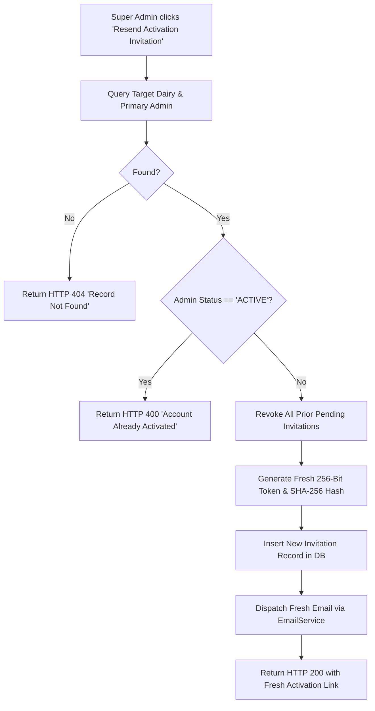

# DFarm Super Admin — Secure Resend Invitation Specification & Invalidation Architecture

## Overview

In multi-tenant operations, email invitations may fail to reach recipients due to temporary mailbox issues, aggressive spam filtering, or expiration after the 48-hour window. The DFarm Super Admin platform provides a hardened **Resend Activation Invitation** capability that generates fresh cryptographic credentials while strictly preventing duplicate tenant records or credential hijacking.

---

## 1. Core Principles of Resend Flow

1. **Strict Idempotency:** Invoking resend **never** provisions a duplicate dairy organization or creates duplicate user rows in `users`. It operates strictly on the existing Dairy ID and Primary Admin ID.
2. **Prior Token Invalidation:** When a new invitation is issued, all previous pending invitations for that organization are immediately updated to `REVOKED`. The previous link becomes instantly inert.
3. **Fresh Cryptographic Entropy:** Each resend generates a new 256-bit random token (`crypto.randomBytes(32)`), resets the 48-hour expiration timer, and persists only the SHA-256 hash.
4. **Already Activated Safeguard:** Resend is strictly blocked if the Primary Admin has already activated their account. This prevents credential usurpation or accidental invalidation of active sessions.

---

## 2. API Contract: `POST /api/v1/dairies/invitations/resend`

### Request Payload:
```json
{
  "dairyId": "dairy-uuid-101",
  "adminId": "user-uuid-202"
}
```
*(Either `dairyId` or `adminId` is accepted)*

### Business Rules & Execution Pipeline:


### Database Updates:
```sql
-- 1. Invalidate previous pending tokens
UPDATE dairy_admin_invitations
SET status = 'REVOKED', revoked_at = NOW()
WHERE dairy_id = $1 AND status = 'PENDING';

-- 2. Insert fresh invitation
INSERT INTO dairy_admin_invitations (
  id, dairy_id, admin_id, email, token_hash, status, delivery_status,
  delivery_provider, delivery_message_id, created_at, expires_at
) VALUES (
  $2, $1, $3, $4, $5, 'PENDING', $6, $7, $8, NOW(), NOW() + INTERVAL '48 hours'
);
```

---

## 3. Super Admin UI Integration (`DairyDetailPage.tsx`)

On the Super Admin Dairy Detail Page (`/dairies/:dairyId`), the operational status banner clearly informs the operator of the onboarding state:

### Visual Indicators:
1. **Pending Status Callout:**
   - Displays warning badge: `Pending Primary Admin Activation`
   - Shows recipient email: `Primary Admin Email: admin@dairy.org`
   - Shows 48-hour expiration timer and timestamp.
2. **Resend Activation Button:**
   - Prominent `Resend Activation Invitation` button.
   - Shows loading spinner while SMTP dispatch is in flight.
   - Updates toast notification with provider delivery confirmation or failure reason.
   - Refreshes query cache (`queryKeys.dairies.detail`, `queryKeys.admins.all`).
3. **Activated State Transition:**
   - Once activated, the banner automatically updates to:
     `Primary Admin Activated • Account Active`
   - The resend button is permanently disabled or hidden, preventing unauthorized resets.
