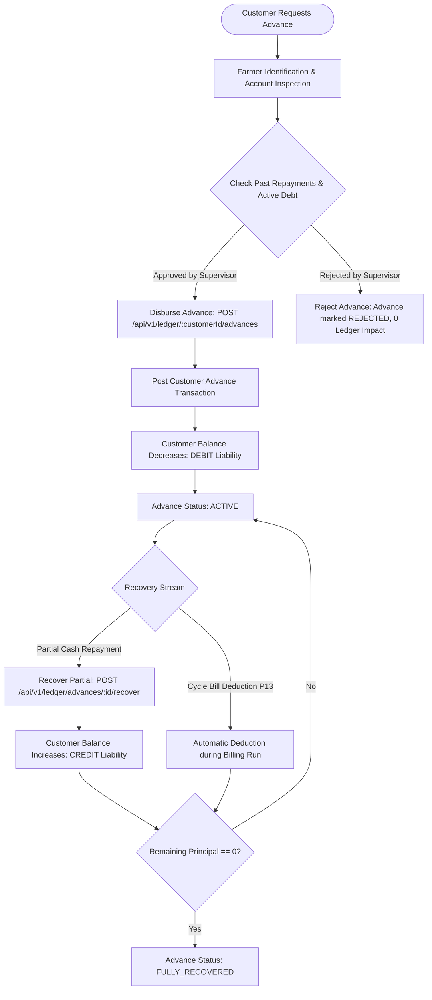

# Customer Advance Management Workflow
**Phase 12 of 20: Cash Advance Disbursement, Partial & Full Recovery Operations**

---

## 1. Overview & Business Context

In rural dairy procurement, smallholder farmers frequently require emergency credit or working capital for animal husbandry expenses (e.g., cattle purchase, veterinary treatments, feeds, seasonal needs).

The DFarm Advance Management subsystem provides a controlled lifecycle for requesting, approving, disbursing, tracking, and recovering loans. Advances directly reduce the dairy's liability to the producer (or create a net customer receivable) through double-entry journal postings.

---

## 2. End-to-End Advance Lifecycle

---

## 3. Step-by-Step Operations

### 3.1 Advance Application & Disbursement
1. **Selection:** Operator or Supervisor identifies the customer using Face Biometrics, RFID, or Farmer Code.
2. **Eligibility Inspection:** System presents existing active advance obligations, pending deductions, and current milk earnings.
3. **Disbursement Entry:**
   - Principal Amount (e.g., ₹2,000.00).
   - Mandatory Reason (e.g., "Urgent veterinary treatment for high-yielding cow").
   - Recovery Type: `MONTHLY_BILL_DEDUCTION` or `MANUAL_CASH_RECEIPT`.
   - Client Idempotency Key.
4. **Financial Journal Posting:**
   - Stored procedure `post_customer_advance` locks customer ledger account.
   - Decreases customer liability balance by ₹2,000.00 (`DEBIT`).
   - Inserts `CUSTOMER_ADVANCE_DEBIT` in `ledger_transactions`.
   - Records double-entry entries:
     - Debit: `CUSTOMER_PAYABLE` (₹2,000.00)
     - Credit: `CASH_BANK` (₹2,000.00)
5. **Receipt Generation:** Terminal prints a formal receipt containing the advance UUID, farmer code, approved amount, and new liability balance.

---

### 3.2 Repayment & Recovery Handling

#### Partial Recovery
- Farmers may make voluntary cash repayments at the collection counter at any time.
- The collection operator calls `POST /api/v1/ledger/advances/:advanceId/recover`.
- **Validation:** Recovery amount must be strictly positive and $\le \text{Remaining Principal}$.
- **Over-Recovery Prevention:** Attempting to recover an amount greater than the outstanding balance is strictly rejected with `400 OVER_RECOVERY_PROHIBITED`.
- **Ledger Impact:**
  - Remaining principal decreases.
  - Farmer's running liability balance increases back by the recovered sum (`CREDIT`).
  - Journal entry: Debit `CASH_BANK`, Credit `CUSTOMER_PAYABLE`.

#### Full Settlement
- When cumulative recovered amount equals the initial approved principal, the advance status transitions automatically to `FULLY_RECOVERED`.
- No further recovery requests can be posted against a settled advance.
