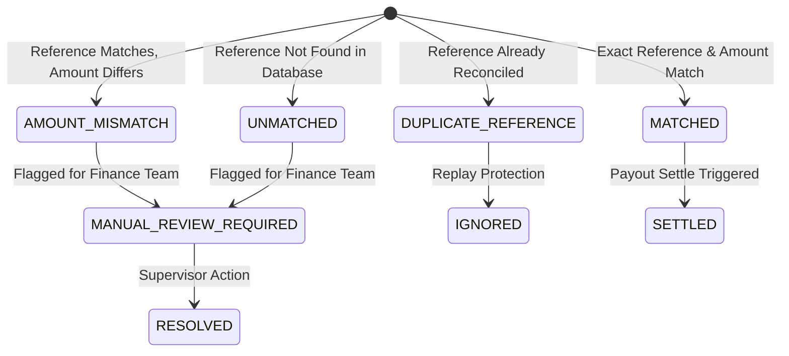

# Bank Statement & Webhook Reconciliation

## 1. Overview

Reconciliation bridges external financial evidence (commercial bank statement CSV files or signed banking webhooks) with internal DFarm payout and receipt records.

The system strictly enforces that no payment is marked `SETTLED` without verified financial evidence. Client-supplied `"status": "SUCCESS"` from mobile terminals or untrusted clients is explicitly rejected as authoritative confirmation.

---

## 2. Reconciliation States

Every transaction record processed through statement import or webhook is assigned one of the following deterministic statuses:

| Status | Description | Action Required |
| :--- | :--- | :--- |
| `MATCHED` | External reference matches an active submitted payout and amounts are identical. | Auto-settles payout and posts double-entry ledger debit. |
| `AMOUNT_MISMATCH` | External reference matches a payout, but bank amount differs from recorded amount. | Held in `RECONCILIATION_REQUIRED`; flagged for manual discrepancy resolution. |
| `DUPLICATE_REFERENCE` | Bank transaction reference has already been reconciled in a previous batch/statement. | Flagged as duplicate to prevent double-settlement. |
| `UNMATCHED` | Transaction reference does not match any known DFarm payout or receipt. | Requires accountant inspection to map to a customer or mark dismissed. |
| `MANUAL_REVIEW_REQUIRED` | Holds disputed transactions awaiting resolution by an authorized finance officer. | Handled via `/api/v1/reconciliation/:id/resolve`. |

---

## 3. Bank Statement CSV Import Flow

1. Accountant uploads bank statement via `POST /api/v1/reconciliation/import`.
2. Engine processes each statement row:
   - Validates date format, amount, reference number, and direction (`DEBIT`/`CREDIT`).
   - Checks against `payment_reconciliation_records` for prior matching.
   - Searches `customer_payouts` where `payment_reference = row.referenceNumber` or `id = row.referenceNumber`.
   - Computes amount discrepancy ($|\text{bankAmount} - \text{payoutAmount}|$).
3. Atomically commits reconciliation records and auto-settles all clean `MATCHED` payouts.
4. Generates an import summary report detailing:
   - Total rows processed
   - Matched count
   - Unmatched count
   - Mismatch count
   - Duplicate count

---

## 4. Banking Webhook Integration

For banks supporting webhooks (e.g. ICICI Corporate Internet Banking, SBI, RazorpayX):

- **HMAC-SHA256 Signature Verification:** Webhook payloads must include an `X-Signature` or `X-Bank-Signature` header computed using the shared secret.
- **Timestamp Tolerance & Replay Protection:** Request timestamps must fall within a 300-second window ($\pm 5\text{ minutes}$). Stale timestamps trigger HTTP 401 `INVALID_SIGNATURE`.
- **Event Idempotency:** The provider's event ID (`event_id` or `transfer_id`) is stored in `payment_reconciliation_records`. Replayed webhooks return HTTP 200 without duplicate processing.
