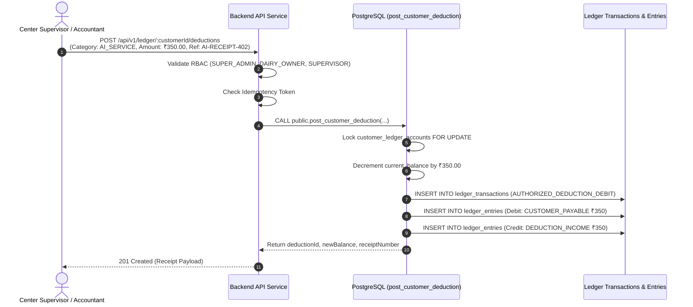

# Authorized Customer Deductions Workflow
**Phase 12 of 20: Non-Milk Operational Charges & Fee Recoveries**

---

## 1. Overview & Authorized Categories

Dairy cooperatives provide auxiliary agricultural services and supplies to affiliated producers. These recurring and one-off costs are recovered directly from the producer's milk account.

The DFarm Deductions module supports authorized deductions strictly defined by dairy governance policy:

| Deduction Category Code | Category Name | Description | Default Offsetting Account |
| :--- | :--- | :--- | :--- |
| `VETERINARY_MEDICINE` | Veterinary Services | Emergency animal treatment, vaccinations, deworming kits. | `DEDUCTION_INCOME` |
| `AI_SERVICE` | Artificial Insemination | Artificial insemination technician visits and semen straw charges. | `DEDUCTION_INCOME` |
| `CATTLE_INSURANCE` | Cattle Insurance Premium | Subsidized livestock insurance policy premia collected for underwriters. | `DEDUCTION_INCOME` |
| `SHARE_CAPITAL` | Cooperative Share Capital | Compulsory or voluntary capital accumulation subscriptions. | `DEDUCTION_INCOME` |
| `EQUIPMENT_REPAIR` | Dairy Equipment Repair | Maintenance of on-farm milking cans, milking machines, cooling buckets. | `DEDUCTION_INCOME` |
| `FODDER_SEEDS` | Fodder & Crop Seeds | Hybrid silage seeds and fodder grass cuttings distributed by cooperative. | `DEDUCTION_INCOME` |
| `OTHER_AUTHORIZED` | Other Approved Deductions | Formally minuted board-approved levies with documented paper audit trails. | `DEDUCTION_INCOME` |

---

## 2. Authorization & Posting Workflow

---

## 3. Strict Scope & Safeguards

1. **Mandatory Documentation:** Every deduction entry must include a non-empty human-readable `description` and a `supportingReference` (e.g., service voucher, slip number, clinic receipt) whenever applicable.
2. **Actor Authorization:** Collection operators and farmers are forbidden from posting deductions; attempting to do so returns `403 FORBIDDEN`.
3. **Immutability:** Once committed, a deduction cannot be altered or deleted. If billed in error, an audited supervisor adjustment with the exact reversal amount and justification must be executed.
