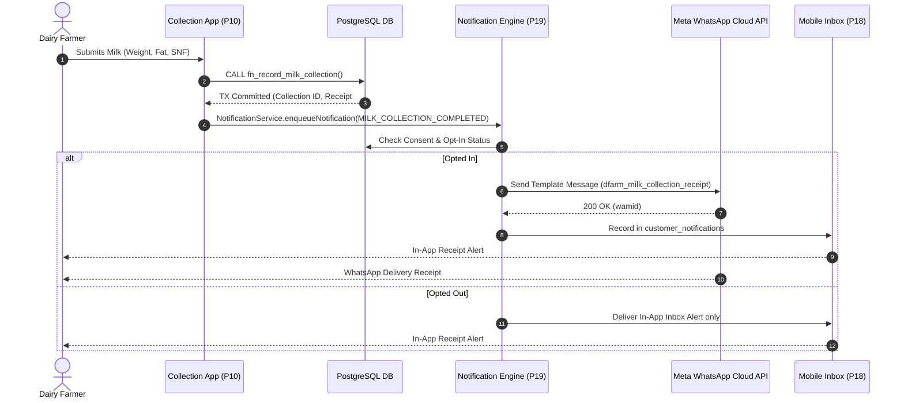

# DFarm Customer Notifications & Event-Driven Workflows

## 1. Overview

This document details the business event triggers, localization rules, and message workflows for dairy customer notifications across milk collections, billing, payouts, and account registration.

---

## 2. Supported Notification Event Types

| Event Type | Business Trigger | Supported Channels | Primary Data Fields |
| :--- | :--- | :--- | :--- |
| `MILK_COLLECTION_COMPLETED` | Milk Intake Committed at Weighing Station | WhatsApp, Push, In-App | Shift (Morning/Evening), Milk Type (Cow/Buffalo), Quantity (L), Fat %, SNF %, Rate/L, Total Amount (₹), Receipt # |
| `MONTHLY_BILL_GENERATED` | Billing Cycle Finalized by Accountant | WhatsApp, Push, In-App | Bill Number, Period Name, Gross Amount, Deductions, Net Payable, PDF Link |
| `PAYMENT_SETTLED` | Bank Disbursal or Cash Payout Completed | WhatsApp, Push, In-App | Payout ID, Amount (₹), Payment Method, Ref #, Masked Bank Account (`XXXX-XXXX-1234`), Settled Date |
| `PAYMENT_FAILED` | Payout Disbursal Rejected by Bank Carrier | WhatsApp, Push, In-App | Payout ID, Amount (₹), Ref #, Failure Reason, Support Contact |
| `FEED_PURCHASE_COMPLETED` | Cattle Feed Sale Billed at Center Store | WhatsApp, Push, In-App | Invoice #, Product Name, Quantity, Total Amount (₹) |
| `CUSTOMER_BALANCE_UPDATED` | Manual Debit/Credit Adjustment or Advance | Push, In-App | Transaction Type, Amount, Previous Balance, New Balance |
| `CUSTOMER_REGISTRATION_COMPLETED` | Farmer Enrolled in DFarm | WhatsApp, Push, In-App | Farmer Code, Customer Name, Center Name |
| `FACE_ENROLLMENT_PENDING` | Farmer Registered without Face Biometrics | Push, In-App | Farmer Code, Required Action, Dairy Center |
| `RFID_ASSIGNMENT_PENDING` | Farmer Registered without Smart RFID Card | Push, In-App | Farmer Code, Required Action, Dairy Center |

---

## 3. Localization & Language Rendering

DFarm notifications strictly support bi-lingual rendering:
1. **Marathi (`mr`)**: Primary regional language for rural dairy farmers in Maharashtra.
2. **English (`en`)**: Official administrative and financial language fallback.

The recipient's preferred language is resolved dynamically:
1. Explicit override in `forceLanguage` parameter.
2. Saved preference in `whatsapp_customer_mappings.preferred_language`.
3. Default fallback: `mr`.

### Exact Financial Formatting
All currency and decimal metrics are authoritative persisted database values:
- Currency: Formatted to exactly 2 decimal places with ₹ symbol (e.g. `₹450.00`).
- Milk Liters: Formatted to 2 decimal places (e.g. `12.50 L`).
- Quality metrics: Formatted to 1-2 decimal places (e.g. `Fat: 4.2%, SNF: 8.5%`).

---

## 4. Workflows

### 4.1 Milk Collection Receipt Workflow

### 4.2 Monthly Bill Settlement Workflow
1. Dairy accountant generates and locks the monthly billing period (`POST /api/v1/billing/periods/:id/generate`).
2. For each farmer with finalized bills, `MONTHLY_BILL_GENERATED` is dispatched asynchronously.
3. Message provides full breakdown: gross milk income, feed purchases, advances deducted, and net payable.
4. Direct authorized statement download link is included.

### 4.3 Payout Settled / Failed Workflow
1. When a disbursement batch is confirmed (`POST /api/v1/payments/payouts/:id/confirm`), `PAYMENT_SETTLED` is sent with masked bank account details.
2. If bank disbursement fails (`POST /api/v1/payments/payouts/:id/fail`), **no misleading success message is ever sent**. Instead, `PAYMENT_FAILED` alert is dispatched specifying the failure reason and center contact instructions.
