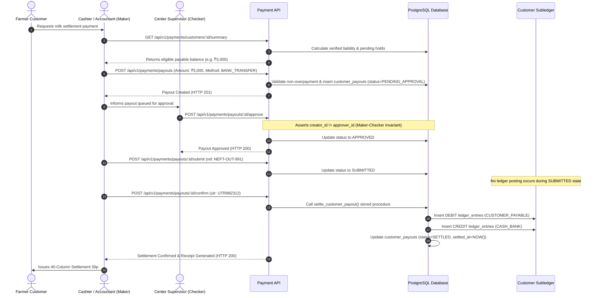

# Individual Farmer Payout Workflow

## 1. Overview & Objective

The Individual Farmer Payout workflow handles single farmer settlements (e.g. ad-hoc payments, milk bill settlements, or monthly balance disbursements). It prevents unauthorized overpayments, enforces Maker-Checker separation of duties, and ensures that financial ledger postings only occur upon verified settlement confirmation.

---

## 2. End-to-End Payout Lifecycle

---

## 3. Business Rules & Guardrails

### 3.1 Overpayment Prevention
A payout cannot exceed the farmer's current eligible payable balance unless `allowOverpaymentAdvance: true` is explicitly passed and authorized:
$$\text{Eligible Payable} = \text{Current Ledger Liability} - \sum \text{Pending Active Payouts}$$
If requested amount exceeds eligible payable balance, the API rejects the request with HTTP 400: `OVERPAYMENT_NOT_PERMITTED`.

### 3.2 Maker-Checker Separation of Duties
- Payouts can be drafted by `ACCOUNTS_EMPLOYEE` or `COLLECTION_OPERATOR`.
- Approval requires `DAIRY_ADMIN`, `DAIRY_OWNER`, or authorized `SUPERVISOR`.
- **Self-Approval Prohibition:** A user cannot approve a payout they initiated. Attempting self-approval returns HTTP 403: `SELF_APPROVAL_NOT_PERMITTED`.

### 3.3 Partial Payouts
Farmers may request partial disbursements (e.g. ₹4,000 out of a ₹10,000 balance). The system settles the ₹4,000 debit and maintains the remaining ₹6,000 balance as an active liability for subsequent payouts.

### 3.4 Payout Reversals
If an erroneous payout is settled, it must be reversed using:
`POST /api/v1/payments/payouts/:id/reverse`
- Requires a mandatory audit reason.
- Re-credits the customer liability account via a compensatory journal transaction.
- Marks payout status as `REVERSED`.
- Never deletes or overwrites existing ledger records.
