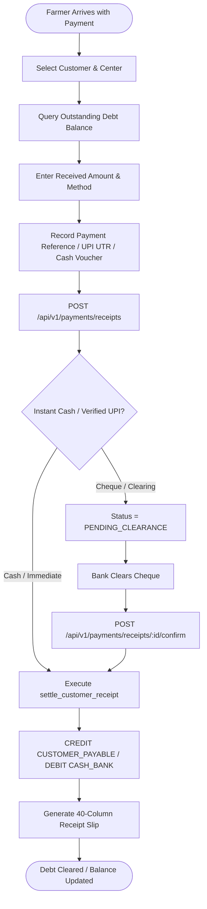

# Customer Repayment & Debt Collection Workflow

## 1. Overview & Objective

When a farmer owes money to the dairy—due to cattle feed credit purchases, veterinary supplies, or advance loan recoveries—the dairy collects the funds through the Customer Repayment & Receipt workflow (`CUSTOMER_PAYS_DAIRY`).

This workflow ensures:
1. Strict debt clearance attribution (a farmer can only pay down their own account).
2. Transparent receipt voucher generation.
3. Accurate subledger credit posting.
4. Support for CASH, UPI, BANK_TRANSFER, and CHEQUE.

---

## 2. Customer Repayment Flow

---

## 3. Financial Postings

When a repayment of ₹1,500.00 is settled:

1. **Subledger Accounting:**
   - **DEBIT:** `1000-CASH_BANK` (₹1,500.00) — Represents asset cash/bank inflow into dairy treasury.
   - **CREDIT:** `2000-CUSTOMER_PAYABLE` (₹1,500.00) — Under the sign convention, credits increase the farmer's balance toward zero (clearing the negative debt).

2. **Customer Ledger Account:**
   - `current_balance` is adjusted upwards by ₹1,500.00.

---

## 4. Key Security & Verification Policies

- **Customer Attribution:** Repayments must link directly to the target farmer's customer UUID. Cross-customer balance clearing is strictly prohibited.
- **Idempotency:** Every receipt submission requires an `idempotencyKey`. Duplicate requests return HTTP 200 with `isIdempotentReplay: true` without double-crediting the customer account.
- **Cheque & Bank Transfers:** Payments made via cheque or unverified bank transfer are marked `PENDING` until cleared by bank statement reconciliation.
