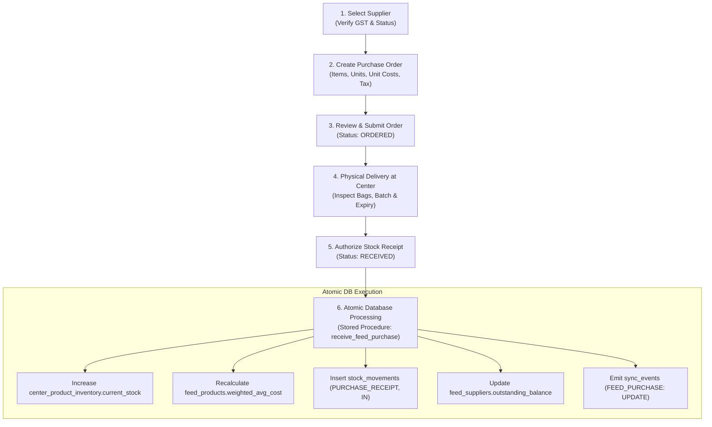

# Feed Procurement & Stock Receiving Workflow

## 1. Procurement Lifecycle Overview

The cattle feed procurement workflow governs the commercial purchasing of cattle feed bags, mineral mixtures, and nutritional supplements from authorized manufacturers or suppliers, and the physical receiving of stock into dairy center warehouses.

---

## 2. Detailed Workflow Steps

### Step 1: Select Supplier
- Operator or Inventory Manager navigates to **Purchase Receiving** or **Suppliers**.
- The system checks that the supplier is in `ACTIVE` status.
- Sensitive supplier information (such as bank details or GST verification) is scoped to the tenant organization.

### Step 2: Create Purchase Order
- The buyer selects the target **Receiving Center** (e.g. `Center A`).
- Line items are added with:
  - `productId`: Selected from the active product catalog.
  - `quantity`: Number of units (e.g. 100).
  - `unit`: Pack unit (`BAG`) or base unit (`KG`).
  - `unitCost`: Price per unit agreed upon with the supplier (e.g. ₹1,200.00 / bag).
  - `taxRatePercent`: Applicable GST rate (e.g. 5.00%).
  - Optional `batchNumber` and `expiryDate`.
- System automatically calculates item subtotal, tax amount, and invoice grand total.
- Submits `POST /api/v1/feed/purchases` with an idempotent request key.
- Initial purchase status: `ORDERED`.

> [!IMPORTANT]
> **Stock Does Not Increase on Order Creation**: Simply recording an order or invoice draft does not alter warehouse stock. Stock only increases upon explicit physical receipt verification.

### Step 3: Physical Inspection & Stock Receiving
- When the truck arrives at the center, the Center Manager or Inventory Manager counts physical bags, checks seal integrity, and verifies the supplier's delivery challan or tax invoice.
- If goods match, the manager executes **Stock Receipt**:
  - Submits `POST /api/v1/feed/purchases/:purchaseId/receive` with:
    - `receivedBy`: Authenticated supervisor user UUID.
    - `idempotencyKey`: Unique receipt transaction key (`IDEM-RCV-...`).
    - `notes`: Inspection remarks (e.g. "100 bags verified, batch #B2026-11").

### Step 4: Atomic Inventory & Costing Update
Inside PostgreSQL procedure `receive_feed_purchase`:
1. **Duplicate Receipt Prevention**:
   - The procedure verifies the purchase record has status `ORDERED`.
   - If the purchase is already in `RECEIVED` status, the call is rejected with a `CONFLICT (409)` exception or returns existing data if replayed with the same idempotency key.
2. **Weighted Average Cost (WAC) Update**:
   - For each product received, its new weighted average cost is updated:
     $$WAC_{new} = \frac{(S_{existing} \times WAC_{old}) + (Q_{in} \times C_{unit})}{S_{existing} + Q_{in}}$$
3. **Stock Increase**:
   - `center_product_inventory.current_stock` is incremented by the base unit equivalent (e.g. 100 bags × 50 kg/bag = 5,000 kg).
4. **Append-Only Movement**:
   - A `PURCHASE_RECEIPT` record with `direction = 'IN'` is written to `stock_movements`.
5. **Supplier Liability**:
   - `feed_suppliers.outstanding_balance` is incremented by the purchase grand total.

---

## 3. Duplicate Prevention & Security Controls

- **Idempotency Guarantee**: Every purchase creation and receiving call requires an `idempotencyKey`. Network retries with the same key safely return the previously generated transaction without duplicating stock.
- **Authorization Guard**: Center operators (`MILK_RECORDER`, `FIELD_AGENT`) cannot authorize stock receipts. Stock receiving requires `SUPER_ADMIN`, `DAIRY_OWNER`, `DAIRY_ADMIN`, `CENTER_MANAGER`, or `INVENTORY_MANAGER` permissions.
- **Multi-Tenant Protection**: Dairies cannot view or receive purchases belonging to another organization.

