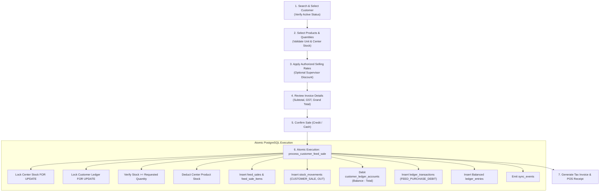
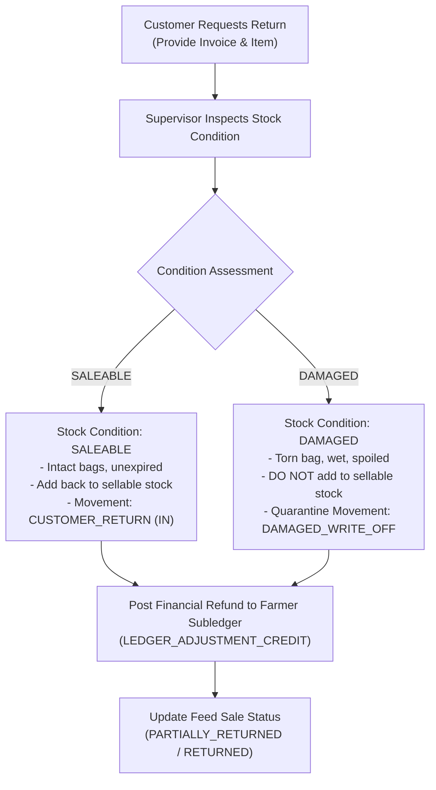

# Customer Feed Sales & Returns Workflow

## 1. Sales Workflow Overview

The Cattle Feed Sales workflow allows dairy center operators and staff to sell cattle feed bags and supplements directly to registered dairy farmers (members/producers). The primary commercial mode is **Credit Sale**, where feed purchases are debited to the farmer's running account balance and automatically deducted from periodic milk collection settlements (P13). Cash sales are also fully supported.

---

## 2. Detailed POS Sales Flow

### Step 1: Customer Lookup & Verification
- The center operator searches for the customer by **Farmer Code**, **Name**, or **Mobile Number**.
- The POS displays:
  - Farmer Name, Code, and Phone.
  - Current Subledger Balance (e.g. ₹4,250.00 payable to farmer).
  - Membership Status: Must be `ACTIVE`. Sales to suspended or inactive farmers are blocked.

### Step 2: Product Selection & Stock Check
- Operator selects feed products (e.g. "Super Milk Cattle Feed 50kg").
- The operator chooses the selling unit:
  - `BAG` (e.g. 2 bags).
  - `KG` (e.g. 100 kg).
- **Instant Client & Backend Stock Validation**: The system checks `center_product_inventory.current_stock`. If requested quantity exceeds available stock, the sale cannot proceed.

### Step 3: Price Calculation & Discount Controls
- Selling prices are snapshotted from `feed_products.selling_price`.
- Applicable tax (GST) is calculated automatically based on product tax configuration.
- **Strict Discount Policy**: Discounts cannot be entered freely by operators without supervisor authorization (`discountApprovedBy`). Unapproved discounts are rejected with `400 Bad Request`.

### Step 4: Atomic Execution & Financial Posting
Upon clicking **"Confirm Sale"**, `POST /api/v1/feed/sales` calls PostgreSQL stored procedure `process_customer_feed_sale`:
1. **Stock Deduction**:
   - `center_product_inventory.current_stock` is decreased by the base quantity.
2. **Stock Movement Ledger**:
   - Outward movement record (`CUSTOMER_SALE`) is appended to `stock_movements`.
3. **Subledger Debit (P12)**:
   - For credit sales, `customer_ledger_accounts.current_balance` is reduced by the sale total.
   - An entry is inserted into `ledger_transactions` with `transaction_type = 'FEED_PURCHASE_DEBIT'`, `direction = 'DEBIT'`.
4. **Balanced Journal**:
   - Double-entry records are created in `ledger_entries`:
     - **DEBIT**: `CUSTOMER_PAYABLE` (Farmer account).
     - **CREDIT**: `FEED_INVENTORY` (Center store).
5. **Invoice & Receipt**:
   - Generates sequential invoice number `INV-FEED-YYYYMMDD-XXXXXXXX` and receipt number `RCP-FEED-YYYYMMDD-XXXXXXXX`.

---

## 3. Customer Returns & Stock Condition Workflow

When a farmer returns feed (e.g. over-ordered, or defective packaging discovered), the return must be authorized by a Center Manager or Inventory Manager.

### Key Return Policies:
- **Condition Segregation**:
  - `SALEABLE`: Stock is added back to center sellable inventory.
  - `DAMAGED`: Stock is quarantined. It is recorded as a write-off and **never** returned to sellable stock, preventing damaged feed from being re-sold to another farmer.
- **Quantity Cap**: Total returned quantity cannot exceed the remaining original purchased quantity.
- **Proportionate Financial Credit**: The refund credit amount is calculated proportionately including applicable taxes and discounts.
- **Ledger Posting**: The farmer's subledger is credited with `LEDGER_ADJUSTMENT_CREDIT`, increasing their payable balance.
- **Role Enforcement**: Center operators cannot authorize returns; only `DAIRY_OWNER`, `CENTER_MANAGER`, or `INVENTORY_MANAGER` can approve returns.

