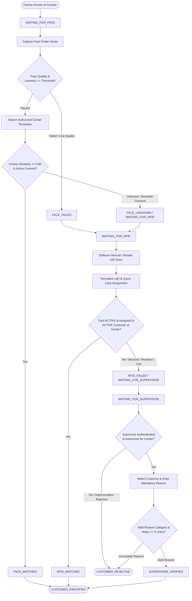

# DFarm: Customer Identification Architecture & State Machine Flow

This document details the software architecture, state machine specification, execution flow, biometric validation pipeline, and failover hierarchy for the three approved customer identification methods in DFarm Phase 08.

---

## 1. Identification Priority & Canonical Identity

The counter identification pipeline enforces an immutable priority order:
$$\text{Method 1: Face Recognition} \longrightarrow \text{Method 2: RFID Card Tap} \longrightarrow \text{Method 3: Supervisor Manual Override}$$

All three identification methods resolve to **one canonical Customer UUID (`customer_uuid`)**. If all three methods fail or are rejected, the session terminates with `CUSTOMER_REJECTED` / `UNKNOWN CUSTOMER`.

No employee attendance functionality is permitted; the pipeline identifies customers for milk collection only.

---

## 2. Identification State Machine Specification

The state machine prevents race conditions, enforces clean audit trails, and guarantees that conflicting identities cannot be assigned to an active intake session.

### 2.1 The 11 Canonical States

| State | Description | Category |
|---|---|---|
| `WAITING_FOR_FACE` | Counter session initiated; terminal camera is ready for live face probe | Initial State |
| `FACE_MATCHED` | Probe vector matched an enrolled active template with score $\ge 0.80$ | Intermediate Match |
| `FACE_UNKNOWN` | No candidate matched or similarity score fell below confidence threshold | Intermediate Fallback |
| `FACE_FAILED` | Face quality insufficient, liveness check failed, or consent revoked | Intermediate Fallback |
| `WAITING_FOR_RFID` | Face recognition was inconclusive or skipped; awaiting card presentation | Fallback State |
| `RFID_MATCHED` | Card UID matches an active assignment for an eligible, active customer | Intermediate Match |
| `RFID_FAILED` | Card is unknown, blocked, revoked, lost, unassigned, or belongs to another center | Intermediate Fallback |
| `WAITING_FOR_SUPERVISOR`| Both automated methods failed; waiting for authorized supervisor login | Fallback State |
| `SUPERVISOR_VERIFIED` | Authorized supervisor selected customer and provided mandatory justification | Intermediate Match |
| `CUSTOMER_IDENTIFIED` | Canonical `customer_uuid` successfully resolved and verified `ACTIVE` | Terminal Success |
| `CUSTOMER_REJECTED` | Transaction aborted (soft-deleted customer, unauthorized, or missing reason) | Terminal Rejection |

---

### 2.2 Allowed Transition Matrix

| From State | Allowed Next States | Trigger Conditions |
|---|---|---|
| `WAITING_FOR_FACE` | `FACE_MATCHED`, `FACE_UNKNOWN`, `FACE_FAILED`, `WAITING_FOR_RFID`, `WAITING_FOR_SUPERVISOR`, `CUSTOMER_REJECTED` | Face probe evaluated, skipped to card, or direct override |
| `FACE_MATCHED` | `CUSTOMER_IDENTIFIED`, `CUSTOMER_REJECTED` | Verification of active customer account status |
| `FACE_UNKNOWN` | `WAITING_FOR_RFID`, `WAITING_FOR_SUPERVISOR`, `CUSTOMER_REJECTED` | Automatic transition to Method 2 |
| `FACE_FAILED` | `WAITING_FOR_RFID`, `WAITING_FOR_SUPERVISOR`, `CUSTOMER_REJECTED` | Automatic transition to Method 2 |
| `WAITING_FOR_RFID` | `RFID_MATCHED`, `RFID_FAILED`, `WAITING_FOR_SUPERVISOR`, `CUSTOMER_REJECTED` | Card UID evaluated or skipped to supervisor |
| `RFID_MATCHED` | `CUSTOMER_IDENTIFIED`, `CUSTOMER_REJECTED` | Verification of active customer account status |
| `RFID_FAILED` | `WAITING_FOR_SUPERVISOR`, `CUSTOMER_REJECTED` | Automatic transition to Method 3 |
| `WAITING_FOR_SUPERVISOR` | `SUPERVISOR_VERIFIED`, `CUSTOMER_REJECTED` | Supervisor approval or rejection |
| `SUPERVISOR_VERIFIED` | `CUSTOMER_IDENTIFIED`, `CUSTOMER_REJECTED` | Verification of active customer account status |
| `CUSTOMER_IDENTIFIED` | *(None - Terminal)* | Session successfully bound to canonical Customer UUID |
| `CUSTOMER_REJECTED` | `WAITING_FOR_FACE`, `WAITING_FOR_RFID`, `WAITING_FOR_SUPERVISOR` | Counter reset for retry with new probe/card |

---

## 3. Method 1: Face Recognition Pipeline

### 3.1 P07 Engine Integration & Inspection Contract
- Before invoking face matching, the backend queries `P07FaceEngineAdapter.inspectEngine()`.
- If Phase 07 has not produced a working engine runtime, the system reports `P07_FACE_ENGINE_UNAVAILABLE` rather than fabricating simulated matches.
- All face matching requires:
  1. Active customer profile (`customers.status = 'ACTIVE'` and `is_deleted = FALSE`).
  2. Active biometric consent (`face_enrollments.status = 'ACTIVE'`).
  3. Valid model version ID (foreign key reference to `face_model_versions`).
  4. Cosine similarity score $\ge 0.80$ (calibrated operational threshold).

### 3.2 Ephemeral Privacy Protocol
- Camera video frames are evaluated strictly in volatile RAM.
- Raw facial images are **never stored on disk or logged to audit tables**.
- Audit logs retain only model version UUID, match score, quality score, and timestamp.

---

## 4. Method 2: Software RFID Card Verification

### 4.1 Software Entry & Boundary
- In Phase 08, physical RFID reader drivers are deferred.
- Input is received via software entry in uppercase hexadecimal format (`normalizeRfidUid`).
- The software reader adapter is cleanly decoupled via `RfidReaderAdapter` interface.

### 4.2 Multi-Tenant Scoping
- Card lookup joins `rfid_cards` and `rfid_card_assignments` scoped strictly by `organization_id` and `center_id`.
- Cross-tenant card usage returns `403 Forbidden` / `UNKNOWN_CARD`.
- Inactive, soft-deleted, or unassigned card states immediately transition the session to `WAITING_FOR_SUPERVISOR`.

---

## 5. Method 3: Supervisor Manual Override

### 5.1 Anti-Impersonation & Scoping
- Only users with role `SUPERVISOR`, `CENTER_MANAGER`, `DAIRY_OWNER`, or `SUPER_ADMIN` can execute overrides. Standard terminal operators cannot approve overrides.
- Supervisors must be explicitly assigned to the operating collection center (`user_centers.is_active = TRUE`).
- Supervisors **cannot** bypass soft-deleted or suspended accounts without administrative restoration.

### 5.2 Mandatory Audit Requirement
- Every manual override requires:
  - `reasonCategory`: Standardized classification enum.
  - `justificationNotes`: Free-text justification of at least 5 characters.
  - `supervisorId`: Recorded in dual audit tables (`identification_audit_logs`, `supervisor_verification_records`).
