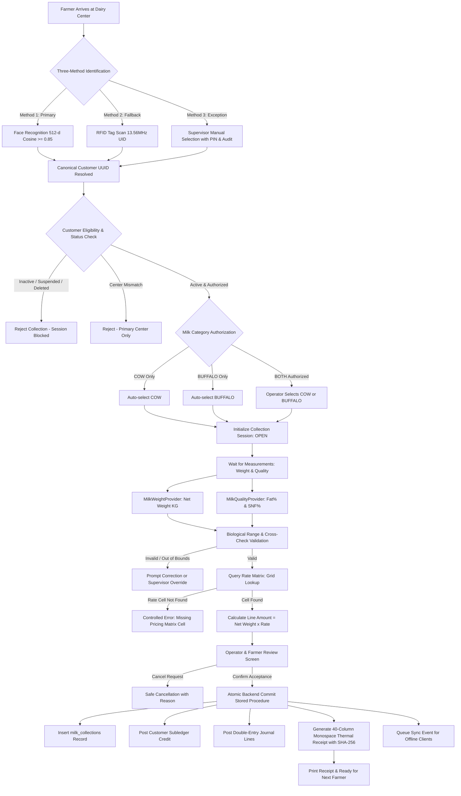

# DFarm Milk Collection & Accounting Workflow Specification

## 1. Overview
The Milk Collection and Automated Accounting Workflow is the core operational engine of DFarm. It orchestrates fast, fraud-resistant dairy milk intake from registered dairy farmers across decentralized village collection centers, calculates pricing strictly using approved rate charts, and performs atomic double-entry subledger posting in PostgreSQL.

---

## 2. High-Level Architecture Flow



---

## 3. Customer Identification Cascade
Identification follows a strict 3-method cascade:
1. **Face Recognition (Primary):** Real-time MobileFaceNet 512-dimensional vector comparison with Cosine similarity $\ge 0.85$. If match is uncertain ($< 0.85$), the system fails closed and offers RFID fallback.
2. **RFID Tag Verification (Secondary):** 13.56 MHz UID lookup mapped to active customer card assignment.
3. **Supervisor Manual Verification (Exception):** Operator or supervisor searches by farmer code or name; requires authenticated supervisor PIN and persists audit trail with justification.

All three methods resolve to a single **Canonical Customer UUID**.

---

## 4. Milk Category Governance
- **Cow Only:** Application automatically defaults to `COW` milk; manual toggle disabled.
- **Buffalo Only:** Application automatically defaults to `BUFFALO` milk; manual toggle disabled.
- **Both:** Operator must explicitly select category prior to session initialization.
- **Session Category Lock:** Once session is created, the category cannot be mutated. If the wrong category was chosen, the session must be safely CANCELLED with an audit log reason, and a fresh session opened.

---

## 5. Explicit 16-State Session State Machine
```
WAITING_FOR_CUSTOMER -> CUSTOMER_IDENTIFIED -> CUSTOMER_VERIFIED -> CATEGORY_PENDING -> 
CATEGORY_SELECTED -> SESSION_CREATED -> WAITING_FOR_MEASUREMENTS -> MEASUREMENTS_RECEIVED -> 
VALIDATING -> READY_FOR_REVIEW -> COMMITTING -> COMPLETED (or CANCELLED / FAILED / INCOMPLETE)
```
- **Concurrency Protection:** A customer can have only one active (non-terminal) session at any given time.
- **Multiple Deliveries:** A customer may deliver multiple batches in the same shift; each delivery generates a distinct `intake_sequence_uuid` and `client_intake_uuid`.
- **Idempotent Replay:** Re-submission of the same delivery payload returns the existing transaction with status `IDEMPOTENT_REPLAY` without duplicate ledger postings.

---

## 6. Software Data Boundary (Deferred Hardware Integration)
All physical serial communication (RS-232, load cell wiring, milk analyzer protocols, UART/Wiegand RFID drivers) is strictly **DEFERRED**.
- **Production Boundary:** Uses clean interfaces `MilkQualityProvider` and `MilkWeightProvider`. Manual inputs are clearly flagged with reading source `MANUAL_ENTRY` and status `DEFERRED_HARDWARE_BOUNDARY`.
- **Test Fixture:** `TestFixtureQualityProvider` and `TestFixtureWeightProvider` are restricted to test environments; production never accepts test fixtures.

---

## 7. Rate Calculation Engine
- Evaluates approved rate charts (`rate_charts`), versions (`rate_chart_versions`), and cells (`rate_chart_cells`).
- Rates are determined strictly by exact discrete match on `(fat_percentage, snf_percentage)` grid coordinates.
- **Zero Invention Rule:** The system NEVER guesses, extrapolates, or silently chooses the nearest cell. If a cell is missing, a controlled `RATE_CELL_NOT_FOUND` error is returned.
- Server-authoritative recalculation occurs inside the PostgreSQL stored procedure before commit.

---

## 8. Atomic Subledger Posting & Financial Invariants
When a collection is committed:
1. `milk_collections` intake record is inserted with `transaction_status = 'COMPLETED'`.
2. `customer_ledger_accounts` has its `current_balance` credited by the exact gross milk amount.
3. `ledger_transactions` record is logged with direction `CREDIT` and transaction type `MILK_COLLECTION_CREDIT`.
4. `ledger_entries` balanced double-entry lines are written:
   - Credit: `CUSTOMER_PAYABLE` (Farmer's account)
   - Debit: `MILK_PURCHASE_EXPENSE` (Dairy expense account)
5. `collection_receipts` record is created storing the 40-column thermal slip and SHA-256 verification hash.
6. The entire flow executes within a single database transaction via stored procedure `public.complete_milk_collection_session(...)`.
