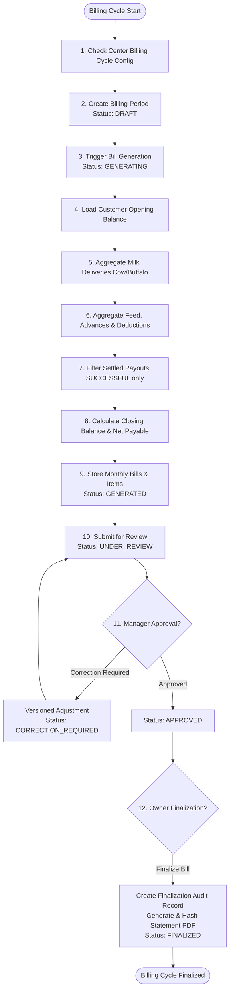

# DFarm Monthly Billing & Customer Settlement Workflow

## 1. Operational Flow Overview

The Monthly Billing workflow automates the cycle from raw milk intakes and store transactions to final financial settlement statements and downloadable PDF records.

---

## 2. Step-by-Step Operator & System Procedures

### Step 1: Billing Period Definition
- **Actor**: Center Manager, Accountant, Dairy Owner, or Automated Billing Scheduler.
- **Action**: Invoke `POST /api/v1/billing/periods`.
- **Validation Rules**:
  - `cycleType`: Initial default is `CALENDAR_MONTH` (e.g. 2026-11-01 to 2026-11-30). `TEN_DAY`, `FIFTEEN_DAY`, and `CUSTOM_PERIOD` are supported by the engine but require explicit owner authorization.
  - `startDate` must be $\le$ `endDate`.
  - Date overlap prevention: Overlapping periods for the same center are rejected with `409 Conflict (OVERLAPPING_BILLING_PERIOD)`.
- **Outcome**: A new row in `billing_periods` with status `DRAFT`.

### Step 2: Bill Generation Run (Batch or Individual)
- **Actor**: Center Manager, Accountant, or Scheduled Runner.
- **Action**: Invoke `POST /api/v1/billing/periods/:periodId/generate`.
  - Can optionally pass `{"customerId": "uuid"}` for single-customer on-demand generation.
- **Processing Phases**:
  1. Period status shifts to `GENERATING`.
  2. Identifies all customers registered at the center who either delivered milk, have ledger activity, or maintain a non-zero balance.
  3. For each customer:
     - **Opening Balance**: Fetched from `customer_ledger_accounts` or `ledger_transactions` immediately before period `start_date`.
     - **Milk Collections**: Queries `milk_collections` where `business_date` is in period range and status is `COMPLETED`. Separates Cow vs. Buffalo kilograms, applies registered rates, and calculates gross milk value.
     - **Feed Debits**: Queries `ledger_transactions` for `FEED_PURCHASE_DEBIT`.
     - **Advance Debits**: Queries `ledger_transactions` for `ADVANCE_DEBIT`.
     - **Customer Deductions**: Queries `customer_deductions` applicable to the period.
     - **Settled Payouts**: Queries `customer_payments` where `payment_status` is in `('SUCCESSFUL', 'RECONCILED')`. Any payment in `PENDING`, `SUBMITTED`, or `FAILED` is strictly excluded.
     - **Closing Balance**: Calculated as `Opening + Total Credits - Total Debits - Settled Payouts`.
     - **Net Payable**: If closing balance $> 0.00$, net payable = closing balance. If closing balance $\le 0.00$, net payable = $0.00$ (negative balance is flagged as `is_negative_balance: true` and carried forward).
     - **Persistence**: Idempotently inserts/updates `monthly_bills` and inserts breakdown rows into `monthly_bill_items`.
  4. Period status shifts to `GENERATED`.

### Step 3: Accountant / Manager Review & Preview
- **Actor**: Accountant / Center Manager.
- **Action**: 
  - Preview customer statement: `GET /api/v1/billing/customers/:customerId/statement?periodId=:periodId`.
  - View period summary: `GET /api/v1/billing/periods/:periodId`.
  - Check progress: `GET /api/v1/billing/periods/:periodId/progress`.
  - When reconciled against intake slips, invoke `POST /api/v1/billing/:billId/submit-review` to advance status to `UNDER_REVIEW`.

### Step 4: Center Manager Approval
- **Actor**: Center Manager, Dairy Owner, or Super Admin.
- **Action**: Invoke `POST /api/v1/billing/:billId/approve`.
- **Validation**: Requires `approveBills` permission. Center managers can only approve bills within their assigned centers.
- **Outcome**: Bill status transitions to `APPROVED`.

### Step 5: Versioned Adjustment (If Discrepancies Arise)
- **Actor**: Accountant, Center Manager, or Dairy Owner.
- **Action**: Invoke `POST /api/v1/billing/:billId/adjust`.
  - Body: `{"adjustmentType": "CREDIT" | "DEBIT", "amount": 100.00, "reason": "Late evening sample fat adjustment"}`.
- **Mechanism**:
  - Inserts an audit record into `monthly_bill_adjustments`.
  - Increments bill `version` (e.g. from 1 to 2).
  - Updates `closing_balance` and `net_payable_amount`.
  - Moves status to `CORRECTION_REQUIRED`.
  - The database immutability trigger permits this update because `NEW.version > OLD.version`.

### Step 6: Dairy Owner Finalization
- **Actor**: Dairy Owner or Super Admin exclusively. Center Managers are explicitly blocked from finalization (`403 Forbidden`).
- **Action**: Invoke `POST /api/v1/billing/:billId/finalize`.
- **Execution**:
  1. Generates the final official statement PDF via `PdfStatementGenerator`.
  2. Computes SHA-256 cryptographic checksum of the PDF.
  3. Records finalizer identity, timestamp, and checksum in `bill_finalization_records`.
  4. Updates bill status to `FINALIZED`.
  5. If all bills in the period are finalized, the parent period status is updated to `FINALIZED`.
- **Immutability Guarantee**: Once `FINALIZED`, the database trigger `enforce_finalized_period_immutability()` blocks any direct SQL updates or deletions on the bill and its line items.

---

## 3. Scheduled Automation Routine

DFarm includes an automated scheduler (`BillingScheduler`) designed to run on the 1st day of each month:

1. **Center Configuration Discovery**: Scans `dairy_centers` for billing settings.
2. **Cycle Check**: Verifies if the center is active and configured for `CALENDAR_MONTH`.
3. **Idempotent Period Setup**: Creates the previous month's period if not already existing. If an unfinalized period already exists, reuses it safely.
4. **Automated Bill Synthesis**: Triggers calculation and line-item creation. Sets period to `GENERATED`.
5. **Human Gatekeeper Rule**: **The scheduler NEVER auto-finalizes settlements.** Final approval and sealing require human verification by the Center Manager and Dairy Owner.
6. **Execution Log**: Records start time, completion time, bills generated count, error traces, and status in `billing_scheduler_execution_logs`.
